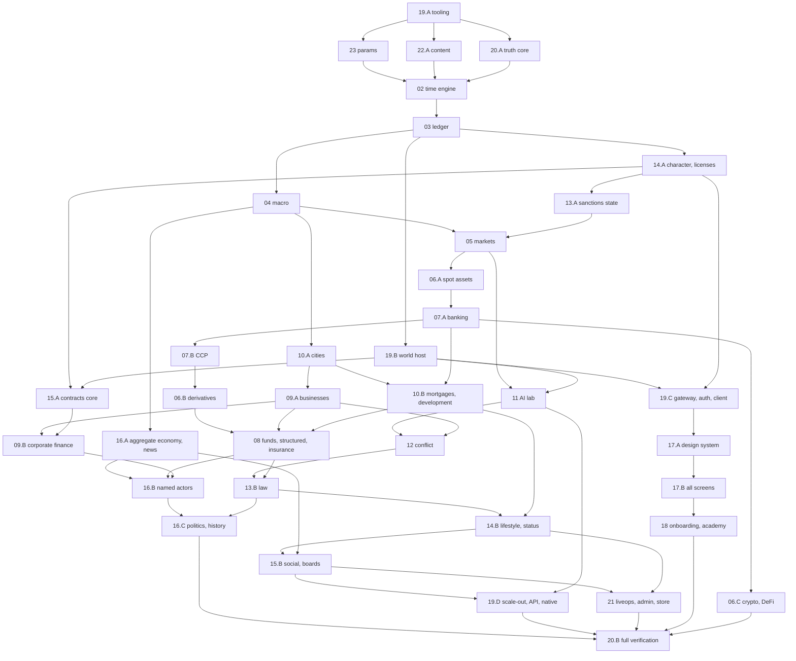

# GLOBAL CONTEXT (included at the top of every task pack)

You are implementing one task of **TYCOON**, a persistent multiplayer financial game. The full design is a 3 MB specification; you only receive the parts your task needs. This global context is binding on every task. If anything in your task pack seems to contradict this file, this file wins for code shape (names, packages, APIs) and the spec excerpts win for game rules and numbers.

## G1. How to work

1. Read the whole pack before writing code: this context, the task card, the spec excerpts, the upstream exports, the parameters, the decisions and the acceptance tests.
2. Create exactly the files the card lists (you may add small private helper files inside the same folder; list them in your report). Never edit files owned by another task except where the card says "edit".
3. Use only the upstream exports the pack shows. If you need something that is not exported, stop and report "MISSING EXPORT: <task> <symbol>" instead of inventing it.
4. Every spec rule in your excerpts must be implemented as written. Never simplify a formula, skip a branch, or leave a TODO that changes behaviour. Where the spec says DEFAULT, use that default.
5. Every acceptance test assigned to the task becomes at least one automated test whose name starts with its id, e.g. `it('05#8 market buy of q ADV moves price by s + Y σ_d √(q/D)', …)`.
6. Finish with: `pnpm -w lint && pnpm -w typecheck && pnpm -w test --filter <your package>` all green. Then write the short report described in G12.

## G2. Repository layout (monorepo root = repository root)

pnpm workspaces + Turborepo. Package scope `@tycoon/*`.

```
apps/web        Next.js 16 App Router client (read node_modules/next/dist/docs/ before writing Next code;
                Next 16: proxy.ts not middleware.ts, async params/cookies, Turbopack default)
apps/gateway    WebSocket gateway (uWebSockets.js)       apps/world      world host: coordinator + partitions
apps/projector  event consumers -> read models           apps/jobs       BullMQ jobs
apps/admin      admin console (Next.js 16)               apps/harness    Truth Machine runners (20)
apps/native     Capacitor shell
packages/engine/core        02 time engine, store, rng, dmath, fixed, ids, canon, testing
packages/engine/ledger      03     packages/engine/macro       04     packages/engine/markets   05
packages/engine/assets      06 (equity, etf, bond, fx, commodity, crypto, defi, derivatives, collectibles)
packages/engine/banking     07     packages/engine/funds       08     packages/engine/business  09
packages/engine/realestate  10     packages/engine/lab         11     packages/engine/conflict  12
packages/engine/law         13     packages/engine/progression 14     packages/engine/social    15
packages/engine/world       16     packages/engine/index.ts    PartitionEngine factory
packages/protocol (zod schemas, canonical encoder)   packages/content (22 catalogs)   packages/params (23)
packages/platform (db, bus, auth, telemetry; NOT deterministic)   packages/ui (17)   packages/i18n (en, fr)
packages/sdk   packages/config (tsconfig, eslint incl. determinism rules, tailwind, vitest presets)
infra/  tests/ (Playwright e2e, protocol contract tests)  docs/
```

Each engine module folder contains: `schema.ts` (entity types + table defs), `rules/*.ts` (pure functions), `intents.ts`, `events.ts`, `phases.ts`, `invariants.ts`, `views.ts`, `params.ts`, `index.ts` (exports the `ModuleDef`), and tests next to the code as `*.test.ts`.

Import rules (CI-enforced): engine modules import only `@tycoon/engine/core`, the engine modules they hard-depend on, `@tycoon/params`, `@tycoon/content`, and types from `@tycoon/protocol`. The engine never imports `platform`, `ui`, Node built-ins, network, filesystem or clocks.

Toolchain: TypeScript strict (`noUncheckedIndexedAccess`, `exactOptionalPropertyTypes`), Node 24 LTS, Vitest (+ fast-check for property tests), zod 4, Playwright, Tailwind 4, Zustand 5, TanStack Query, next-intl, Drizzle + PostgreSQL 18, Valkey 8, NATS JetStream, ClickHouse, BullMQ, Better Auth, OpenTelemetry, three.js (city), TradingView Lightweight Charts 5.

## G3. Units and conventions (00 §3)

| Quantity | Type | Rule |
|---|---|---|
| Money | `Money = bigint` micro-units (1e-6) of a currency, always with a `Ccy` | display `$12.4k`, `$3.21M`, `$1.05B`, `$4.2T` |
| Currency | `Ccy = 'FDL' \| 'EUN' \| 'PYN' \| 'NKR' \| 'SRL'` | FDL is the reserve currency |
| Price | `Price = bigint` micro-units per unit of asset | |
| Quantity | `Qty = bigint` in the asset's base lot | each asset has `lotSize`, `qtyDecimals` |
| Rates | `number` (float64) in model math; persisted as integer `rateE6` (1e-6) when they enter the ledger | |
| Probability | `number` in [0,1] | |
| Time | `Tick = number` (integer since genesis) | |
| Compute | integer PFLOP-days × 1000 | display GPUh (1 PFLOP-day = 10 GPUh) |
| Energy | integer kWh. Data: DQU float, persisted ×1000 integer | |

- All model math in float64; conversion to integers only at the ledger boundary with round-half-to-even through `toMoney(x, ccy)` / `toQty` / `toPrice`. No other code converts floats to money.
- Money crossing the protocol is a decimal string.
- IDs: `<kind>_<26 chars>` generated only by `ctx.newId(kind)` (deterministic). Authored ids like `ast_EQ_HALC` come from content.
- Parameters: `PARAM.snake_case` keys live in `@tycoon/params`; code reads them with `ctx.params.num('key')`, `ctx.params.money('key', ccy)` etc. Never hard-code a number that has a PARAM key. Param defaults in the registry are in display units: money in dollars (convert with `toMoney`), `%` as fractions, "game days" × 720 = ticks, "real days" × 17,280 = ticks.
- Notation: `σ(x)=1/(1+e^-x)`, `clamp`, `ln`, `dt = 1/262080` (one tick in game years).

## G4. Time (00 §5.1)

5 real seconds per tick; 720 ticks per game day (= 1 real hour); 30 ticks per game hour; one tick = 2 game minutes. Week = 7 game days (Mon–Fri trading, Sat–Sun weekend). Quarter = 13 weeks = 91 game days, months 28/28/35 days. Year = 364 game days = 262,080 ticks. Chapter = 8 real weeks = 1,344 game days. Real day = 24 game days.
Trading day tick-of-day `t`: pre-market 0–59; opening auction t=60; continuous 61–539; closing auction t=540; after-hours 541–719. Accruals (interest, rent, wages, fees) post at day close t=719. Business operations run once per game hour, staggered: an entity runs when `tickOfDay mod 30 == fnv1a32(id) mod 30`.

## G5. Tick pipeline (00 §5.2)

```
P0 ingest  P1 validate  P2 calendar  P3 world(16)  P4 npc(05,16)  P5 ai(11)  P6 match(05,06)
P7 clear(07)  P8 finance(07,08)  P9 real(09,10)  P10 conflict(12)  P11 law(13)  P12 social(14,15)
P13 ledger(03: commit postings atomically, settle/release holds, assert invariants)  P14 emit
```
A phase may read any committed state and the outputs of earlier phases of this tick; it writes only its own module's tables and queues postings for P13. Postings never commit before P13. A failed invariant rolls the tick back and replays it in safe mode. Consequences of tick N that other modules react to land in tick N+1 (via `ctx.send(..., 'NEXT')` or events).

## G6. The engine module contract (binding names; owned by tasks of unit 02)

```ts
// @tycoon/engine/core — primitives
export type Tick = number; export type Money = bigint; export type Qty = bigint; export type Price = bigint;
export type Ccy = 'FDL' | 'EUN' | 'PYN' | 'NKR' | 'SRL'; export type Id = string;
export type PhaseId = 'P0'|'P1'|'P2'|'P3'|'P4'|'P5'|'P6'|'P7'|'P8'|'P9'|'P10'|'P11'|'P12'|'P13'|'P14';
export type Visibility = 'PUBLIC' | 'PARTIES' | 'PRIVATE' | 'SEALED';
export type Boundary = 'HOUR' | 'DAY_OPEN' | 'DAY_CLOSE' | 'WEEK_CLOSE' | 'MONTH_CLOSE' | 'QUARTER_CLOSE' | 'YEAR_CLOSE' | 'CHAPTER_CLOSE'
  | 'WEEK_OPEN' | 'MONTH_OPEN' | 'QUARTER_OPEN' | 'YEAR_OPEN' | 'CHAPTER_OPEN' | 'PHASE_CHANGE';   // E-51 (T02-05, PR #20): *_OPEN at tickOfDay 0 of the period's first day; PHASE_CHANGE at tickOfDay ∈ {0, 60, 61, 540, 541}. Hook order: OPEN outermost first (CHAPTER→YEAR→QUARTER→MONTH→WEEK→DAY), then HOUR and PHASE_CHANGE, then CLOSE innermost first (DAY→…→CHAPTER).
export class SortedMap<K extends string, V> { get(k): V|undefined; set(k, v): SortedMap<K,V>; delete(k); has(k); size; entries(): Iterable<[K,V]> /* byte order of key */; keys(); values(); }
export class SortedSet<K extends string> { /* same ordering */ }
export function cmpStr(a: string, b: string): -1|0|1;            // UTF-16 code-unit byte order
export function sortBy<T>(arr: readonly T[], key: (t: T) => (string|number|bigint)[]): T[]; // stable, total
export * as dmath from './dmath';   // exp, ln, log2, log10, pow, sin, cos, atan, atan2, tanh, sigmoid, erf, erfc,
                                    // normCdf, normInv, lgamma, expm1, log1p, kahanSum, clamp, lerp,
                                    // bsPrice, bsGreeks, solveBisection(f,a,b,iters), newton(f,df,x0,iters), cholesky
export function roundHalfEven(x: number): number;
export function toMoney(x: number, ccy: Ccy): Money; export function toQty(x: number, lotScale: bigint, mode?: 'HALF_EVEN'|'LOT_FLOOR'): Qty;
export function toPrice(x: number): Price; export function fromMoney(m: Money): number;
export function divRoundHalfEven(n: bigint, d: bigint): bigint; export function mulRate(m: Money, rateE6: bigint): Money;
export function mulRateE12(m: Money, rateE12: bigint): Money; export function accrue(m: Money, annualRateE6: bigint, days: number): Money;
export function notional(qty: Qty, price: Price, lotScale: bigint): Money; export function fxConvert(m: Money, rateE6: bigint): Money;
export function allocate(total: bigint, weights: readonly { id: string; w: bigint }[]): Map<string, bigint>; // largest remainder, parts sum exactly
export function proRata(total: bigint, holdings: SortedMap<string, bigint>): SortedMap<string, bigint>;
export function assertFinite(x: number, ctx: string): number; export function safeDiv(a: number, b: number, fallback: number): number;
export function sha256(bytes: Uint8Array): Uint8Array; export function fnv1a32(s: string): number;
export function canonEncode(v: unknown): Uint8Array;  // canonical encoder (from @tycoon/protocol, re-exported)
export function ticksToGameDate(t: Tick): GameDate; export function calendarOf(t: Tick): CalendarInfo;

export interface Rng {            // one deterministic stream; keys '<module>.<purpose>[:<subjectId>]' (02 §3.10.4)
  next(): number; u53(): number; uOpen(): number; int(n: number): number; bernoulli(p: number): boolean;
  normal(): number; studentT(nu: number): number; exponential(lambda: number): number; poisson(lambda: number): number;
  kouJump(pUp: number, etaUp: number, etaDown: number): number;
  categorical<T extends string>(weights: readonly [T, number][]): T; shuffle<T>(a: T[]): T[];
}

export interface CalendarInfo { tick: Tick; tickOfDay: number; gameDay: number; weekday: 0|1|2|3|4|5|6; isTradingDay: boolean;
  gameHour: number; boundaries: ReadonlySet<Boundary>; quarter: number; year: number; chapter: number; }

export interface TableDef<T> { name: string /* '<module>.<table>' e.g. 'mkt.order' */; module: string; idOf(e: T): Id; schema?: unknown }

export interface StoreRead {
  get<T>(table: string, id: Id): T | undefined;
  iter<T>(table: string): Iterable<T>;                       // sorted by id (byte order)
  range<T>(table: string, fromId: Id, toId: Id): Iterable<T>;
  index<T>(table: string, indexName: string, key: string): Iterable<T>; // secondary index declared in TableDef, sorted by id
  count(table: string): number;
}
export interface Store extends StoreRead {                    // writes check ownership: OwnershipViolation if table.module !== caller
  put<T>(table: string, entity: T): void;                    // records undo entry; normalizes -0; rejects NaN/Infinity
  del(table: string, id: Id): void;
}

export interface EngineEvent { tick: Tick; seq: number; kind: string; subjectIds: Id[]; payload: unknown; visibility: Visibility }
export interface PhaseMessage { fromEntity: Id; toEntity: Id; phase: PhaseId; tick: Tick; kind: string; body: unknown; canonicalKey: string }

export interface PhaseCtx {
  readonly tick: Tick; readonly phase: PhaseId; readonly cal: CalendarInfo; readonly header: TickHeader;
  readonly module: string; readonly safeMode: boolean;
  readonly store: Store;
  rng(key: string): Rng;                                     // only the module's own registered streams
  newId(kind: string): Id;
  readonly params: ParamsView;                                // from @tycoon/params
  readonly content: ContentView;                              // from @tycoon/content
  readonly ledger: LedgerApi;                                 // from 03 (see G7); throws if 03 not loaded
  readonly holds: HoldApi;                                    // from 03 (see G7)
  emit(kind: string, subjectIds: Id[], payload: unknown, visibility: Visibility): void;
  send(toEntity: Id, kind: string, body: unknown, when: 'B1' | 'B2' | 'B3' | 'NEXT'): void;
  inbox(kind?: string): readonly PhaseMessage[];              // messages delivered to this phase, sorted by canonicalKey
  delta(recipient: Id | `pub:${string}`, channel: string, ops: unknown[]): void;  // client deltas (P14 flush)
  fail(invariantId: string, entityIds: Id[], observed: string, expected: string): void; // never throw for control flow
}
export interface ValidateCtx extends Omit<PhaseCtx, 'emit' | 'send' | 'delta'> {}   // P1: read state, place holds

export interface SealedIntent<P = unknown> { intentId: Id; actorId: Id; onBehalfOf?: Id; mandateId?: Id; kind: string;
  payload: P; channel: 'UI'|'API'|'AI'|'MANAGER'|'SYSTEM'; orderKey: string; tick: Tick }
export interface Reject { code: string /* '<MOD>_<REASON>' e.g. 'MKT_INSUFFICIENT_FUNDS' */; params?: Record<string, string> }
export interface IntentHandler<P = unknown> {
  kind: string;                       // namespaced: mkt.*, bank.*, fund.*, biz.*, prop.*, lab.*, ops.*, law.*, soc.*, life.*, acct.*
  schema: import('zod').ZodType<P>;   // registered in @tycoon/protocol too
  applyPhase: PhaseId;                // phase in which apply() runs (P1 if immediate)
  validate(ctx: ValidateCtx, i: SealedIntent<P>): Reject | null;   // P1, in fair order; place holds here
  apply(ctx: PhaseCtx, i: SealedIntent<P>): Reject | null;          // effect; may still reject (PARTIAL/REJECTED)
}
export interface InvariantImpl { def: InvariantDef /* 20 §2.1 */; check(ctx: InvariantCtx): { ok: true } | { ok: false; entityIds: Id[]; observed: string; expected: string } }
export interface ViewHandler<A = unknown, R = unknown> { id: string; schema: import('zod').ZodType<A>; run(store: StoreRead, args: A, viewer: ViewerContext): R }

export interface ModuleDef {
  id: string;                         // build unit id, e.g. '05', '06A'; module number = first two chars
  module: string;                     // '05'
  dependsOn: string[];                // unit ids (hard edges, 19 §12.2)
  tables: TableDef<any>[];            // tables this module owns (only it may write them)
  streams: string[];                  // RNG stream key prefixes it owns, e.g. ['mkt.factor', 'mkt.idio']
  phases: Partial<Record<PhaseId, (ctx: PhaseCtx) => void>>;
  boundaries?: Partial<Record<Boundary, (ctx: PhaseCtx) => void>>; // run in P2 when the boundary is in cal.boundaries
  intents: IntentHandler<any>[];
  events: Record<string, import('zod').ZodType>;   // event kind -> payload schema
  invariants: InvariantImpl[];
  views: ViewHandler<any, any>[];
  genesis?(ctx: PhaseCtx): void;     // creates the module's initial world state from content at world creation
}
export function defineModule(m: ModuleDef): ModuleDef;

// testing (the main tool of every task's tests): @tycoon/engine/core/testing
export interface TestWorld {
  readonly store: StoreRead; readonly tick: Tick;
  submit(actorId: Id, kind: string, payload: unknown, opts?: Partial<SealedIntent>): Id;  // queued for next step
  step(): TickOutcome;                 // runs one full tick P0..P14
  runTicks(n: number): TickOutcome[]; runUntil(pred: (w: TestWorld) => boolean, maxTicks: number): TickOutcome[];
  runToTickOfDay(t: number): void; runGameDays(d: number): void;
  events(filter?: { kind?: string; since?: Tick }): EngineEvent[];
  postings(filter?: { reason?: string; entityId?: Id; since?: Tick }): Posting[];
  intentResult(intentId: Id): IntentResult | undefined;
  balance(entityId: Id, code: number, ccy: Ccy, sub?: string): Money;
  view<R>(viewId: string, args: unknown, viewer?: Id): R;
  setParam(key: string, value: unknown): void;     // test-only override
  stateHash(): string; snapshot(): Uint8Array; 
  spawnCharacter(opts?: { cash?: Money; license?: string; rank?: string; city?: string }): Id; // available once 14.A is built
  asSystem<T>(fn: (ctx: PhaseCtx) => T): T;       // test-only direct state setup (bypasses ownership; never in prod)
}
export interface TickOutcome { tick: Tick; committed: boolean; safeMode: boolean; failedInvariants: string[]; stateHash: string }
export function createTestWorld(opts: { modules: ModuleDef[]; seed?: string; partitions?: number; params?: Record<string, unknown>;
  content?: 'full' | 'minimal' | ContentOverrides; startTick?: Tick }): TestWorld;
```

### G6.1 Ports for later modules (dependency inversion)

A module may never import a module built after it. When its rules need data from a later module (for example 05 needs fundamental values from 09 or index weights from 08), it declares a **port**: a TypeScript interface in its own `ports.ts` (e.g. `MarketPorts`), and its factory takes the implementations: `createMarketsModule(ports: Partial<MarketPorts>)`. The later module exports an implementation of that port, and `packages/engine/index.ts` wires them when building the world. A missing port uses the default the spec gives for "module not present" (stated in the card), never an invented rule.

## G7. Ledger and holds API (binding names; owned by tasks of unit 03)

All money and asset quantities move only through these template functions (03 §3.3.3). Each validates cheaply, queues one balanced `Entry` for P13 and returns its `entryId`. Codes come from 03's reason-code catalog (each code has exactly one class: FAUCET, SINK, TRANSFER, CREDIT_CREATE, CREDIT_DESTROY, REVALUE; a code may only use its allowed templates).

```ts
export interface PostOpts { refs?: Id[]; holdId?: Id; valueLegA?: number; valueLegB?: number; sub?: string; memo?: string }
export interface LedgerApi {
  pay(from: Id, to: Id, amt: Money, ccy: Ccy, code: string, o?: PostOpts): Id;                 // TRANSFER
  swapAsset(buyer: Id, seller: Id, assetId: Id, qty: Qty, amt: Money, ccy: Ccy, code: string, o?: PostOpts): Id;
  mint(to: Id, amt: Money, ccy: Ccy, code: string, o?: PostOpts): Id;                          // FAUCET, no elastic sector
  burn(from: Id, amt: Money, ccy: Ccy, code: string, o?: PostOpts): Id;                        // SINK
  elasticIn(sector: Id, to: Id, amt: Money, ccy: Ccy, code: string, o?: PostOpts): Id;          // FAUCET from hh/frm/row
  elasticOut(from: Id, sector: Id, amt: Money, ccy: Ccy, code: string, o?: PostOpts): Id;       // SINK to hh/frm/row
  lend(bank: Id, borrower: Id, amt: Money, ccy: Ccy, code: string, loanId: Id, o?: PostOpts): Id;   // CREDIT_CREATE
  repay(borrower: Id, bank: Id, principal: Money, ccy: Ccy, code: string, loanId: Id, o?: PostOpts): Id; // CREDIT_DESTROY
  cbCredit(cb: Id, bank: Id, amt: Money, ccy: Ccy, code: string, o?: PostOpts): Id;
  cbCreditUnwind(bank: Id, cb: Id, amt: Money, ccy: Ccy, code: string, o?: PostOpts): Id;
  accrue(e: Id, amt: Money, ccy: Ccy, code: string, drAcct: number, crAcct: number, o?: PostOpts): Id; // REVALUE, one entity
  accruePair(a: Id, b: Id, amt: Money, ccy: Ccy, code: string, o?: PostOpts): Id;
  fx(a: Id, b: Id, ccy1: Ccy, amt1: Money, ccy2: Ccy, amt2: Money, code: string, o?: PostOpts): Id;
  moveQty(from: Id, to: Id, assetId: Id, qty: Qty, bookValue: Money, ccy: Ccy, code: string, o?: PostOpts): Id;
  reclass(e: Id, amt: Money, ccy: Ccy, code: string, fromAcct: number, toAcct: number, o?: PostOpts): Id;
  // reads (committed state + this tick's queued entries are NOT included unless stated)
  balance(accountKey: string): Money; cash(entityId: Id, ccy: Ccy): Money; available(entityId: Id, ccy: Ccy): Money; // cash − active holds
  position(entityId: Id, assetId: Id): Qty; availableQty(entityId: Id, assetId: Id): Qty;
  netWorth(entityId: Id): Money;   // marked, in reporting currency (03 §3.10)
}
export interface HoldApi {
  placeCash(owner: Id, ccy: Ccy, amt: Money, expiresTick: Tick, ref: Id): Id | Reject;   // Reject {code:'LED_INSUFFICIENT_FUNDS'}
  placeQty(owner: Id, assetId: Id, qty: Qty, expiresTick: Tick, ref: Id): Id | Reject;
  release(holdId: Id): void; reduce(holdId: Id, byAmount: bigint): void; get(holdId: Id): Hold | undefined;
}
```
Entity kinds (00 §5.3): `chr cmp biz prop fnd bnk ins spv gov cbk ccp exc rat reg crt npc hh frm row ali sys`. Every entity has one balance sheet (registered with 03 via `registerEntity(ctx, {id, kind, reportingCcy, ownerId, homeCity?})`, exported by 03).

## G8. Determinism rules (02 §3.7, 19 Rule 3.6.2) — lint-enforced in packages/engine

Forbidden in engine code: `Date`, `performance`, `Math.random`, `crypto` randomness, timers, `process`, `globalThis`, `Intl`, `toLocaleString`, `localeCompare`, `async/await`/Promises, `for…in`, iterating `Object.keys/values/entries` of map-like objects, `Map`/`Set` iteration where order matters (use `SortedMap`/`SortedSet`), `Array.sort` without a total comparator (use `sortBy`), `JSON.stringify` for hashing/persistence (use `canonEncode`), `WeakMap/WeakRef`, `Math.exp/log/pow/sin/cos/tan/atan2/cbrt/hypot/...` (use `dmath`), `Math.round` (use `roundHalfEven`), `Number` for money or quantities. Allowed raw math: `+ - * /`, `Math.sqrt/abs/floor/ceil/trunc/min/max/sign/fround/imul/clz32`.
NaN/Infinity are illegal in state. Ties are broken by entity id then intent id. Iterate collections only in sorted order. Rejection sampling is forbidden; each variate uses a fixed number of draws. A module may draw only from its own streams. Split money into parts only with `allocate`. No exceptions for control flow: report impossible states with `ctx.fail`.

## G9. Events, intents, rates

- Event kinds are namespaced like intents (`mkt.fill`, `acct.rank.up`); every kind has a zod payload schema in the module's `events.ts` and is registered in `@tycoon/protocol`. Visibility per 00 §5.6; SEALED = court evidence only.
- Intent results: `ACCEPTED | REJECTED | PARTIAL | QUEUED_NEXT` with stable reject codes `<MOD>_<REASON>` (localized via i18n keys `err.<code>`).
- Rate limits: 20 intents per tick per character + 20 per operator, ≤ 100 combined (enforced by 19/02 intake, not by modules). AI: 2,000 DU per tick per player.
- Fairness: humans, player AIs and delegated managers use the same intents. No private API.
- L11 privacy: nothing automatically reveals a player's holdings, strategy or style. Disclosure only by opt-in, legal filing rule, or in-game espionage.

## G10. Locked decisions (never change)

L1 one persistent world, invisible partitions. L2 breach floor 1%. L3 hidden sessions accumulate progress (ceiling 0.85). L4 visual direction Ink & Brass (+ Shadow palette for Lab/Security). L5 16+, no gambling mechanics. L6 fully fictional brands, cities, currencies. L7 monetization cosmetic only, never money/rank/odds, no loot boxes. L8 English first, French second, string keys from day one (no raw UI text). L9 1 real hour = 1 game day. L10 derivatives, IPOs, takeovers gated behind late licenses; player tokens later (flag off); no prediction markets, no vice businesses. L11 no automatic leaks. L12 rewarded ads $250 each, max 10/day, only under $1,000 NW. L13 approved features (player IPOs, funds, honeypots, AI tournament, rival funds, world events, rumors, bankruptcy comeback, trade journal, "Why it moved", company building). L14 rebuilt from scratch. L15 full ambition, nothing cut.
Spec precedence when two texts disagree: 24 Decisions register > the owning module > 23 Parameter registry > other text. 22 catalogs win on content names and counts.
Conflict/cyber content is purely game-mechanical (named verbs, probabilities, budgets, cooldowns). Never implement or describe real-world attack techniques.

## G11. Shared enums (00 §5.8)

Ranks `R0 Broke, R1 Hustler, R2 Owner, R3 Mogul, R4 Tycoon, R5 Titan, R6 Dynasty`. Licenses `LIC0 Cash, LIC1 Retail, LIC2 Pro, LIC3 Derivatives, LIC4 Institutional`; charters `CH_BANK, CH_FUND, CH_INSURER, CH_EXCHANGE_MEMBER, CH_CUSTODIAN`. AI tiers `T0 … T5`. Business tiers `B1 … B6`. Property tiers `working, mid, prime, trophy`. Severity `S1 … S6`. World: 5 blocs (Federal Union FDL, Euran Compact EUN, Pacific League PYN, Nordic Alliance NKR, Southern Coalition SRL), 15 cities (3 per bloc) + Isla Serena (FDL). Player start: $5,000 FDL, LIC0, R0, home city among the 3 FDL cities, 72 real hours protection.

## G12. Your report (end of task)

```
TASK <id> DONE | BLOCKED
files: <list with line counts>
tests: <n passed> / <n>; acceptance tests covered: <ids>
exports: unchanged from card | changed: <diff>   (changing exports requires reviewer approval)
missing exports / spec questions: <list or none>
```


---

# TASK T16A-01: World schema - HouseholdSector, FirmSector, NewsTemplate, NewsItem, CausalLink, ConsequenceRule, PendingConsequence, RumorSource, Rumor, Tip, ShockInstance view, world.* event schemas, RNG stream keys, reason-code bindings, ports

Unit 16A · stage S1 · depends on: T02-06, T02-09, T02-11, T02-13, T03-01, T03-02, T04-01

Files to create:
- `packages/engine/world/schema.ts`
- `packages/engine/world/events.ts`
- `packages/engine/world/streams.ts`
- `packages/engine/world/codes.ts`
- `packages/engine/world/ports.ts`
- `packages/engine/world/schema.test.ts`

## Goal
Give every later 16A card one typed home for the aggregate sectors, news, rumors, tips, causal links and the shock view, plus the ports through which 16 reads other modules and calls their hooks.

## Imports
- T02-09 `TableDef`, T02-11 `ModuleDef`, T02-06 stream registry, T02-13 next-tick consequence hooks.
- T03-01 entity kinds `hh` (one per city), `frm` (one per bloc), `row` (one); 03 §2 perimeter ELASTIC.
- T04-01 bloc ids and macro event schemas.

## Exports
```ts
// schema.ts — field-for-field from 16 §2.1, §2.5, §2.6 (money as bigint micro)
export interface HouseholdSector { entityId: Id; cityId: Id; blocId: Id; population: number; laborForce: number; employed: number; wageIndex: number;
  disposableIncomeGameDay: bigint; consumptionGameDay: bigint; consumptionByCategory: Record<ConsumptionCategory, bigint>; savingsGameDay: bigint;
  depositsHeld: bigint; housingDemandIndex: number; creditDemandGameDay: bigint; sentiment: number; localEmploymentAdj: number }
export interface FirmSector { entityId: Id; blocId: Id; nominalOutputGameDay: bigint; wageBillGameDay: bigint; employment: number; investmentGameDay: bigint;
  rndGameDay: Record<TechDomain, bigint>; b2bDemandByCategory: Record<B2BCategory, bigint>; profitGameDay: bigint; dividendsGameDay: bigint }
export interface NewsTemplate { /* §2.5 */ } export interface NewsItem { /* §2.5, causeEventIds non-empty */ }
export interface CausalLink { linkId: Id; causeEventId: Id; effectEventId: Id; channel: string; lagTicks: number; ruleId: string | null; recordedTick: Tick }
export interface ConsequenceRule { ruleId: string; triggerKind: string; filter: string; effects: { owner: ModuleId; hook: string; magnitude: 'Quant'; lagGameDays: [number, number]; durationGameDays?: [number, number]; recordOnly: boolean }[] }
export interface PendingConsequence { pcId: Id; ruleId: string; rootEventId: Id; causeEventId: Id; depth: number; dueTick: Tick; owner: ModuleId; hook: string; magnitude: number; rootMagnitude: number }
export interface RumorSource { /* §2.5 */ } export interface Rumor { /* §2.5, isTrue SEALED */ } export interface Tip { /* §2.5, isAccurate SEALED */ }
export interface ShockInstanceView { /* §2.6, read-only projection of 04's world events (T04-17) */ }
export const worldTables: TableDef<unknown>[];   // module '16'
// streams.ts
export const WORLD_STREAMS = ['world.shock','world.actor','world.rumor','world.politics','world.dynasty','world.news'] as const;
// codes.ts — §3.14 names to catalog codes (see CATALOG_GAPS_16A)
export const WORLD_CODES: Record<string, string | null>;  export const CATALOG_GAPS_16A: readonly string[];
// ports.ts
export interface WorldPorts { macro04: Macro04Read; city10: City10Read | null; biz09: Biz09Hooks | null; bank07: Bank07Hooks | null; market05: Market05Read | null;
  owners: Record<ModuleId, OwnerHooks | null>; facts16C: FactsRead | null; actors16B: ActorsRead | null; ops12: TipChannelRead | null }
```

## Implementation steps
1. Tables owned by module '16'; hh/frm rows keyed by the 03 entity ids (one hh per city, one frm per bloc).
2. All §5 event kinds of 16A scope get zod schemas and visibility (PUBLIC / PRIVATE / INTERNAL) exactly as §5; 16B/16C kinds are declared but emitted only by those units.
3. Stream keys exactly as §3.1.1; registered with T02-06.
4. Reason codes: the §3.14 names in 16A scope bind via `WORLD_CODES`. `INFO_*` have rows (E-27, PROVISIONAL); aliases `HH_CONSUMPTION_PLAYER`→`BIZ_SALES_HH`, `FRM_B2B_PLAYER`→`BIZ_SALES_FRM` (E-27). `CATALOG_GAPS_16A` = `HH_WAGES`, `HH_CONSUMPTION_NPC`, `FRM_DIVIDENDS`, `ROW_NPC_INCOME` (inside the elastic perimeter; not posted, open question 1).
5. Ports default to null (absent); every consumer card has an INERT AC for a null port.

## Test plan
  - **AC-16A-01-1** schema round-trip of every table and event is byte-stable (canonical codec).
  - **AC-16A-01-2** every §5 event kind in 16A scope has a schema with the §5 visibility.
  - **AC-16A-01-3** `CATALOG_GAPS_16A` lists exactly the unbound §3.14 names in 16A scope (reviewed in errata).
  - **AC-16A-01-4** stream keys equal §3.1.1's list; a draw from an unregistered key throws.

## Done when
ACs pass.


---

# UPSTREAM EXPORTS (the only APIs you may import besides GLOBAL CONTEXT)

### From T02-06 (RNG streams - xoshiro128**, epoch seeding, lazy entropy mixing, fixed-draw variates, stream registry and RNG ledger)

```ts
// xoshiro.ts
export function xoNext(s: Uint32Array): number;          // 02 §3.10.1 verbatim, returns uint32
export function rotl(x: number, k: number): number;
// stream.ts
export type RootKind = 'PUBLIC' | 'SECRET';
export interface RngStreamState { key: string; keyHash: Uint32Array; root: RootKind; s: Uint32Array; epoch: number; lastMixedTick: number; draws: bigint }
export function seedStream(key: string, root: RootKind, epochRoot: Uint8Array, epoch: number): RngStreamState;   // 02 §3.10.2
export function mixEntropy(st: RngStreamState, tick: Tick, entropyWords: Uint32Array): void;                       // 02 §3.10.3
// variates.ts: G6 Rng interface
export interface Rng { next(): number; u53(): number; uOpen(): number; int(n: number): number; bernoulli(p: number): boolean;
  normal(): number; studentT(nu: number): number; exponential(lambda: number): number; poisson(lambda: number): number;
  kouJump(pUp: number, etaUp: number, etaDown: number): number;
  categorical<T extends string>(weights: readonly [T, number][]): T; shuffle<T>(a: T[]): T[]; }
export function makeRng(draw: () => number /* uint32 */): Rng;
export const DRAWS: Readonly<{ u53: 2; uOpen: 2; int: 2; bernoulli: 2; normal: 2; exponential: 2; poisson: 2; kouJump: 4; categorical: 2 }>;
// registry.ts: 02 §3.10.4 table as data
export interface StreamSpec { module: string; pattern: string; root: RootKind | 'HARNESS'; usedFor: string }
export const STREAM_REGISTRY: readonly StreamSpec[];      // every row, pattern e.g. 'mkt.idio:<assetId>'
export function matchStream(key: string): StreamSpec | undefined;   // '<x>' segments match [A-Za-z0-9_\-.]+ ; no partial matches
export function streamPrefix(spec: StreamSpec): string;   // 'mkt.idio'
// manager.ts
export interface EpochRoots { publicRoot(epoch: number): Uint8Array; secretEpochRoot(epoch: number): Uint8Array }  // secret = SHA-256('TYC/secret-epoch' ‖ secretRoot ‖ k) (02 §3.11.4)
export interface RngLedgerRow { key: string; draws: number }
export class RngManager {
  constructor(roots: EpochRoots, state?: SortedMap<string, RngStreamState>);
  beginTick(tick: Tick, epoch: number, entropyWords: Uint32Array): void;    // re-seeds every existing stream when epoch changed (02 §3.11.4)
  stream(module: string, ownedPrefixes: readonly string[], key: string): Rng;  // EngineFault('I0.rng_unregistered' | 'I0.rng_foreign' | 'I0.rng_no_tick'); beginTick: 'I0.rng_entropy' (02 §3.10.7) on violation
  ledger(): RngLedgerRow[];                                                 // this tick's draws per key, sorted by key
  drawsBigint(key: string): bigint;
  state(): SortedMap<string, RngStreamState>;                              // persisted in partition state (snapshot)
  checkpoint(): unknown; restore(c: unknown): void;                         // for tick rollback (states + counters)
}
// invariants.ts
export const INV_ENG_002: InvariantImpl;     // reads facts 'core.rng.ledger' (RngLedgerRow[]) and 'core.rng.counterDeltas' ({key, before, after}[])
export const FACT_RNG_LEDGER = 'core.rng.ledger'; export const FACT_RNG_DELTAS = 'core.rng.counterDeltas';
// tools/ci/scan-stream-keys.ts: CLI `pnpm ci:streams`
export function scanStreamKeys(repoRoot: string): { unknown: { file: string; line: number; key: string }[]; unregisteredPrefixes: { module: string; prefix: string }[] };
```

### From T02-09 (Store - table registry, ownership, undo log, phase stamps, write set, entity hashes, logicalStateHash and partition stateHash)

```ts
// table.ts
export interface IndexDef<T> { name: string; key(e: T): string | null }    // null = not indexed
export interface TableDef<T> { name: string; module: string; idOf(e: T): Id; schema?: unknown; indexes?: IndexDef<T>[] }  // G6 + optional indexes
export class TableRegistry { add(def: TableDef<any>): void; get(name: string): TableDef<any> | undefined; owner(name: string): string; all(): TableDef<any>[] }
export class TableError extends Error { readonly code: 'TBL_DUPLICATE' | 'TBL_BAD_NAME' | 'TBL_UNKNOWN' }  // name must match /^[a-z]{2,8}\.[a-z0-9_]+$/
// store.ts
export interface StoreRead { get<T>(table: string, id: Id): T | undefined; iter<T>(table: string): Iterable<T>; range<T>(table: string, fromId: Id, toId: Id): Iterable<T>;
  index<T>(table: string, indexName: string, key: string): Iterable<T>; count(table: string): number }     // G6
export interface Store extends StoreRead { put<T>(table: string, entity: T): void; del(table: string, id: Id): void }   // G6
export class OwnershipViolation extends EngineFault {}   // code 'INV-ENG-001'
export interface StoreBinding { module: string; phase: PhaseId; entityScope?: Id }  // who is calling; entityScope set during per-entity work (safe-mode attribution)
export class PartitionStore {
  constructor(tables: TableRegistry, partitionId: string);
  bind(b: StoreBinding): Store;                 // a Store view whose writes are checked against b.module and stamped with b.phase
  readonly committed: StoreRead;                // state of tick - 1 (reads from the base, ignoring open writes)
  readonly current: StoreRead;                  // committed + open writes
  beginTick(tick: number): void;
  writeSet(): readonly WriteRecord[];           // open tick writes in order
  readStamps(): readonly ReadStamp[];           // reads of entities written in this tick: {table,id,readerPhase,writerPhase}
  rollbackTick(): void;                         // undo all open writes (02 §3.15.2: rollback is free)
  rollbackEntity(table: string, id: Id): void;  // undo open writes of one entity (20 Rule 3.2.5)
  commitTick(): { stateHash: Uint8Array; logicalStateHash: bigint; dirty: number };
  logicalStateHash(): bigint; stateHash(): Uint8Array;  // of current
  entityHash(table: string, id: Id): Uint8Array | undefined;
  asSystem(): Store;                            // test-only bypass of ownership; throws unless the store was created with { testMode: true }
}
export interface WriteRecord extends TruthWrite { before?: unknown; after?: unknown; seq: number }
export interface ReadStamp { table: string; id: Id; readerPhase: PhaseId; writerPhase: PhaseId; readerModule: string }
// hash.ts
export function entityHash(entity: unknown): Uint8Array;                    // SHA-256(canonEncode(entity))
export function logicalTerm(id: Id, eh: Uint8Array): bigint;                // u256(SHA-256(id ‖ entityHash))
export const MOD_2_256: bigint;
export function hex256(x: bigint): string;                                   // 64 hex chars
export function partitionMerkle(entries: readonly { table: string; id: Id; eh: Uint8Array }[]): Uint8Array;  // sorted by kindTag (KIND_TAG_ORDER of kindOf(id)), table, id
// provenance.ts
export class MoneyProvenance { begin(): void; note(v: bigint, source: string): void; has(v: bigint): boolean; rows(): { v: bigint; source: string }[] }
export function setActiveProvenance(p: MoneyProvenance | null): void;       // the engine sets it per tick (single-threaded partition); toMoney & fixed helpers call notifyMoney when active
export function notifyMoney(v: bigint, source: string): bigint;
// invariants.ts
export const INV_ENG_001: InvariantImpl;   // facts 'core.store.violations' (OwnershipViolation records caught this tick)
export const INV_ENG_006: InvariantImpl;   // facts 'core.store.readStamps'
export const FACT_STORE_VIOLATIONS = 'core.store.violations'; export const FACT_READ_STAMPS = 'core.store.readStamps';
```

### From T02-11 (Module contract - PhaseCtx, ValidateCtx, IntentHandler, ViewHandler, ModuleDef/defineModule, module registry, LedgerProvider port)

```ts
// ledger-port.ts: G7 verbatim (types only; 03 implements)
export interface PostOpts { refs?: Id[]; holdId?: Id; valueLegA?: number; valueLegB?: number; sub?: string; memo?: string }
export interface LedgerApi { /* every method of G7 exactly: pay, swapAsset, mint, burn, elasticIn, elasticOut, lend, repay, cbCredit, cbCreditUnwind,
  accrue, accruePair, fx, moveQty, reclass, balance, cash, available, position, availableQty, netWorth */ }
export interface Hold { holdId: Id; ownerEntityId: Id; account: string; amount: Money; qty?: Qty; assetId?: Id; ccy: string; purpose: string;
  placedTick: Tick; expiresTick: Tick; status: 'ACTIVE'|'SETTLED'|'RELEASED' }   // 02 §2.8
export interface HoldApi { placeCash(owner: Id, ccy: Ccy, amt: Money, expiresTick: Tick, ref: Id): Id | Reject; placeQty(owner: Id, assetId: Id, qty: Qty, expiresTick: Tick, ref: Id): Id | Reject;
  release(holdId: Id): void; reduce(holdId: Id, byAmount: bigint): void; get(holdId: Id): Hold | undefined }
export interface Posting { tick: Tick; entryId: Id; debitAccount: string; creditAccount: string; amount: Money; ccy: Ccy; reason: string; refs: Id[] }  // 00 §5.4
export interface SuspenseReport { pairs: { from: string; to: string; ccy: Ccy; balance: Money }[] }   // sys:9900 balances (02 §3.14.2)
export interface PostingLeg { entryId: Id; legId: string; fromPartition: string; toPartition: string; body: unknown }   // body owned by 03
export interface LedgerPartition {                               // one per partition, created by the provider
  apiFor(module: string, phase: PhaseId, tick: Tick): { ledger: LedgerApi; holds: HoldApi };
  outgoingLegs(): PostingLeg[];                                  // produced in R3, exchanged at B3
  acceptLegs(legs: readonly PostingLeg[]): void;
  prepare(tick: Tick): { ok: boolean; failures: { invariantId: string; entityIds: Id[]; observed: string; expected: string }[]; suspense: SuspenseReport; postings: readonly Posting[] };
  commit(tick: Tick): void; rollback(tick: Tick): void;
  queryPostings(filter: { reason?: string; entityId?: Id; since?: Tick }): Posting[];
  balance(entityId: Id, code: number, ccy: Ccy, sub?: string): Money;
  snapshotRows(): { name: string; rows: unknown[] }[];          // included in snapshots
}
export interface LedgerProvider { createPartition(partitionId: string, store: unknown /* PartitionStore */): LedgerPartition;
  globalCheck(reports: readonly { partitionId: string; suspense: SuspenseReport }[]): { ok: boolean; failures: { invariantId: string; observed: string; expected: string }[] };  // COORD (I13, I3, I4, I8)
  testHooks?: { balance(read: StoreRead, entityId: Id, code: number, ccy: Ccy, sub?: string): Money;   // used by TestWorld.balance / .postings (T02-21)
    postings(read: StoreRead, filter?: { reason?: string; entityId?: Id; since?: Tick }): Posting[] } }
// ctx.ts: G6 verbatim
export interface Reject { code: string; params?: Record<string, string> }
export type SealedIntent<P = unknown> = G6SealedIntent<P>;
export interface EngineEvent { tick: Tick; seq: number; kind: string; subjectIds: Id[]; payload: unknown; visibility: Visibility; partyIds?: Id[] }
export interface PhaseMessage { fromEntity: Id; toEntity: Id; phase: PhaseId; tick: Tick; kind: string; body: unknown; canonicalKey: string }
export interface TickHeaderView { worldId: string; tick: Tick; engineVersion: string; paramsVersion: number; contentVersion: number; sealUtcMs: bigint; epoch: number; quarantine: readonly unknown[] }
export interface PhaseCtx { readonly tick: Tick; readonly phase: PhaseId; readonly cal: CalendarInfo; readonly header: TickHeaderView; readonly module: string; readonly safeMode: boolean;
  readonly store: Store; rng(key: string): Rng; newId(kind: string): Id; readonly params: ParamsView; readonly content: ContentView;
  readonly ledger: LedgerApi; readonly holds: HoldApi;
  emit(kind: string, subjectIds: Id[], payload: unknown, visibility: Visibility, partyIds?: Id[]): void;
  send(toEntity: Id, kind: string, body: unknown, when: 'B1'|'B2'|'B3'|'NEXT'): void;
  inbox(kind?: string): readonly PhaseMessage[];
  delta(recipient: Id | `pub:${string}`, channel: string, ops: unknown[]): void;
  fail(invariantId: string, entityIds: Id[], observed: string, expected: string): void }
export interface ValidateCtx extends Omit<PhaseCtx, 'emit'|'send'|'delta'> {}
export interface IntentHandler<P = unknown> { kind: string; schema: ZodType<P>; applyPhase: PhaseId; validate(ctx: ValidateCtx, i: SealedIntent<P>): Reject | null; apply(ctx: PhaseCtx, i: SealedIntent<P>): Reject | null }
export type { InvariantImpl, InvariantDef, InvariantCtx } from '../truth';
// views.ts
export interface ViewerContext { viewerId: Id | null; isAdmin: boolean; partyOf(ids: readonly Id[]): boolean }
export interface ViewHandler<A = unknown, R = unknown> { id: string; schema: ZodType<A>; run(store: StoreRead, args: A, viewer: ViewerContext): R }
// define.ts
export interface ModuleServices { ledger?: LedgerProvider; calendarEvents?: (store: StoreRead, year: number) => { tick: number; kind: string; labelKey: string; module: string; bloc?: string }[];
  spawnCharacter?: (ctx: PhaseCtx, opts: { cash?: Money; license?: string; rank?: string; city?: string }) => Id }   // calendarEvents: read by core.calendar.get (T02-20); spawnCharacter: provided by 14A, used by TestWorld.spawnCharacter (T02-21)
export interface ModuleDef { id: string; module: string; dependsOn: string[]; tables: TableDef<any>[]; streams: string[];
  phases: Partial<Record<PhaseId, (ctx: PhaseCtx) => void>>; boundaries?: Partial<Record<Boundary, (ctx: PhaseCtx) => void>>;
  intents: IntentHandler<any>[]; events: Record<string, ZodType>; invariants: InvariantImpl<any>[]; views: ViewHandler<any, any>[];
  genesis?(ctx: PhaseCtx): void; services?: ModuleServices }      // G6 + optional `services` (superset, flagged)
export function defineModule(m: ModuleDef): ModuleDef;           // validates shape, freezes, returns the same object
// registry.ts
export const BUILD_UNITS: Readonly<Record<string, readonly string[]>>;   // 19 §12.2 table: unit id -> hard deps (e.g. '05': ['03','04','14A','13A'])
export class ModuleSetError extends Error { readonly code: 'MOD_UNKNOWN_UNIT'|'MOD_MISSING_DEP'|'MOD_DUP_UNIT'|'MOD_TABLE_OWNER'|'MOD_DUP_TABLE'|'MOD_STREAM_FOREIGN'|'MOD_DUP_INTENT'|'MOD_INTENT_NS'|'MOD_DUP_EVENT'|'MOD_EVENT_NS'|'MOD_DUP_VIEW'|'MOD_TWO_LEDGERS' }
export interface ModuleSet { modules: readonly ModuleDef[] /* sorted by module number then unit id */; intent(kind: string): { def: ModuleDef; h: IntentHandler<any> } | undefined;
  eventSchema(kind: string): ZodType | undefined; view(id: string): { def: ModuleDef; v: ViewHandler<any, any> } | undefined; ledger?: LedgerProvider; ownsStream(module: string, key: string): boolean }
export function buildModuleSet(mods: readonly ModuleDef[]): ModuleSet;
export const INTENT_NAMESPACES: Readonly<Record<string, string[]>>;    // module -> allowed prefixes (05 'mkt.', 07 'bank.', 08 'fund.', 09 'biz.', 10 'prop.', 11 'lab.', 12 'ops.', 13 'law.', 15 'soc.', 14 'life.'|'acct.', 20 'acct.', 21 'adm.', 02 'adm.'|'core.')
```

### From T02-13 (Boundary hooks, consequences next tick, core event schemas, delta visibility filter)

```ts
// boundaries.ts
export interface HookRun { boundary: Boundary; module: string; unit: string }
export function hookPlan(cal: CalendarInfo, modules: ModuleSet): HookRun[];   // the exact order of hook calls for this tick
export function runBoundaryHooks(plan: readonly HookRun[], ctxFor: (module: string, unit: string) => PhaseCtx, modules: ModuleSet): HookRun[];  // returns what ran (fact 'core.hooks.fired')
export const FACT_HOOKS_FIRED = 'core.hooks.fired';
// consequences.ts
export function collectNext(outbox: readonly PhaseMessage[]): PhaseMessage[];        // sorted by canonicalKey; stored in T_INBOX under id `inbox_<tick+1>`
export function deliverInbox(tick: number, store: import('../store').StoreRead): PhaseMessage[];   // messages for this tick, sorted, read at the start of R1 before intents
export const CONSEQUENCE_KINDS: readonly { kind: string; producedIn: PhaseId; executedIn: PhaseId; owner: string }[];  // 02 §3.5.4 table rows
// deltas.ts
export interface DeltaAudit { recipient: string; channel: string; violation: string }
export function filterDeltas(deltas: readonly ClientDelta[], events: readonly EngineEvent[]): { sent: ClientDelta[]; audit: DeltaAudit[] };
export const FACT_DELTA_AUDIT = 'core.deltas.audit';
// events.ts: 02 §5 schemas (zod), visibility constants
export const CORE_EVENTS: Record<string, import('zod').ZodType>;   // core.tick.committed, core.phase.changed, core.day.closed, core.period.boundary, core.holiday,
  // core.entropy.revealed, core.epoch.rotated, core.intent.rejected, core.safe_mode.entered, core.safe_mode.recovered, core.halt, core.resume, core.reanchor,
  // core.version.cutover, core.param.changed, core.snapshot.written, core.budget.overrun, core.determinism.incident, core.gateway.late
  // plus the world events the engine itself emits for the Truth Machine (schemas per 20 §5): tm.world.halted {tick, reasonCategory: 'SYSTEM_CHECK'} PUBLIC, tm.world.resumed {tick} PUBLIC, tm.intent.quarantined {intentId, tick} PRIVATE
export const CORE_BOUNDARY_HOOKS: Partial<Record<Boundary, (ctx: PhaseCtx) => void>>;   // core module '02' hooks of step 2 (registered by T02-21)
export function coreP14Events(ctx: PhaseCtx, committed: { worldHash: string; intentsRoot: string; mode: string }): void;   // core.tick.committed and core.day.closed in P14
export const CORE_EVENT_VISIBILITY: Readonly<Record<string, 'PUBLIC'|'PRIVATE'|'SEALED'|'INTERNAL'>>;
export const INTENT_REJECT_CODES: readonly string[];   // REJECT_REPLAY, REJECT_STALE, REJECT_RATE_LIMIT, REJECT_SCHEMA, REJECT_SIGNATURE, REJECT_HALTED, SYS_QUARANTINED, SYS_KIND_BLOCKED, REJECT_MARKET_CLOSED
// time-invariants.ts
export const INV_ENG_005: InvariantImpl;   // reads FACT_DELTA_AUDIT
export const INV_ENG_007: InvariantImpl;   // reads T_WORLD pre/post tick and FACT_HOOKS_FIRED vs hookPlan(calendarOf(tick))
```

### From T03-01 (Ledger schema, chart of accounts, account keys, authored ids and event schemas)

```ts
// packages/engine/ledger/schema.ts
export type EntityKind = 'sys'|'cbk'|'gov'|'reg'|'crt'|'exc'|'ccp'|'rat'|'bnk'|'ins'|'fnd'|'spv'|'cmp'|'biz'|'prop'|'ali'|'npc'|'hh'|'frm'|'row'|'chr';
export const ENTITY_KIND_ORDER: readonly EntityKind[];          // exactly the 03 §2.1 order (canonical iteration order)
export type BlocCode = Ccy;                                     // bloc ids = currency codes (24 R39)
export type Jurisdiction = BlocCode | 'SERENA';
export type Perimeter = 'PLAYER' | 'NPC' | 'ELASTIC' | 'SYSTEM';
export type EntityStatus = 'ACTIVE' | 'FROZEN' | 'INSOLVENCY_REVIEW' | 'IN_INSOLVENCY' | 'DISSOLVED';
export type PayAccountChoice = { kind: 'CASH' } | { kind: 'BANK'; bankId: Id };
export interface LedgerEntity {                                  // 03 §2.1 Entity + rail defaults (03 §3.3.4)
  id: Id; kind: EntityKind; nameKey: string; ownerId: Id | null; rootOwnerId: Id;
  perimeter: Perimeter; homeBloc: Jurisdiction; homeCity?: string; reportingCcy: Ccy; partitionId: string;
  status: EntityStatus; createdTick: Tick; closedTick?: Tick;
  payFrom: PayAccountChoice; receiveInto: PayAccountChoice;     // DEFAULT { kind: 'CASH' } both
  railChangeTick?: Tick;                                        // acct.payment.setAccounts takes effect from this tick
}
export type AccountClass = 'ASSET' | 'LIABILITY' | 'EQUITY' | 'INCOME' | 'EXPENSE' | 'MEMO';
export interface Account {                                       // 03 §2.2 verbatim field names
  key: string; entityId: Id; code: number; sub?: string; ccy: Ccy; class: AccountClass;
  balance: Money; qty?: Qty; assetId?: Id; isMoney: boolean; openedTick: Tick;
}
export type FlowClass = 'FAUCET' | 'SINK' | 'TRANSFER' | 'CREDIT_CREATE' | 'CREDIT_DESTROY' | 'REVALUE';
export type CashFlowClass = 'OP' | 'INV' | 'FIN' | 'NC';
export type TemplateId = 'PAY'|'SWAP_ASSET'|'MINT'|'BURN'|'ELASTIC_IN'|'ELASTIC_OUT'|'LEND'|'REPAY'|'CB_CREDIT'|'CB_CREDIT_UNWIND'|'ACCRUE'|'ACCRUE_PAIR'|'FX'|'MOVE_QTY'|'RECLASS';
export interface Posting {                                       // 03 §2.3 verbatim
  tick: Tick; entryId: Id; postingSeq: number; debitAccount: string; creditAccount: string; amount: Money; ccy: Ccy;
  reason: string; refs: Id[]; qty?: Qty; assetId?: Id; legOf?: { legId: string; side: 'A' | 'B' };
}
export interface Entry {
  entryId: Id; tick: Tick; template: TemplateId; reason: string; postings: Posting[];
  requestedBy: { module: string; phase: PhaseId; entityId?: Id; intentId?: Id };
  holdId?: Id;                                                  // hold this entry settles (03 §3.3.2 rule 5)
  headline?: { amount: Money; ccy: Ccy; counterpartyId?: Id };  // the template's main amount and counterparty (for ledger.entry.committed)
  invalid?: { invariantId: string; observed: string; expected: string };  // set by eager validation; P13 fails it
}
export interface Hold {                                          // 02 §3.14.3 hold record, owned by 03
  holdId: Id; owner: Id; kind: 'CASH' | 'QTY'; ccy?: Ccy; assetId?: Id; amount: bigint; remaining: bigint;
  parts: { accountKey: string; amount: bigint; remaining: bigint }[];  // the accounts the rail will use, in draw order (03 §3.3.4 last paragraph)
  expiresTick: Tick; ref: Id; placedTick: Tick; crossPartition: boolean;
  purposeCode?: string;                                         // reason code that will consume it (restricted cash, T03-12)
  status: 'ACTIVE' | 'SETTLED' | 'RELEASED';
}
export interface LedgerFact { id: string /* `${kind}:${subjectId}` */; kind: LedgerFactKind; subjectId: Id; value: unknown; tick: Tick }
export type LedgerFactKind =                                     // facts other modules push into 03 (event edges, 19 Rule 12.4.2)
  | 'POLICY_RATE_E6'          // subject bloc; value number (04)
  | 'FX_MARK_E6'              // subject `${from}>${to}`; value bigint string, units of `to` per `from` (05)
  | 'INTRADAY_CREDIT_LIMIT'   // subject bnkId; value Money string (07)
  | 'OVERDRAFT_LIMIT'         // subject accountKey; value Money string (07)
  | 'BANK_FROZEN'             // subject bnkId; value boolean (07, edge case 2)
  | 'COURT_FREEZE'            // subject entityId; value boolean (13)
  | 'HELD'                    // subject chrId; value boolean (13.A)
  | 'LICENSE'                 // subject chrId; value 'LIC0'..'LIC4' (14.A)
  | 'HOME_IN_BLOC'            // subject `${chrId}:${bloc}`; value boolean (10)
  | 'LAST_ACTIVE_TICK'        // subject chrId; value Tick of last accepted human intent (14.A)
  | 'ACTIVE_DAYS'             // subject chrId; value number[] game-day indexes with an accepted human intent (last 168)
  | 'ACCOUNTING_FIRM_TIER'    // subject entityId; value number tier (09)
  | 'LIFESTYLE_SPEND_4Q'      // subject chrId; value Money string (14)
  | 'TIPS_4Q'                 // subject chrId; value number (16)
  | 'MARKET_STATS'            // subject assetId; value { adv20: string; sigmaDaily: number; listedBloc: BlocCode; product: string; outstanding: string } (05/06)
  | 'BOARD_CONTROL'           // subject `${holderId}:${issuerId}`; value boolean (09 governance)
  | 'SHARE_CLASS'             // subject `${issuerId}:${shareClass}`; value { votesPerShare: number; economicWeight: number; outstanding: string } (09)
  | 'LINKED_ACCOUNTS'         // subject chrId; value Id[] (15 anti-cheat)
  | 'SERENA_PROPERTY'         // subject cmpId; value boolean (10)
  | 'ESCROW_OPEN_TOTAL'       // subject ccy; value Money string: Σ open contract escrow obligations (15, I14)
  | 'SEC_BORROW'              // subject `${entityId}:${assetId}`; value Qty string borrowed under a securities-borrow record (07, I9)
  | 'ELIGIBLE_COLLATERAL'      // subject bnkId; value Money string pledged eligible collateral at the cbk (07; D050 intraday limit default)
  | 'DEPOSIT_INSURED_LIMIT'   // subject bnkId; value Money string insured limit per depositor (07; T03-13 deposits row)
  | 'RESOLUTION_RECOVERY'   // subject bnkId; value fraction recovery announced for uninsured deposits (07)
  | 'HELD_FOR_USE'   // subject propId or asset account key; value boolean property held for own use (10/09; T03-14)
  | 'APPRAISAL_EVENT'   // subject propId or itemId; value { tick, kind } re-appraisal trigger (10/06; T03-14)
  | 'REPLACEMENT_COST'   // subject modelId; value Money string (11; T03-14)
  | 'MODEL_IMPAIRMENT_PCT'   // subject modelId; value fraction (11; T03-14)
  | 'FACILITY_RATE_E6'   // subject ccy; value number standing-facility rate (04; T03-15)
  | 'SPV_EQUITY_TRANCHE'   // subject spvId; value trancheId (08; T03-16)
  | 'FX_CLOSE_E6'   // subject `${from}>${to}`; value bigint string official day-close FX mark (05; T03-17)
  | 'CHALLENGE_BOOK'   // subject entityId; value boolean challenge-event portfolio, never counted (15; T03-17)
  | 'INTRAGROUP_GUARANTEE'   // subject `${guarantor}>${beneficiary}`; value Money string (07/09; T03-18)
  | 'CONCESSION_RESERVE'   // subject operatedId; value Money string mandated reserve of the day (10; T03-18)
  | 'LISTED'   // subject entityId; value boolean (05; T03-19)
  | 'PUBLIC_FUND'   // subject fndId; value boolean (08; T03-19)
  | 'CHARTERED'   // subject entityId; value boolean (13; T03-19)
  | 'EARNINGS_DATE'   // subject `${entityId}:${kind}:${index}`; value Tick (09; T03-19)
  | 'LOAN_MATURITY'   // subject loanId; value Tick (07; T03-19)
  | 'BANK_CAPITAL_RATIO'   // subject bnkId; value number (07; T03-19 KPIs)
  | 'BANK_LCR'   // subject bnkId; value number (07; T03-19 KPIs)
  | 'INS_SOLVENCY_RATIO'   // subject insId; value number (08; T03-19 KPIs)
  | 'FUND_KPIS'   // subject fndId; value { navPerUnit, ret, drawdown, grossLev, netLev } (08; T03-19 KPIs)
  | 'SERENA_ACTIVE_CLAIM'   // subject cmpId; value boolean company claims active Serena status (09; T03-22/T03-23)
  | 'OWNER_OCCUPIED_SINCE'   // subject propId; value Tick or null (10; T03-20)
  | 'ASSESSED_VALUE'   // subject propId; value Money string assessed value for property tax (10; T03-20/T03-21)
  | 'COLLATERAL_OF'   // subject liability key (loanId); value asset account keys pledged (07; T03-25)
  | 'SUBORDINATED_ASSET'   // subject bond assetId; value boolean (06/09; T03-25)
  | 'BIZ_TIER'   // subject bizId; value 'T1'|'T2'|... (09; T03-26)
  | 'FRESH_START_COOLDOWN_UNTIL'   // subject chrId; value Tick (14; T03-26)
  | 'CRIME_COURT_DEBT';   // subject liability key; value 'FINE'|'RESTITUTION'|'JUDGMENT' (13; T03-26)
export const TBL: { entity: 'led.entity'; account: 'led.account'; entry: 'led.entry'; hold: 'led.hold'; fact: 'led.fact' };
export const entityTable: TableDef<LedgerEntity>;   // indexes: byKind (kind), byOwner (ownerId ?? ''), byRoot (rootOwnerId)
export const accountTable: TableDef<Account>;       // indexes: byEntity (entityId), byAsset (assetId ?? ''), byCode (String(code))
export const entryTable: TableDef<Entry>;           // index: byTick (tick zero-padded to 12 digits)
export const holdTable: TableDef<Hold>;             // indexes: byOwner (owner), byExpiry (expiresTick padded), byStatus (status)
export const factTable: TableDef<LedgerFact>;       // index: byKind (kind)
export type ReasonCodeDef = { code: string; cls: FlowClass; owner: number; cf: CashFlowClass; allowedTemplates: TemplateId[];
  taxTag?: TaxTag; stabilizerFamily?: string; descriptionKey: string };      // 03 §2.4 verbatim
export type TaxTag = 'DIV'|'INT'|'RENT'|'ROYALTY'|'BIZ'|'SERVICE'|'OTHER'|'GAIN'|'GAIN_SHORT'|'EXEMPT'|'FINE'|'ILLICIT'|'DONATION'|'HOSTING'|'P2P'|'P2P_IF_RELATED'|'VAT_FINAL'|'TAX';
export type TaxType = 'PERSONAL_INCOME'|'CAPITAL_GAINS'|'CORPORATE'|'PROPERTY'|'VAT'|'SEC_TX'|'STAMP'|'P2P'|'WHT'|'EXIT'|'FRANCHISE';   // 03 §2.9
export type ClaimRank = 'SECURED'|'ADMIN'|'TAX'|'WAGES'|'DEPOSITS_INSURED'|'SENIOR_UNSECURED'|'SUBORDINATED'|'PREFERRED_EQUITY'|'COMMON_EQUITY'; // 03 §2.10, in priority order
export type MarkSource = 'CLEAR'|'CLOSE'|'NAV'|'MODEL_FUND'|'MODEL_CURVE'|'MODEL_OPTION'|'APPRAISAL'|'INDEX'|'COST_LESS_AMORT'|'RECOVERY'|'ZERO';
export interface Mark { assetId: Id; tick: Tick; price: Price; ccy: Ccy; source: MarkSource; confidence: 'LIQUID'|'MODEL'|'APPRAISAL'|'STALE'; validUntilTick: Tick }

// packages/engine/ledger/rules/chart.ts
export interface ChartEntry { code: number; name: string; cls: AccountClass; subMeaning: string | null; isMoney: boolean;
  kinds: readonly EntityKind[] | 'ALL'; qtyBearing: boolean; contra: boolean; mustBeZeroAtP13: boolean; consolidatedOnly: boolean }
export const CHART: SortedMap<string, ChartEntry>;   // key = String(code) zero-padded to 4 digits ('1001')
export function chartEntry(code: number): ChartEntry | undefined;
export function classOfCode(code: number): AccountClass | undefined;     // 1xxx ASSET, 2xxx LIABILITY, 3xxx EQUITY, 4xxx INCOME, 5xxx/6xxx EXPENSE, 9xxx MEMO; contra assets 1309/1839 stay ASSET, 3150 EQUITY
export function isMoneyCode(code: number, kind: EntityKind): boolean;    // 1001, 1002, 1003, 1010 for every kind; 1009 only for hh/frm/row
export function kindMayUse(code: number, kind: EntityKind): boolean;
export const MARKETABLE_CODES: readonly number[];   // 03 §3.3.8: 1500,1510,1520,1530,1540,1541,1542,1560,1600,2600,1210,1870 (1220 OWNED excluded)

// packages/engine/ledger/rules/accountKey.ts
export function accountKey(entityId: Id, code: number, ccy: Ccy, sub?: string): string;  // '<entityId>:<code>[:<sub>]:<ccy>'
export function parseAccountKey(key: string): { entityId: Id; code: number; sub?: string; ccy: Ccy };
export function entityOfKey(key: string): Id;

// packages/engine/ledger/rules/ids.ts
export const SYS_ID: 'sys_SYSTEM';
export function cbkId(ccy: Ccy): Id;                // 'cbk_<CCY>'  (authored ids in 22 must use these; reconciler checks)
export function govId(bloc: BlocCode): Id;          // 'gov_<BLOC>'
export function frmId(bloc: BlocCode): Id;          // 'frm_<BLOC>'
export function hhId(cityId: string): Id;           // 'hh_<cityId>'
export const ROW_ID: 'row_WORLD';
export const CCP_ID: 'ccp_TCH';                     // the Clearing House
export const SERENA_AUTHORITY_GOV: Id;              // = govId('FDL') (03 §3.12.8: FDL treasury collects for the free zone)
export function kindOfId(id: Id): EntityKind | undefined;   // prefix before the first '_'
export function suspenseSub(fromPartition: string, toPartition: string): string;  // `${A}->${B}`

// packages/engine/ledger/events.ts
export const LEDGER_EVENTS: Record<string, import('zod').ZodType>;  // every kind of 03 §5 (list in step 6)
export type LedgerEventKind = keyof typeof LEDGER_EVENTS;
```

### From T03-02 (Reason-code catalog framework, FAUCET (37) and SINK (86) codes)

```ts
// packages/engine/ledger/catalog/types.ts
export type ElasticKind = 'hh' | 'frm' | 'row';
export type LegSpec = number | '@ASSET' | '@' | '-';
export interface ReasonCodeEntry extends ReasonCodeDef {
  descriptionEn: string;              // the spec Description cell, verbatim
  elasticSectors: ElasticKind[];      // non-empty iff allowedTemplates includes ELASTIC_IN or ELASTIC_OUT
  legA: LegSpec; legB: LegSpec;       // default value legs (legend below)
  restrictedOk: boolean;              // 03 §3.5.6
  requestableBy: number[] | 'ALL';    // modules besides `owner` allowed to request it
  illicit: boolean;                   // 03 §3.12.14
  source: '03' | '24§8';              // where the code is defined
}
export type CodeRow = readonly [code: string, owner: number, cf: CashFlowClass, tpl: string, sectors: string, legA: string, legB: string,
  tax: string, fam: string, restrictedOk: 'Y' | '-', alsoBy: string, descriptionEn: string];
export const CLASS_TEMPLATES: Readonly<Record<FlowClass, readonly TemplateId[]>>;
//  FAUCET: MINT, ELASTIC_IN | SINK: BURN, ELASTIC_OUT | TRANSFER: PAY, SWAP_ASSET, FX, MOVE_QTY
//  CREDIT_CREATE: LEND, CB_CREDIT | CREDIT_DESTROY: REPAY, CB_CREDIT_UNWIND | REVALUE: ACCRUE, ACCRUE_PAIR, RECLASS   (03 §3.3.3 last paragraph)
export const ILLICIT_CODES: readonly string[];

// packages/engine/ledger/catalog/registry.ts
export function rowsToEntries(cls: FlowClass, rows: readonly CodeRow[], source?: '03' | '24§8'): ReasonCodeEntry[];
export function validateCodeEntry(e: ReasonCodeEntry): string[];          // [] when valid
export interface ReasonCatalog {
  get(code: string): ReasonCodeEntry | undefined;
  all(): readonly ReasonCodeEntry[];                                      // sorted by code (cmpStr)
  byClass(cls: FlowClass): readonly ReasonCodeEntry[];
  countByClass(): Record<FlowClass, number>;
  templateAllowed(code: string, tpl: TemplateId): boolean;
  mayRequest(code: string, module: number): boolean;
  resolveAlias(name: string): string | undefined;                          // alias data comes from T03-05 (24 §8)
}
export function buildCatalog(parts: readonly (readonly ReasonCodeEntry[])[], aliases?: readonly (readonly [string, string])[]): { catalog: ReasonCatalog; errors: string[] };

// packages/engine/ledger/catalog/faucet.ts
export const FAUCET_ROWS: readonly CodeRow[];   export const FAUCET_CODES: readonly ReasonCodeEntry[];   // 37
// packages/engine/ledger/catalog/sink.ts
export const SINK_ROWS: readonly CodeRow[];     export const SINK_CODES: readonly ReasonCodeEntry[];     // 86
```

### From T04-01 (Macro schema - enums, entity types, ids, tables, default bloc table, ports, event schemas, stream keys)

```ts
// packages/engine/macro/schema.ts
// Bloc ids are currency codes (24 R39): 04's two-letter ids are aliases only.
export type BlocId = 'FDL' | 'EUN' | 'PYN' | 'NKR' | 'SRL';
export const BLOC_ALIAS: Readonly<Record<'FU'|'EC'|'PL'|'NA'|'SC', BlocId>>;   // FU→FDL, EC→EUN, PL→PYN, NA→NKR, SC→SRL
export const BLOC_ORDER: readonly BlocId[];   // ['FDL','EUN','PYN','NKR','SRL'] = 04's FU, EC, PL, NA, SC draw order (§3.19)
export type Regime, FxRegimeKind, Tenor, ReleaseKind, CrisisKind, StormKind, RippleKind, EventTier, CrisisPhase; // exactly 04 §2.1
export interface BlocDef; export type FiscalRule;                 // exactly 04 §2.2 (id: BlocId, ccy: Ccy)
export interface BlocMacroState; export type ImbalanceKey; export interface ActiveShock;   // exactly 04 §2.3, ImbalanceKey also includes 'stimulus' (§3.3.3 row)
// BlocMacroState additionally stores: rStarRw: number (§3.4.4 random walk); credit: number; creditGdpTrend: number; peNorm: number;
//   fiscalImpulse: number; unemployment12mLow: number; dep: number (effective depreciation yoy); sentiment: number; consumptionSignal: number
export interface PublicMacroView; export interface LatestPrint; export interface CurvePoint;   // exactly 04 §2.4
export interface GlobalMacroState;                                  // exactly 04 §2.5
export interface CentralBank; export interface MeetingSchedule; export interface CbDecision; export interface ForwardGuidance;
export interface AssetPurchaseProgram; export interface YieldCurveControl; export interface FacilityTerms; export interface SwapLine; // 04 §2.6
// CentralBank additionally stores (04 §3.6.2, §3.6.4 step 7, §3.4.4, §6.1 need them): memberOffsets: number[] (9, fixed at appointment);
//   rStarBias: number; governorNpcId: Id | null; governorTermEndTick: Tick; offTargetDays: number (consecutive days |π_core − target| > 0.02);
//   ycc10Streak: number; yccHighInflDays: number; yccRaises: number; lowDepthDays: number; ltroOpenUntilTick: Tick | null; ccybPending: { value: number; effectiveTick: Tick } | null;
//   emergencyQuarter: number (quarter index of emergencyCountQuarter)
export interface FiscalState; export interface FiscalProgram; export interface SovereignIssue; export interface SovAuction; export interface AuctionBid;
export interface Buyback; export interface Syndication;              // 04 §2.7
export interface SovereignCreditState; export interface SovereignRatingInputs; export interface SovereignDefaultCase; export interface ExchangeOffer; // 04 §2.8
export interface FxState;                                           // 04 §2.9
export interface CrisisSchedulerState; export interface WorldEvent; // 04 §2.10
export interface StabilizerState;                                   // 04 §2.11 (read-only mirror of 03, R04)
export interface ReleaseSchedule; export interface DataRelease;     // 04 §2.12
export interface ConcordFacility;                                   // 04 §2.13
// additions decided here (04 leaves storage implicit):
export interface CurveState { id: BlocId; tick: Tick; hHat: number; marketImplied: { horizonQuarters: 1|2|4|8; rate: number }[]; nInf: number;
  nodes: CurvePoint[]; ois: CurvePoint[]; ns: { L: number; S: number; C: number; lambda: number }; nsOis: { L: number; S: number; C: number; lambda: number };
  nsReal: { L: number; S: number; C: number; lambda: number }; tp10: number; breakeven: CurvePoint[]; basis: number; inversionDays: number }
export interface DailyHistoryRow { id: string /* `${bloc}:${gameDay}` or `GLOBAL:${gameDay}` */; bloc: BlocId | 'GLOBAL'; gameDay: number;
  realGdpIndex: number; cpiLevel: number; coreCpiLevel: number; outputGap: number; /* outputGapEstimate: added by T04-01b (E-54) */ energyIndex: number; foodIndex: number; worldTradeIndex: number;
  equityIndex: number | null; spotVsFdl: number; effectiveFx: number; reservesFdl: string; policyRate: number; y3m: number; y10: number;
  deficitPrimaryGdp: number; creditGdp: number; housePriceIndex: number | null; fearIndex: number; fsi: number; regime: Regime }
export interface HookCall { id: Id; owner: '05'|'06'|'07'|'08'|'10'|'11'|'12'|'16'; hook: string; args: Record<string, number | string | string[] | null>;
  worldEventId: string; createdTick: Tick; startTick: Tick /* createdTick + 1 */ }
export interface NpcPoolOrder { id: Id; poolId: `CB:${BlocId}` | `TSY:${BlocId}` | 'CSF'; assetId: string; side: 'BUY'|'SELL'; qty: Qty; limitPrice?: Price; tif: 'TICK'|'RESTING'; tick: Tick; purpose: 'QE'|'QT'|'YCC'|'FX_BAND'|'FX_LEAN'|'FX_COORD'|'FX_PEG'|'RESERVE_REBAL'|'BACKSTOP'|'MANDATE_SELL' } // 04 §6.3
export interface FacilityLoan { id: Id; kind: 'REPO'|'ELA'|'LTRO'|'SWAP_ONLEND'; bloc: BlocId; bankId: Id; amount: Money; ccy: Ccy; rate: number; openTick: Tick; maturityTick: Tick;
  collateral: { assetId: string; qty: Qty; haircut: number; valueAtOpen: Money }[]; accrued: Money; status: 'OPEN'|'REPAID' }
export interface DepositFacilityBalance { id: string /* `${bloc}:${bankId}` */; bloc: BlocId; bankId: Id; amount: Money }
export interface PrimaryDealerStatus { id: string /* `${bloc}:${entityId}` */; bloc: BlocId; entityId: Id; npc: boolean; status: 'APPLIED'|'ACTIVE'|'RESIGNING'|'REVOKED';
  fromQuarter: number; revokedUntilQuarter: number | null; auctionsThisQuarter: number; auctionsBidThisQuarter: number; missesThisQuarter: number; awardedFaceQuarter: SortedMap<string, string> /* quarter -> face */ }
export interface MacroInputs { id: 'INPUTS'; tick: Tick; staleKeys: string[]; values: Record<string, number> }  // last values of §3.14.5 inputs, held on miss (edge 23)
export interface SovExchangeVote { id: string /* `${offerId}:${holderId}:${assetId}` */; offerId: string; holderId: Id; assetId: string; face: Qty; vote: 'ACCEPT'|'REJECT' }
export interface SyndicationOrder { id: Id; syndicationId: string; bidderId: Id; face: Qty; limitSpreadBp: number | null; holdId: Id; tick: Tick }
export interface BuybackOffer { id: Id; buybackId: string; holderId: Id; assetId: string; face: Qty; minPrice: Price; holdId: Id; tick: Tick }

export const macroTables: {
  bloc: TableDef<BlocMacroState & { id: BlocId }>; global: TableDef<GlobalMacroState & { id: 'GLOBAL' }>; cb: TableDef<CentralBank>;
  curve: TableDef<CurveState>; history: TableDef<DailyHistoryRow>; publicView: TableDef<PublicMacroView & { id: BlocId }>;
  release: TableDef<DataRelease>; schedule: TableDef<ReleaseSchedule & { id: string }>; program: TableDef<FiscalProgram>;
  issue: TableDef<SovereignIssue & { id: string }>; auction: TableDef<SovAuction>; bid: TableDef<AuctionBid & { id: string }>;
  buyback: TableDef<Buyback>; buybackOffer: TableDef<BuybackOffer>; syndication: TableDef<Syndication>; syndicationOrder: TableDef<SyndicationOrder>;
  dealer: TableDef<PrimaryDealerStatus>; defaultCase: TableDef<SovereignDefaultCase>; vote: TableDef<SovExchangeVote>; voteSnapshot: TableDef<{ id: string /* `${offerId}:${holderId}:${assetId}` */; offerId: string; holderId: Id; assetId: string; face: Qty }>;
  event: TableDef<WorldEvent>; hookCall: TableDef<HookCall>; poolOrder: TableDef<NpcPoolOrder>;
  facility: TableDef<FacilityLoan>; depositFacility: TableDef<DepositFacilityBalance>; csf: TableDef<ConcordFacility>;
  stab: TableDef<StabilizerState & { id: 'STAB' }>; inputs: TableDef<MacroInputs>;
};   // names 'mac.bloc', 'mac.global', … ; module '04'; secondary indexes: release by `bloc`, auction by `govId`, bid by `auctionId`, event by `phase`, hookCall by `owner`, poolOrder by `tick`, facility by `bankId`
export const ALL_MACRO_TABLES: TableDef<any>[];

// packages/engine/macro/ids.ts
export const cbkId: (b: BlocId) => Id;  export const govId: (b: BlocId) => Id;  export const excId: (b: BlocId) => Id;
export const regId: (b: BlocId) => Id;  export const crtId: (b: BlocId) => Id;    // 'cbk_FDL', 'gov_FDL', 'exc_FDL', 'reg_FDL', 'crt_FDL'
export const CSF_ID: 'npc_CSF'; export const STAB_ID: 'sys_STAB'; export const DEALER_POOL_ID: (b: BlocId) => Id; // 'npc_PD_FDL' (NPC dealer pool)
export function blocOfEntity(id: Id): BlocId | null;   // parses the five institution prefixes
export function releaseId(ctx: PhaseCtx, b: BlocId, k: ReleaseKind): Id;   // ctx.newId('mrl') (E-40; core id kinds are 2–5 letters); the payload keeps bloc/kind (02 owns the id format)
export function meetingId(ctx: PhaseCtx): Id; export function auctionId(ctx: PhaseCtx): Id; export function crisisId(ctx: PhaseCtx): Id; // kinds 'mtg','auc','crs'

// packages/engine/macro/blocs.ts  (DEFAULT table of 04 §2.2; 22 may rename, numbers are binding)
export interface BlocDefaults extends Omit<BlocDef, 'name'|'cityIds'|'cbkId'|'govId'|'excId'|'regId'|'crtId'> {
  initialDebtGdp: number; initialPrimaryBalanceGdp: number; initialPolicyRate: number; hawkRange: [number, number]; fx0: number;
  mandate: 'PRICE_STABILITY'|'DUAL'; techShare: number; rrDefault: number; revBase: number; tpBase: number; tpFear: number; conv: number;
  ca0: number; betaRisk: number; betaOil: number; phiFx: number; meetingTradingDayOfQuarter: number; releaseOffset: number }
export const BLOC_DEFAULTS: Readonly<Record<BlocId, BlocDefaults>>;   // every number of 04 §2.2, §3.4.2 techShare, §3.6.1 meeting day, §3.6.2 φ_fx, §3.7.4 tpBase/tpFear, §3.8.2 rr, §3.9.1 revBase, §3.11.2 conv, §3.13.1 CA0/β, §3.15.1 offset
export const SECTOR_COUNT = 12;
export function blocDef(content: ContentView, b: BlocId): BlocDef;   // merges content names/cityIds with BLOC_DEFAULTS numbers
export const ISLA_SERENA_CITY: string;   // content id of Isla Serena (no bloc, FDL)

// packages/engine/macro/ports.ts  (G6.1; every function pure over StoreRead; null/undefined = input missing → last value holds)
export interface MacroMarketPort {   // 05
  equityIndexLevel(s: StoreRead, b: BlocId): number | null; gxLevel(s: StoreRead): number | null; gxReturnToday(s: StoreRead): number | null;
  rv21Gx(s: StoreRead): number | null; gxDrawdown21d(s: StoreRead): number | null; peAggregate(s: StoreRead, b: BlocId): number | null;
  fxSpot(s: StoreRead, c: Ccy): number | null /* FDL per unit, last print */; lineYield(s: StoreRead, assetId: string): number | null;
  lineAdv(s: StoreRead, assetId: string): number | null /* face per tick */; bondDepthIndex(s: StoreRead, b: BlocId, offTheRun: boolean): number | null;
  bankEquityDrawdown364(s: StoreRead, b: BlocId | 'WORLD'): number | null; indexWideHalt(s: StoreRead, tick: Tick): boolean;
  poolFills(s: StoreRead, tick: Tick, poolId: string): { assetId: string; side: 'BUY'|'SELL'; qty: Qty; notional: Money; ccy: Ccy }[];
  makerHalfSpread(s: StoreRead, assetId: string): number | null; fairPriceOf(s: StoreRead, assetId: string): Price | null }
export interface MacroAssetPort {    // 06
  commodityClose(s: StoreRead, commodityId: 'CRUDE'|'GAS'|'MWH'|'WHEAT'|'CORN'|'COFFEE'|'COCOA'|'GOLD'): number | null;
  sovereignLines(s: StoreRead, gov: Id): { assetId: string; tenor: Tenor; couponRate: number; maturityTick: Tick; faceOutstanding: Qty; onTheRun: boolean; inflationLinked: boolean; fxDenominated: boolean }[];
  priceFromYield(s: StoreRead, assetId: string, yieldCc: number, tick: Tick): number /* clean per 100 */; yieldFromPrice(s: StoreRead, assetId: string, per100: number, tick: Tick): number;
  sovCds(s: StoreRead, gov: Id): { spread5y: number; adv: number } | null; igCreditSpreadIndex(s: StoreRead): number | null;
  maxStablecoinDepeg(s: StoreRead): number | null; cryptoHype(s: StoreRead): number | null; minStablecoinBacking(s: StoreRead): number | null;
  semisValuationZ(s: StoreRead): number | null;
  assetInfo(s: StoreRead, assetId: string): { cls: 'GOV'|'CORP'|'ABS_SENIOR'|'COVERED'|'EQUITY'|'OTHER'; issuerBloc: BlocId | null; maturityTick: Tick | null; ccy: Ccy } | null;  // collateral classification for 04 §3.8.3 (T04-08)
  qeEligibleLines(s: StoreRead, b: BlocId, kind: 'CORP_IG'|'ABS_SENIOR'): { assetId: string; faceOutstanding: Qty; maturityTick: Tick }[] }  // QE mix (T04-09)
export interface MacroCreditPort {   // 07
  creditAggregates(s: StoreRead, b: BlocId): { credit: number; creditConditions: number; interbankSpread: number } | null;
  bankReserves(s: StoreRead, bankId: Id): { balance: Money; required: Money; eligibleDeposits: Money } | null;
  solvencyOk(s: StoreRead, bankId: Id): boolean; isChartered(s: StoreRead, entityId: Id, b: BlocId): boolean; bankEquity(s: StoreRead, bankId: Id): Money | null;
  repoHaircutIndexChange(s: StoreRead): number | null; ccpDefaultFundUsage(s: StoreRead): number | null; npcBankBelow12xMin(s: StoreRead, b: BlocId): number;
  repoLeverageIndex(s: StoreRead): number | null; npcBankIds(s: StoreRead, b: BlocId): Id[]; pledgedQty(s: StoreRead, owner: Id, assetId: string): Qty;
  weakestNpcBanks(s: StoreRead, n: number): Id[]; isLoanClaim(s: StoreRead, id: string): { bankId: Id; principal: Money; ccy: Ccy } | null }  // credit claims as ELA collateral (T04-08)
export interface MacroFundsPort {    // 08
  sovereignGrades(s: StoreRead, gov: Id): string[] /* three agencies, best first */; gradeOf(s: StoreRead, assetIdOrIssuer: string): string | null;
  etfDiscountIndex(s: StoreRead): number | null; poolUnderwritingQuality(s: StoreRead): number | null }
export interface MacroHousingPort { housePriceIndex(s: StoreRead, b: BlocId): number | null; housePriceGap(s: StoreRead, b: BlocId): number | null } // 10
export interface MacroAiPort { aiRaceIndex(s: StoreRead): number | null }                                                          // 11
export interface MacroConflictPort { worldHackRate(s: StoreRead): number | null; playerHackShare(s: StoreRead): number | null }    // 12
export interface MacroWorldPort {    // 16
  politicalStability(s: StoreRead, b: BlocId): number | null; geopoliticalTension(s: StoreRead): number | null;
  fiscalProposals(s: StoreRead, tick: Tick): FiscalProgram[]; politicalDefault(s: StoreRead, b: BlocId): boolean;
  governorAppointment(s: StoreRead, b: BlocId, tick: Tick): { governorNpcId: Id; hawk0: number } | null; governorHawk(s: StoreRead, b: BlocId): number | null;
  tariffDelta(s: StoreRead, tick: Tick): number; policyValue(s: StoreRead, leverId: string, scopeKey: string): number | null;
  politicalStabilityShocks(s: StoreRead, tick: Tick): { bloc: BlocId; delta: number; days: number }[]; fiscalTransfersShare?: never }
export interface MacroPlayerPort {   // 14A / 13A / 15 (built later than 04 in the graph or not a hard edge)
  licenseOf(s: StoreRead, entityId: Id): 'LIC0'|'LIC1'|'LIC2'|'LIC3'|'LIC4' | null; hasCharter(s: StoreRead, entityId: Id, ch: string, b?: BlocId): boolean;
  isHeld(s: StoreRead, chrId: Id): boolean; ownerGroupOf(s: StoreRead, entityId: Id): string; reputationLowestBand(s: StoreRead, entityId: Id): boolean;
  topWealthGrowth(s: StoreRead): number | null; swfPrivilege(s: StoreRead, entityId: Id): boolean }
export interface MacroPorts { markets: MacroMarketPort; assets: MacroAssetPort; credit: MacroCreditPort | null; funds: MacroFundsPort; housing: MacroHousingPort;
  ai: MacroAiPort; conflict: MacroConflictPort; world: MacroWorldPort; players: MacroPlayerPort }
export function defaultMacroPorts(): MacroPorts;  // every reader returns null / [] / false; credit = null (§3.14.4 fallback, edge 18);
                                                   // players.ownerGroupOf returns the entity id itself; players.licenseOf null (rejects licensed intents)

// packages/engine/macro/events.ts
export const MACRO_EVENTS: Record<string, import('zod').ZodType>;   // every kind of 04 §5, plus 'macro.input.stale' (edge 23, internal) and 'macro.sov.bid.accepted' (§4)
export const MACRO_EVENT_VISIBILITY: Readonly<Record<string, Visibility>>;  // 04 §5 column; macro.event.internal and macro.input.stale SEALED; macro.cb.repo/ela PARTIES
export const HIDDEN_FIELD_NAMES: readonly string[];   // §2.4 rule: 'regime','outputGap','outputGapTarget','rStar','rStarEstimate','hawkishness','hawkDrift','creditGap','trueValue','plannedEndTick','precursorStartTick','severity','hHat','bids'
export function assertNoHiddenFields(payload: unknown): string[];   // recursive key scan; returns offending key paths (used by tests and T04-20)

// packages/engine/macro/streams.ts  (04 §3.19 names mapped onto the binding 02 §3.10.4 registry)
export const MACRO_STREAMS: readonly string[];  // ['macro.global_regime','macro.regime','macro.shock','macro.cb_decision','macro.cb_personality','macro.fiscal','macro.fx','macro.crisis','macro.sovereign_event','macro.nowcast']
export const S: {
  globalRegime: () => string;                    // 'macro.global_regime'         (04: macro:global)
  regime: (b: BlocId) => string;                 // 'macro.regime:<bloc>'          (macro:<bloc>:regime)
  shock: (b: BlocId) => string;                  // 'macro.shock:<bloc>'           (gap, infl, rstar, release measurement and consensus: one stream, fixed draw order)
  cbPersonality: (b: BlocId) => string;          // 'macro.cb_personality:cbk_<bloc>' (hawk draws, hawk drift, member offsets, governor r* bias)
  cbDecision: (b: BlocId) => string;             // 'macro.cb_decision:cbk_<bloc>'    (guidance noise)
  fiscal: (b: BlocId) => string;                 // 'macro.fiscal:gov_<bloc>'
  fx: (base: Ccy, quote: Ccy) => string;         // 'macro.fx:<BASE>:<QUOTE>', e.g. fx('EUN','FDL') = 'macro.fx:EUN:FDL' (E-63; no '/')
  crisis: () => string;                          // 'macro.crisis'                 (macro:events and macro:events:kind, fixed order)
  sov: (b: BlocId) => string;                    // 'macro.sovereign_event:gov_<bloc>' (HAZARD default draw, NPC exchange votes)
  nowcast: (chrId: Id, releaseId: Id) => string; // 'macro.nowcast:<chrId>:<releaseId>'  (02 §3.10.4 row, E-63)
};
```


---

# SPEC EXCERPTS (verbatim; binding game rules)

**[16 §1 Purpose]** (context)

## §1 Purpose

1. **A world that lives without the player** (W01, W03): households earn and spend, firms hire and invest, banks lend, politicians legislate, families feud, and news reports it, whether or not any player is online. Players are added to this foundation, never its only cause.
2. **Named actors with motives and memory** (W02, W04): banks protect liquidity, founders protect independence, families protect control, suppliers favour dependable customers. Their decisions respect their balance sheets.
3. **Causal truth** (W05, W09): every headline corresponds to a real state change; consequences unfold over recorded links on different schedules, so later explanations can trace them.
4. **History that matters** (W10): mergers, bankruptcies, feuds, elections, discoveries persist; returning players meet familiar actors in changed circumstances.
5. **Discoverable depth** (P01–P08): dynasties behind familiar names, politics as competing interests, secrets with provenance and counterplay.
6. **Fairness**: NPCs see only what is public plus what is genuinely theirs; they never know private player plans and never punish success as such (C09, F05).

---


<!-- excerpt 16§2.1 -->
**[16 §2.1]** (from spec file 16-LIVING-WORLD.md)

### §2.1 Aggregate sectors

```ts
interface HouseholdSector {                 // one 'hh' entity per city (00 §5.3)
  entityId: string; cityId: string; blocId: string;
  population: number;                       // from 10's city size
  laborForce: number;                       // PARAM.lf_share = 0.5 × population
  employed: number;
  wageIndex: number;                        // city wage relative to bloc average, from 10 (district mix)
  disposableIncomeGameDay: Money;           // last computed
  consumptionGameDay: Money;
  consumptionByCategory: Record<ConsumptionCategory, Money>;
  savingsGameDay: Money;
  depositsHeld: Money;                      // at NPC banks (07), mirrors the hh balance sheet
  housingDemandIndex: number;               // 1.0 = baseline households per dwelling (10 consumes)
  creditDemandGameDay: Money;               // mortgages + consumer credit applications (07 consumes)
  sentiment: number;                        // [0,100], from 04 consumer sentiment + local events
}
type ConsumptionCategory = 'FOOD_BEV' | 'RETAIL' | 'HOUSING' | 'TRANSPORT' | 'ENTERTAINMENT' | 'HEALTH'
                         | 'PERSONAL_SERVICES' | 'TECH' | 'FINANCIAL' | 'EDUCATION' | 'LUXURY' | 'UTILITIES';

interface FirmSector {                      // one 'frm' entity per bloc
  entityId: string; blocId: string;
  nominalOutputGameDay: Money;              // from 04 nominal GDP
  wageBillGameDay: Money; employment: number;
  investmentGameDay: Money;                 // capex demand (09 B2B, 10 construction)
  rndGameDay: Record<TechDomain, Money>;    // §3.10
  b2bDemandByCategory: Record<B2BCategory, Money>;
  profitGameDay: Money; dividendsGameDay: Money;
}
type B2BCategory = 'LOGISTICS' | 'CONSTRUCTION' | 'IT_SERVICES' | 'BUSINESS_SERVICES' | 'ENERGY' | 'DATA'
                 | 'COMPUTE' | 'SECURITY' | 'MAINTENANCE' | 'COLD_CHAIN' | 'MARKETING' | 'LEGAL';
```


<!-- excerpt 16§2.5 -->
**[16 §2.5]** (from spec file 16-LIVING-WORLD.md)

### §2.5 News, rumors and tips

```ts
interface NewsTemplate {
  templateId: string; kind: NewsKind; conditions: string[];   // required slot facts
  headlineKey: string; bodyKey: string; slots: string[];
  toneVariants: ('NEUTRAL' | 'WARM' | 'CRITICAL')[];
  baseCredibility: number; alwaysPublish: boolean;
}
type NewsKind = 'MACRO_DATA' | 'CENTRAL_BANK' | 'EARNINGS' | 'GUIDANCE' | 'PRODUCT' | 'TRIAL' | 'LAWSUIT' | 'VERDICT'
              | 'M_AND_A' | 'EXEC_CHANGE' | 'SCANDAL' | 'REGULATION' | 'BILL' | 'ELECTION' | 'WEATHER' | 'GEOPOLITICS'
              | 'SUPPLY' | 'LABOR' | 'CRYPTO_INCIDENT' | 'CYBER' | 'BANKRUPTCY' | 'IPO' | 'DYNASTY' | 'TECH' | 'CITY'
              | 'PLAYER_PUBLIC' | 'ERA' | 'HISTORY';
interface NewsItem {
  newsId: string; templateId: string; outletId: string;
  causeEventIds: string[];                  // non-empty (invariant N1)
  revealedFactIds: string[];
  slots: Record<string, string>;
  publishTick: Tick; tierEarlyTick: Tick;   // Terminal subscribers see headline one tick earlier (§3.6.6)
  newsworthiness: number; credibility: number; tone: 'NEUTRAL' | 'WARM' | 'CRITICAL';
  impactHint: Record<string /*assetId*/, number> | null;   // from the owner module (05/09), never invented here
  telegraph: boolean;                       // precursor of a coming event
  breaking: boolean;
}
interface CausalLink { linkId: string; causeEventId: string; effectEventId: string; channel: string; lagTicks: number; ruleId: string | null; recordedTick: Tick; }

interface RumorSource { sourceId: string; actorId: string | null; nameKey: string; hiddenAccuracy: number; resolved: number; hits: number; stream: 'PUBLIC' | 'CIRCLE_WHISPERS'; }
interface Rumor {
  rumorId: string; sourceId: string; publishTick: Tick; resolvesByTick: Tick;
  claim: { factKind: string; subjectIds: string[]; direction: 'UP' | 'DOWN' | 'YES' | 'NO' };
  isTrue: boolean;                          // SEALED until resolution
  resolution: 'PENDING' | 'CONFIRMED' | 'FIZZLED' | 'DENIED';
}
interface Tip {
  tipId: string; recipientId: string; channel: 'BRIBED_CONTACT' | 'STOLEN_DATA' | 'INFORMANT' | 'BOARD_PACK' | 'ORDER_TAP';
  factId: string | null;                    // null when planted or stale
  isAccurate: boolean;                      // SEALED
  plantedBy: string | null;                 // an NPC fund actor when disinformation
  deliveredTick: Tick; legalRiskTag: 'INSIDER';
}
```


<!-- excerpt 16§2.6 -->
**[16 §2.6]** (from spec file 16-LIVING-WORLD.md)

### §2.6 World events

```ts
type ShockCategory = 'WEATHER' | 'GEOPOLITICAL' | 'LABOR' | 'HEALTH' | 'TECH' | 'ACCIDENT' | 'DISCOVERY' | 'COMMODITY_SUPPLY' | 'CYBER_WAVE';
type ShockTier = 'RIPPLE' | 'STORM' | 'MAJOR';
interface ShockDef {
  shockId: string; category: ShockCategory; tier: ShockTier; nameKey: string;
  scope: 'CITY' | 'BLOC' | 'SECTOR' | 'COMMODITY' | 'WORLD';
  precursorGameDays: [number, number];      // telegraph window range
  effects: ShockEffect[];
  baseWeight: number;                       // relative draw weight within its tier and category
}
interface ShockEffect { channel: string; ownerHook: string; magnitude: [number, number]; lagGameDays: [number, number]; durationGameDays: [number, number]; }
interface ShockInstance { instanceId: string; shockId: string; scopeKey: string; drawnTick: Tick; onsetTick: Tick; endTick: Tick; magnitudes: number[]; state: 'TELEGRAPHED' | 'ACTIVE' | 'ENDED'; causeEventId: string; }
interface CrisisWeek { weekIndex: number; announcedTick: Tick; themeKey: string; }
```


<!-- excerpt 16§5 -->
**[16 §5]** (from spec file 16-LIVING-WORLD.md)

## §5 Engine events

| Kind | Payload | Visibility | Consumers |
|---|---|---|---|
| `world.aggregate.day` | `{ blocId, cityTotals[], b2bTotals[] }` | PUBLIC (summary) | 09, 10, 07, 04, 17 |
| `world.activity` | `{ actorId, kind, subjectIds }` | PUBLIC | 09, 10, news |
| `world.actor.decision` | `{ actorId, actionKind, intentId }` | INTERNAL (outcome public via the owner's event) | telemetry, 20 |
| `world.actor.exit` / `.appointed` | `{ actorId, institutionId, reason }` | PUBLIC | 07, 08, 09, 13, news |
| `world.dynasty.dispute` / `.succession` / `.formed` / `.dissolved` / `.pact` | `{ dynastyId, … }` | PUBLIC (facts behind them may be secret) | news, history, 09 |
| `world.bill.stage` | `{ billId, from, to, votes? }` | PUBLIC | 03, 04, 05, 07, 09, 10, 11, 13, 14, 15 (owners read in-force levers) |
| `world.policy.inForce` | `{ leverId, scopeKey, value, billId }` | PUBLIC | lever owner |
| `world.election.result` | `{ electionId, shares, seats, government }` | PUBLIC | 04, 05, news |
| `world.lobby.register` / `.daySummary` | `{ registrationId \| leverTotals }` | PUBLIC | Civic screen, news |
| `world.news.published` | `{ newsId, kind, outletId, causes }` | PUBLIC (headline at tierEarlyTick to Terminal) | 17, 05 (NPC beliefs on precursors), 15 Wire |
| `world.rumor.published` / `.resolved` | `{ rumorId, sourceId, claim, resolution? }` | PUBLIC (isTrue sealed until resolved) | 05, 17 |
| `world.tip.delivered` | `{ tipId }` | PRIVATE (recipient) | 13 (sealed audit), 17 |
| `world.shock.telegraph` / `.onset` / `.end` | `{ instanceId, shockId, scopeKey, magnitudes? }` | PUBLIC | owners of the effects |
| `world.consequence.fired` / `.vetoed` | `{ pcId, ruleId, causeEventId, effectEventId }` | PUBLIC (link) | 05 explainMove, archive |
| `world.history.entry` | `{ entryId, significance }` | PUBLIC | 14, 15, 17 |
| `world.chronicle.published` | `{ chapter }` | PUBLIC | 15, 14 |
| `world.tech.breakthrough` / `world.era.started` | `{ domain, level } \| { eraIndex }` | PUBLIC | 05, 06, 09, 10, 11, 14, 17, 21 |
| `world.fact.learned` | `{ characterId, factId, method, legalBasis }` | PRIVATE | 13 (insider checks), 17 |
| `world.fact.public` | `{ factId, by }` | PUBLIC | holders, news, 13 |
| `world.brief.issued` | `{ briefId, characterId }` | PRIVATE | 17 |

---


<!-- excerpt 16§3.14 -->
**[16 §3.14]** (from spec file 16-LIVING-WORLD.md)

### §3.14 Reason codes (03 ledger)

| Code | Class | Use |
|---|---|---|
| HH_WAGES | TRANSFER | firm sector to households |
| HH_CONSUMPTION_NPC | TRANSFER | households to NPC firms |
| HH_CONSUMPTION_PLAYER | FAUCET | households to player businesses (09 posts it) |
| FRM_B2B_PLAYER | FAUCET | NPC firm purchases at player businesses (09) |
| FRM_DIVIDENDS | TRANSFER | NPC firm dividends to households and NPC holders |
| ROW_NPC_INCOME | FAUCET (into the NPC sector only; not counted in player money supply) | 04 nominal-GDP closure |
| LOBBY_SPEND | SINK | lobbying registration and spend |
| POL_CONTRIBUTION | SINK | contributions to parties |
| ISSUE_CAMPAIGN | SINK | issue campaigns |
| PETITION_COMMIT | SINK | petition backers' commitments |
| INFO_TERMINAL_FEE | SINK | Terminal subscription (alias of 03 `ACCT_TERMINAL_SUBSCRIPTION`, E-29) |
| INFO_ANALYST_FEE | SINK | analysts |
| INFO_RESEARCH_DESK_FEE | SINK | Research Desk subscription |
| INFO_RESEARCH_QUERY | SINK | Research Desk queries |
| SECRET_PATH_FEE | SINK (alias of `WLD_ARCHIVE_PURCHASE`, E-33) | ARCHIVE_STUDY and other paid paths owned by 16 |
| FACT_SALE_NPC | TRANSFER from the NPC firm sector (capped; E-33) | sale of a fact to an NPC outlet |

---


<!-- excerpt 16§3.1 -->
**[16 §3.1]** (from spec file 16-LIVING-WORLD.md)

### §3.1 Scheduling, budget and determinism

**§3.1.1 Where 16 runs.** In P3 of every tick: the event scheduler (shocks, scheduled announcements, rumor publication, consequence due list), reactive actor decisions, news generation for events committed in the previous tick, and history recording. At day close (t = 719), after 04's macro step in P2: the aggregate economy step (§3.2), tactical decisions of BACKGROUND actors, rumor resolution, shock draws for the next day, and politics stage transitions. All randomness uses 02's streams: `rng('world.shock', day)`, `rng('world.actor', actorId, tick)`, `rng('world.rumor', day)`, `rng('world.politics', blocId, tick)`, `rng('world.dynasty', dynastyId, tick)`, `rng('world.news', eventId)`.

**§3.1.2 Budget.** `PARAM.phase_budget_ms_P3 = 200` per tick on the reference core (owned by 19 §3.3.3; ruling in 24). At most `PARAM.actor_full_evals_per_tick = 2,000` full decision evaluations per tick world-wide; overflow is deferred to the next tick in `(dueTick, actorId)` order. A deferred reactive decision is never dropped.

**§3.1.3 Writes.** 16 writes only its own entities (actors' memory, relationships, dynasties, politics, news, history, tech, secrets) and queues postings for P13. Every effect on another module goes through that module's published hook (named in each rule) and is applied by the owner in its own phase of the same or next tick. 16 never writes another module's state directly.


<!-- excerpt 19§12 -->
**[19 §12]** (from spec file 19-TECH-ARCHITECTURE.md)

## §12 Module dependency graph and build order

This is the binding build sequence for every module of 00 §1. A builder implements the units in this order; a unit may start only when every unit it hard-depends on has passed its gate.

### §12.1 Edge types

- **Hard edge (A → B: B needs A).** B imports A's types or calls A's functions, or B's rules cannot be tested without A's state. Hard edges are the only edges that order the build and are enforced as import boundaries (rule 3.1.2, test T64).
- **Event edge (A ⇢ B).** B consumes A's events (00 §5.6). B builds against the event schema registered in `packages/protocol` and is tested with fixtures; an event edge never blocks the build and never creates an import.
- **Phase edge.** Order inside a tick is fixed by 00 §5.2 and never by module build order.

Cycles in the design (for example law ↔ reputation, markets ↔ news) are always broken into one hard edge and one event edge, or by splitting a module into build units.

### §12.2 Build units

Several modules are split into units so that gating state exists early and rich behaviour arrives later. Units carry the module number and a letter.

| Unit | Contents | Hard dependencies |
|---|---|---|
| **19.A** | Monorepo, toolchain, lint rules (determinism, boundaries), `packages/protocol` skeleton and canonical encoder, CI | – |
| **23** | `packages/params`: registry types, loader, range validator, all params of every file | 19.A |
| **22.A** | `packages/content`: catalog schemas, public/server split, generator scaffolding | 19.A |
| **20.A** | Truth Machine core: invariant registry, headless runner, regression-seed format, property-test presets | 19.A |
| **02** | Time engine: clock, calendar, pipeline, RNG streams, detmath, store, undo log, snapshot codec, `step()` | 19.A, 23, 22.A, 20.A |
| **03** | Ledger and accounting: chart of accounts, postings, reason codes, holds, ipc accounts, statements, consolidation, taxes | 02 |
| **19.B** | World host on one machine: coordinator, partitions as worker threads, bus, batch durability, tick records, snapshots, recovery, entropy commit-reveal | 02, 03 |
| **14.A** | Character, account link, ranks, license state, protection windows, restricted cash buckets (state and checks only) | 03 |
| **13.A** | Sanctions and Held registry: state, P1 checks used by every module (no investigations yet) | 03, 14.A |
| **15.A** | Contract engine core: typed clauses, escrow via holds, anchor rule, filings core | 03, 14.A, 19.B |
| **19.C** | Gateway, protocol channels, auth, sessions, signing keys, HTTP API skeleton, projector framework, client shell with Web Worker | 19.B, 14.A |
| **17.A** | Design system: tokens, shell, components, tick pulse, navigation frame | 19.C |
| **04** | Macro, central banks, sovereigns, FX regimes, crises | 03 |
| **16.A** | Aggregate economy (`hh`, `frm`, `row`), causal news framework, world scheduler | 04 |
| **05** | Market microstructure: batch auction, order types, NPC liquidity, impact, sessions, halts, surveillance features | 03, 04, 14.A, 13.A |
| **06.A** | Spot asset classes: equities, ETF shells, bonds, FX, commodities, collectibles | 05 |
| **07.A** | Banking, credit creation, deposits and runs, interbank, lending, repo, securities lending, prime brokerage | 03, 04, 06.A |
| **07.B** | Clearing house, novation, margin, default waterfall | 07.A, 06.A |
| **06.B** | Derivatives: options, futures, perps, swaps, CDS (cleared via 07.B) | 07.B |
| **06.C** | Crypto and DeFi | 06.A, 07.A |
| **10.A** | Cities, districts, properties, addresses, procedural city, city map data | 03, 04, 22.A |
| **10.B** | Mortgages, development, property exchange, growth | 10.A, 07.A |
| **09.A** | Business catalog, demand, operations, staff, supply chains, NPC contracts | 10.A, 03, 04 |
| **09.B** | Company building, corporate finance, IPOs, M&A, LBOs, restructuring | 09.A, 06.A, 07.A, 15.A |
| **08** | Funds, ETF creation/redemption, securitization, rating agencies, insurance, reinsurance, cat bonds | 06.B, 07.B, 09.A, 10.B |
| **11** | AI lab: compute, data, training, evaluation, deployment, strategy-graph VM (rule 3.11), mandates | 05, 06.A, 14.A, 19.B |
| **12** | Conflict and intelligence: attack surface, ops, hidden sessions, defense, detection, honeypots | 11, 09.A, 10.A, 13.A |
| **13.B** | Investigations, evidence, courts, verdicts, regulators, surveillance, whistleblowers, insurance claims, anti-grief | 12, 05, 07.B, 08, 13.A, 15.A |
| **16.B** | Named NPC actors, decision models, dynasties, politics and lobbying, strikes, non-macro world-event catalog (E-30) | 16.A, 08, 09.B, 10.B |
| **16.C** | World history and archive, eras and technology, secrets and facts, opportunity briefs (E-30) | 16.B, 13.B |
| **14.B** | Lifestyle catalog, Prestige, Reputation, Notoriety, clubs, hosting, Legacy, dynasty succession | 14.A, 10.B, 13.B |
| **15.B** | Partitions-facing social: boards, leagues, chapters, alliances, chat, the Wire, spectating, challenges, anti-cheat policy | 15.A, 14.B, 16.A, 19.C |
| **17.B** | Every screen of 17 (built per module as each module's unit lands; this unit is the final completeness pass) | 17.A and the module of each screen |
| **18** | Onboarding minute by minute, just-in-time introductions, Academy, help, explainability ladder, sandbox use | 17.B, 05, 09.A, 14.A, 16.A |
| **19.D** | Scale-out: multi-host partitions, rebalancing, failover drills, expert API, PWA, native shells, edge gateways | 19.C, 11, 15.B |
| **21** | Admin console, live events, patches, support, moderation, cosmetics store and pass, rewarded ads, privacy, age rating, store compliance | 19.C, 15.B, 14.B |
| **22.B** | Full content catalogs (every named item listed by all modules' notes) | 22.A and each consuming module's schema |
| **20.B** | Full swarm, population experiments, balance bands, release gates over the whole game | all units above |
| **01**, **24** | Documentation only (evaluation and decisions register): no code; kept current throughout | – |

Event edges worth naming (they never block): 16.A ⇢ 05 (news drives prices), 05 ⇢ 16.A (moves drive news), 13.B ⇢ 14.B (verdicts change Reputation and Notoriety), 14.B ⇢ 13.B (Notoriety affects investigation priors), 12 ⇢ 13.B (evidence), 07/08 ⇢ 15.B (systemic dashboards), every module ⇢ 20 (invariants), every module ⇢ 17 (screens), every module ⇢ 16 (news), 09.B ⇢ 05 (corporate actions).

### §12.3 Graph



(The table in §12.2 is authoritative where the drawing omits an edge.)

### §12.4 Build order (topological, with stages)

Units inside a stage may be built in parallel. Every unit closes with gates defined by 20 (interface assumed from 20 §3.9: **G1** unit gate, all of the unit's acceptance tests and property tests pass; **G2** integration gate, golden replay and every registered invariant over a 30-game-day headless world with all units built so far, plus T4 partition independence; **G3** adversarial gate, 20's bot swarm with player-level permissions finds no open exploit of severity S4+ in the unit and balance bands hold; **G4** release gate, G3 plus load tests T52–T54 and the restore drill T48).

| Stage | Units | Gate to leave the stage |
|---|---|---|
| S0 Foundations | 19.A → 23, 22.A, 20.A → 02 → 03 | G2 on an empty world: 30 game days of ticking, ledger invariants, replay T3 |
| S1 Platform core | 19.B, 14.A, 04 → 13.A, 15.A, 16.A → 19.C → 17.A | G2; T21–T24 drills; a logged-in client sees the clock and its `me` channel |
| S2 Markets | 05 → 06.A → 07.A → 07.B → 06.B, 06.C | G2 with NPC liquidity; T12, T13, T54 |
| S3 Real economy | 10.A → 09.A, 10.B → 09.B | G2; businesses and properties settle across CITY and PLAYER partitions |
| S4 Institutions | 08 | G3 for S2–S4 (credit, CCP default waterfall, fund runs exercised by the swarm) |
| S5 AI and adversarial | 11 → 12 → 13.B | G3 including T28 and T15 |
| S6 Living world | 16.B → 16.C | G2; causal news coverage per 16's tests |
| S7 Status and social | 14.B → 15.B | G3 for social exploits (collusion, alt funneling signals) |
| S8 Experience | 17.B → 18, 22.B | 17's and 18's acceptance tests; T55 |
| S9 Operations and scale | 21, 19.D | G4: T26, T48, T52, T53, T59 |
| S10 Whole-game verification | 20.B | G4 over the full game; release |

**Resolves roadmap Q1** (build order: AI and espionage before or after online), DEFAULT (Mathis may override): the authoritative server skeleton (19.B, 19.C) is built in S1, before markets, so every later unit is developed and tested in the partitioned, server-authoritative pipeline from the start; AI and espionage (S5) come after markets, the real economy and institutions; the client sandbox (rule 3.17.4) serves solo learning, never ranked play. This keeps roadmap option A's goal (prove the heist against NPC rivals before strangers can grief each other) because S5 is exercised by NPC actors and the swarm on staging before any public launch, and follows V3 Part 11's bottom-up order.

**Rule 12.4.1 (stage discipline).** A unit is not "done" until its module's acceptance tests pass in the partitioned headless world (not only in unit tests), its params are in 23, its content needs are in 22, its screens exist in 17.B's tracking list, and its invariants are registered with 20.

**Rule 12.4.2 (no stubs that change rules).** A unit built before an event-edge producer exists may use fixture events in tests, but production code never contains placeholder rules that differ from its module's specification. If a dependency is missing, the unit waits.

**Rule 12.4.3 (graph changes).** Adding a hard edge requires updating §12.2 and the generated boundary configuration in the same change; CI test T64 enforces that the code and this table agree.


---

# PARAMETERS (23 registry rows; read via ctx.params)

| key | default | range | unit | owner § | what it affects | live |
|---|---|---|---|---|---|---|
| `actor_full_evals_per_tick` | 2,000 | 500–10,000 | evaluations | 16 §3.1 | full actor decisions per tick (§3.1.2) | yes |
| `lf_share` | 0.5 | 0.4–0.6 | ratio | 16 §2.1 | labor force Replaces `participation_rate` (§5.2). | yes |
| `phase_budget_ms_P3` | 200 | 100–1,000 | ms per tick | 19 §3.3.3 | P3 time budget (§3.1.2; ruling in 24) Replaces `world_phase_budget_ms` (§5.2). | no (E) |

---

# DECISIONS AND RULINGS THAT APPLY (24; they override the excerpts where they differ)

| D002 | Roadmap Q1 build order: superseded by the module dependency graph (19 §12). Foundations (02, 03, 20 invariants) come first. | 01 §4.2 | Closes a V3 or old-vision gap so the builder has one answer | IN FORCE |
| D410 | Roadmap Q1 resolved: the server skeleton is built in S1, before markets; AI and espionage in S5; the sandbox is for learning only (§12.4). DEFAULT. | 19 §12.4 | resolved: the server skeleton is built in S1, before markets | IN FORCE |
| D413 | Build units, stages S0–S10 and gates G1–G4 (§12). DEFAULT. | 19 §12 | Buildable, secure and scalable architecture with deterministic replay | IN FORCE |
| D418 | Gate numbering G0 PR, G1 unit, G2 integration (also toolchain upgrades), G3 adversarial/balance, G4 release (every deploy), G5 chapter boundary (§3.9) — aligned to 19 §12.4's G1–G4 usage; 19's "S4+ exploit" read as Finding severity HIGH+. | 20 §3.9 | so toolchain upgrades), G3 adversarial/balance, G4 release (every deploy), G5 chapter boundary (§3 | IN FORCE |