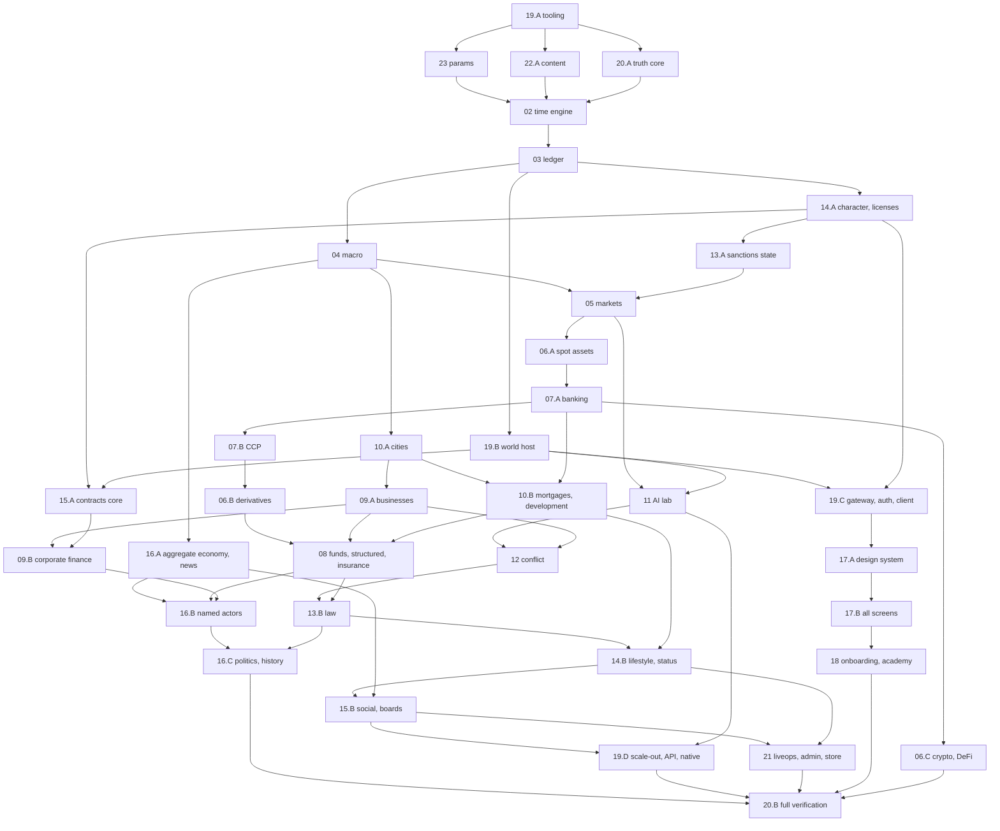

# GLOBAL CONTEXT (included at the top of every task pack)

You are implementing one task of **TYCOON**, a persistent multiplayer financial game. The full design is a 3 MB specification; you only receive the parts your task needs. This global context is binding on every task. If anything in your task pack seems to contradict this file, this file wins for code shape (names, packages, APIs) and the spec excerpts win for game rules and numbers.

## G1. How to work

1. Read the whole pack before writing code: this context, the task card, the spec excerpts, the upstream exports, the parameters, the decisions and the acceptance tests.
2. Create exactly the files the card lists (you may add small private helper files inside the same folder; list them in your report). Never edit files owned by another task except where the card says "edit".
3. Use only the upstream exports the pack shows. If you need something that is not exported, stop and report "MISSING EXPORT: <task> <symbol>" instead of inventing it.
4. Every spec rule in your excerpts must be implemented as written. Never simplify a formula, skip a branch, or leave a TODO that changes behaviour. Where the spec says DEFAULT, use that default.
5. Every acceptance test assigned to the task becomes at least one automated test whose name starts with its id, e.g. `it('05#8 market buy of q ADV moves price by s + Y σ_d √(q/D)', …)`.
6. Finish with: `pnpm -w lint && pnpm -w typecheck && pnpm -w test --filter <your package>` all green. Then write the short report described in G12.

## G2. Repository layout (monorepo root = repository root)

pnpm workspaces + Turborepo. Package scope `@tycoon/*`.

```
apps/web        Next.js 16 App Router client (read node_modules/next/dist/docs/ before writing Next code;
                Next 16: proxy.ts not middleware.ts, async params/cookies, Turbopack default)
apps/gateway    WebSocket gateway (uWebSockets.js)       apps/world      world host: coordinator + partitions
apps/projector  event consumers -> read models           apps/jobs       BullMQ jobs
apps/admin      admin console (Next.js 16)               apps/harness    Truth Machine runners (20)
apps/native     Capacitor shell
packages/engine/core        02 time engine, store, rng, dmath, fixed, ids, canon, testing
packages/engine/ledger      03     packages/engine/macro       04     packages/engine/markets   05
packages/engine/assets      06 (equity, etf, bond, fx, commodity, crypto, defi, derivatives, collectibles)
packages/engine/banking     07     packages/engine/funds       08     packages/engine/business  09
packages/engine/realestate  10     packages/engine/lab         11     packages/engine/conflict  12
packages/engine/law         13     packages/engine/progression 14     packages/engine/social    15
packages/engine/world       16     packages/engine/index.ts    PartitionEngine factory
packages/protocol (zod schemas, canonical encoder)   packages/content (22 catalogs)   packages/params (23)
packages/platform (db, bus, auth, telemetry; NOT deterministic)   packages/ui (17)   packages/i18n (en, fr)
packages/sdk   packages/config (tsconfig, eslint incl. determinism rules, tailwind, vitest presets)
infra/  tests/ (Playwright e2e, protocol contract tests)  docs/
```

Each engine module folder contains: `schema.ts` (entity types + table defs), `rules/*.ts` (pure functions), `intents.ts`, `events.ts`, `phases.ts`, `invariants.ts`, `views.ts`, `params.ts`, `index.ts` (exports the `ModuleDef`), and tests next to the code as `*.test.ts`.

Import rules (CI-enforced): engine modules import only `@tycoon/engine/core`, the engine modules they hard-depend on, `@tycoon/params`, `@tycoon/content`, and types from `@tycoon/protocol`. The engine never imports `platform`, `ui`, Node built-ins, network, filesystem or clocks.

Toolchain: TypeScript strict (`noUncheckedIndexedAccess`, `exactOptionalPropertyTypes`), Node 24 LTS, Vitest (+ fast-check for property tests), zod 4, Playwright, Tailwind 4, Zustand 5, TanStack Query, next-intl, Drizzle + PostgreSQL 18, Valkey 8, NATS JetStream, ClickHouse, BullMQ, Better Auth, OpenTelemetry, three.js (city), TradingView Lightweight Charts 5.

## G3. Units and conventions (00 §3)

| Quantity | Type | Rule |
|---|---|---|
| Money | `Money = bigint` micro-units (1e-6) of a currency, always with a `Ccy` | display `$12.4k`, `$3.21M`, `$1.05B`, `$4.2T` |
| Currency | `Ccy = 'FDL' \| 'EUN' \| 'PYN' \| 'NKR' \| 'SRL'` | FDL is the reserve currency |
| Price | `Price = bigint` micro-units per unit of asset | |
| Quantity | `Qty = bigint` in the asset's base lot | each asset has `lotSize`, `qtyDecimals` |
| Rates | `number` (float64) in model math; persisted as integer `rateE6` (1e-6) when they enter the ledger | |
| Probability | `number` in [0,1] | |
| Time | `Tick = number` (integer since genesis) | |
| Compute | integer PFLOP-days × 1000 | display GPUh (1 PFLOP-day = 10 GPUh) |
| Energy | integer kWh. Data: DQU float, persisted ×1000 integer | |

- All model math in float64; conversion to integers only at the ledger boundary with round-half-to-even through `toMoney(x, ccy)` / `toQty` / `toPrice`. No other code converts floats to money.
- Money crossing the protocol is a decimal string.
- IDs: `<kind>_<26 chars>` generated only by `ctx.newId(kind)` (deterministic). Authored ids like `ast_EQ_HALC` come from content.
- Parameters: `PARAM.snake_case` keys live in `@tycoon/params`; code reads them with `ctx.params.num('key')`, `ctx.params.money('key', ccy)` etc. Never hard-code a number that has a PARAM key. Param defaults in the registry are in display units: money in dollars (convert with `toMoney`), `%` as fractions, "game days" × 720 = ticks, "real days" × 17,280 = ticks.
- Notation: `σ(x)=1/(1+e^-x)`, `clamp`, `ln`, `dt = 1/262080` (one tick in game years).

## G4. Time (00 §5.1)

5 real seconds per tick; 720 ticks per game day (= 1 real hour); 30 ticks per game hour; one tick = 2 game minutes. Week = 7 game days (Mon–Fri trading, Sat–Sun weekend). Quarter = 13 weeks = 91 game days, months 28/28/35 days. Year = 364 game days = 262,080 ticks. Chapter = 8 real weeks = 1,344 game days. Real day = 24 game days.
Trading day tick-of-day `t`: pre-market 0–59; opening auction t=60; continuous 61–539; closing auction t=540; after-hours 541–719. Accruals (interest, rent, wages, fees) post at day close t=719. Business operations run once per game hour, staggered: an entity runs when `tickOfDay mod 30 == fnv1a32(id) mod 30`.

## G5. Tick pipeline (00 §5.2)

```
P0 ingest  P1 validate  P2 calendar  P3 world(16)  P4 npc(05,16)  P5 ai(11)  P6 match(05,06)
P7 clear(07)  P8 finance(07,08)  P9 real(09,10)  P10 conflict(12)  P11 law(13)  P12 social(14,15)
P13 ledger(03: commit postings atomically, settle/release holds, assert invariants)  P14 emit
```
A phase may read any committed state and the outputs of earlier phases of this tick; it writes only its own module's tables and queues postings for P13. Postings never commit before P13. A failed invariant rolls the tick back and replays it in safe mode. Consequences of tick N that other modules react to land in tick N+1 (via `ctx.send(..., 'NEXT')` or events).

## G6. The engine module contract (binding names; owned by tasks of unit 02)

```ts
// @tycoon/engine/core — primitives
export type Tick = number; export type Money = bigint; export type Qty = bigint; export type Price = bigint;
export type Ccy = 'FDL' | 'EUN' | 'PYN' | 'NKR' | 'SRL'; export type Id = string;
export type PhaseId = 'P0'|'P1'|'P2'|'P3'|'P4'|'P5'|'P6'|'P7'|'P8'|'P9'|'P10'|'P11'|'P12'|'P13'|'P14';
export type Visibility = 'PUBLIC' | 'PARTIES' | 'PRIVATE' | 'SEALED';
export type Boundary = 'HOUR' | 'DAY_OPEN' | 'DAY_CLOSE' | 'WEEK_CLOSE' | 'MONTH_CLOSE' | 'QUARTER_CLOSE' | 'YEAR_CLOSE' | 'CHAPTER_CLOSE'
  | 'WEEK_OPEN' | 'MONTH_OPEN' | 'QUARTER_OPEN' | 'YEAR_OPEN' | 'CHAPTER_OPEN' | 'PHASE_CHANGE';   // E-51 (T02-05, PR #20): *_OPEN at tickOfDay 0 of the period's first day; PHASE_CHANGE at tickOfDay ∈ {0, 60, 61, 540, 541}. Hook order: OPEN outermost first (CHAPTER→YEAR→QUARTER→MONTH→WEEK→DAY), then HOUR and PHASE_CHANGE, then CLOSE innermost first (DAY→…→CHAPTER).
export class SortedMap<K extends string, V> { get(k): V|undefined; set(k, v): SortedMap<K,V>; delete(k); has(k); size; entries(): Iterable<[K,V]> /* byte order of key */; keys(); values(); }
export class SortedSet<K extends string> { /* same ordering */ }
export function cmpStr(a: string, b: string): -1|0|1;            // UTF-16 code-unit byte order
export function sortBy<T>(arr: readonly T[], key: (t: T) => (string|number|bigint)[]): T[]; // stable, total
export * as dmath from './dmath';   // exp, ln, log2, log10, pow, sin, cos, atan, atan2, tanh, sigmoid, erf, erfc,
                                    // normCdf, normInv, lgamma, expm1, log1p, kahanSum, clamp, lerp,
                                    // bsPrice, bsGreeks, solveBisection(f,a,b,iters), newton(f,df,x0,iters), cholesky
export function roundHalfEven(x: number): number;
export function toMoney(x: number, ccy: Ccy): Money; export function toQty(x: number, lotScale: bigint, mode?: 'HALF_EVEN'|'LOT_FLOOR'): Qty;
export function toPrice(x: number): Price; export function fromMoney(m: Money): number;
export function divRoundHalfEven(n: bigint, d: bigint): bigint; export function mulRate(m: Money, rateE6: bigint): Money;
export function mulRateE12(m: Money, rateE12: bigint): Money; export function accrue(m: Money, annualRateE6: bigint, days: number): Money;
export function notional(qty: Qty, price: Price, lotScale: bigint): Money; export function fxConvert(m: Money, rateE6: bigint): Money;
export function allocate(total: bigint, weights: readonly { id: string; w: bigint }[]): Map<string, bigint>; // largest remainder, parts sum exactly
export function proRata(total: bigint, holdings: SortedMap<string, bigint>): SortedMap<string, bigint>;
export function assertFinite(x: number, ctx: string): number; export function safeDiv(a: number, b: number, fallback: number): number;
export function sha256(bytes: Uint8Array): Uint8Array; export function fnv1a32(s: string): number;
export function canonEncode(v: unknown): Uint8Array;  // canonical encoder (from @tycoon/protocol, re-exported)
export function ticksToGameDate(t: Tick): GameDate; export function calendarOf(t: Tick): CalendarInfo;

export interface Rng {            // one deterministic stream; keys '<module>.<purpose>[:<subjectId>]' (02 §3.10.4)
  next(): number; u53(): number; uOpen(): number; int(n: number): number; bernoulli(p: number): boolean;
  normal(): number; studentT(nu: number): number; exponential(lambda: number): number; poisson(lambda: number): number;
  kouJump(pUp: number, etaUp: number, etaDown: number): number;
  categorical<T extends string>(weights: readonly [T, number][]): T; shuffle<T>(a: T[]): T[];
}

export interface CalendarInfo { tick: Tick; tickOfDay: number; gameDay: number; weekday: 0|1|2|3|4|5|6; isTradingDay: boolean;
  gameHour: number; boundaries: ReadonlySet<Boundary>; quarter: number; year: number; chapter: number; }

export interface TableDef<T> { name: string /* '<module>.<table>' e.g. 'mkt.order' */; module: string; idOf(e: T): Id; schema?: unknown }

export interface StoreRead {
  get<T>(table: string, id: Id): T | undefined;
  iter<T>(table: string): Iterable<T>;                       // sorted by id (byte order)
  range<T>(table: string, fromId: Id, toId: Id): Iterable<T>;
  index<T>(table: string, indexName: string, key: string): Iterable<T>; // secondary index declared in TableDef, sorted by id
  count(table: string): number;
}
export interface Store extends StoreRead {                    // writes check ownership: OwnershipViolation if table.module !== caller
  put<T>(table: string, entity: T): void;                    // records undo entry; normalizes -0; rejects NaN/Infinity
  del(table: string, id: Id): void;
}

export interface EngineEvent { tick: Tick; seq: number; kind: string; subjectIds: Id[]; payload: unknown; visibility: Visibility }
export interface PhaseMessage { fromEntity: Id; toEntity: Id; phase: PhaseId; tick: Tick; kind: string; body: unknown; canonicalKey: string }

export interface PhaseCtx {
  readonly tick: Tick; readonly phase: PhaseId; readonly cal: CalendarInfo; readonly header: TickHeader;
  readonly module: string; readonly safeMode: boolean;
  readonly store: Store;
  rng(key: string): Rng;                                     // only the module's own registered streams
  newId(kind: string): Id;
  readonly params: ParamsView;                                // from @tycoon/params
  readonly content: ContentView;                              // from @tycoon/content
  readonly ledger: LedgerApi;                                 // from 03 (see G7); throws if 03 not loaded
  readonly holds: HoldApi;                                    // from 03 (see G7)
  emit(kind: string, subjectIds: Id[], payload: unknown, visibility: Visibility): void;
  send(toEntity: Id, kind: string, body: unknown, when: 'B1' | 'B2' | 'B3' | 'NEXT'): void;
  inbox(kind?: string): readonly PhaseMessage[];              // messages delivered to this phase, sorted by canonicalKey
  delta(recipient: Id | `pub:${string}`, channel: string, ops: unknown[]): void;  // client deltas (P14 flush)
  fail(invariantId: string, entityIds: Id[], observed: string, expected: string): void; // never throw for control flow
}
export interface ValidateCtx extends Omit<PhaseCtx, 'emit' | 'send' | 'delta'> {}   // P1: read state, place holds

export interface SealedIntent<P = unknown> { intentId: Id; actorId: Id; onBehalfOf?: Id; mandateId?: Id; kind: string;
  payload: P; channel: 'UI'|'API'|'AI'|'MANAGER'|'SYSTEM'; orderKey: string; tick: Tick }
export interface Reject { code: string /* '<MOD>_<REASON>' e.g. 'MKT_INSUFFICIENT_FUNDS' */; params?: Record<string, string> }
export interface IntentHandler<P = unknown> {
  kind: string;                       // namespaced: mkt.*, bank.*, fund.*, biz.*, prop.*, lab.*, ops.*, law.*, soc.*, life.*, acct.*
  schema: import('zod').ZodType<P>;   // registered in @tycoon/protocol too
  applyPhase: PhaseId;                // phase in which apply() runs (P1 if immediate)
  validate(ctx: ValidateCtx, i: SealedIntent<P>): Reject | null;   // P1, in fair order; place holds here
  apply(ctx: PhaseCtx, i: SealedIntent<P>): Reject | null;          // effect; may still reject (PARTIAL/REJECTED)
}
export interface InvariantImpl { def: InvariantDef /* 20 §2.1 */; check(ctx: InvariantCtx): { ok: true } | { ok: false; entityIds: Id[]; observed: string; expected: string } }
export interface ViewHandler<A = unknown, R = unknown> { id: string; schema: import('zod').ZodType<A>; run(store: StoreRead, args: A, viewer: ViewerContext): R }

export interface ModuleDef {
  id: string;                         // build unit id, e.g. '05', '06A'; module number = first two chars
  module: string;                     // '05'
  dependsOn: string[];                // unit ids (hard edges, 19 §12.2)
  tables: TableDef<any>[];            // tables this module owns (only it may write them)
  streams: string[];                  // RNG stream key prefixes it owns, e.g. ['mkt.factor', 'mkt.idio']
  phases: Partial<Record<PhaseId, (ctx: PhaseCtx) => void>>;
  boundaries?: Partial<Record<Boundary, (ctx: PhaseCtx) => void>>; // run in P2 when the boundary is in cal.boundaries
  intents: IntentHandler<any>[];
  events: Record<string, import('zod').ZodType>;   // event kind -> payload schema
  invariants: InvariantImpl[];
  views: ViewHandler<any, any>[];
  genesis?(ctx: PhaseCtx): void;     // creates the module's initial world state from content at world creation
}
export function defineModule(m: ModuleDef): ModuleDef;

// testing (the main tool of every task's tests): @tycoon/engine/core/testing
export interface TestWorld {
  readonly store: StoreRead; readonly tick: Tick;
  submit(actorId: Id, kind: string, payload: unknown, opts?: Partial<SealedIntent>): Id;  // queued for next step
  step(): TickOutcome;                 // runs one full tick P0..P14
  runTicks(n: number): TickOutcome[]; runUntil(pred: (w: TestWorld) => boolean, maxTicks: number): TickOutcome[];
  runToTickOfDay(t: number): void; runGameDays(d: number): void;
  events(filter?: { kind?: string; since?: Tick }): EngineEvent[];
  postings(filter?: { reason?: string; entityId?: Id; since?: Tick }): Posting[];
  intentResult(intentId: Id): IntentResult | undefined;
  balance(entityId: Id, code: number, ccy: Ccy, sub?: string): Money;
  view<R>(viewId: string, args: unknown, viewer?: Id): R;
  setParam(key: string, value: unknown): void;     // test-only override
  stateHash(): string; snapshot(): Uint8Array; 
  spawnCharacter(opts?: { cash?: Money; license?: string; rank?: string; city?: string }): Id; // available once 14.A is built
  asSystem<T>(fn: (ctx: PhaseCtx) => T): T;       // test-only direct state setup (bypasses ownership; never in prod)
}
export interface TickOutcome { tick: Tick; committed: boolean; safeMode: boolean; failedInvariants: string[]; stateHash: string }
export function createTestWorld(opts: { modules: ModuleDef[]; seed?: string; partitions?: number; params?: Record<string, unknown>;
  content?: 'full' | 'minimal' | ContentOverrides; startTick?: Tick }): TestWorld;
```

### G6.1 Ports for later modules (dependency inversion)

A module may never import a module built after it. When its rules need data from a later module (for example 05 needs fundamental values from 09 or index weights from 08), it declares a **port**: a TypeScript interface in its own `ports.ts` (e.g. `MarketPorts`), and its factory takes the implementations: `createMarketsModule(ports: Partial<MarketPorts>)`. The later module exports an implementation of that port, and `packages/engine/index.ts` wires them when building the world. A missing port uses the default the spec gives for "module not present" (stated in the card), never an invented rule.

## G7. Ledger and holds API (binding names; owned by tasks of unit 03)

All money and asset quantities move only through these template functions (03 §3.3.3). Each validates cheaply, queues one balanced `Entry` for P13 and returns its `entryId`. Codes come from 03's reason-code catalog (each code has exactly one class: FAUCET, SINK, TRANSFER, CREDIT_CREATE, CREDIT_DESTROY, REVALUE; a code may only use its allowed templates).

```ts
export interface PostOpts { refs?: Id[]; holdId?: Id; valueLegA?: number; valueLegB?: number; sub?: string; memo?: string }
export interface LedgerApi {
  pay(from: Id, to: Id, amt: Money, ccy: Ccy, code: string, o?: PostOpts): Id;                 // TRANSFER
  swapAsset(buyer: Id, seller: Id, assetId: Id, qty: Qty, amt: Money, ccy: Ccy, code: string, o?: PostOpts): Id;
  mint(to: Id, amt: Money, ccy: Ccy, code: string, o?: PostOpts): Id;                          // FAUCET, no elastic sector
  burn(from: Id, amt: Money, ccy: Ccy, code: string, o?: PostOpts): Id;                        // SINK
  elasticIn(sector: Id, to: Id, amt: Money, ccy: Ccy, code: string, o?: PostOpts): Id;          // FAUCET from hh/frm/row
  elasticOut(from: Id, sector: Id, amt: Money, ccy: Ccy, code: string, o?: PostOpts): Id;       // SINK to hh/frm/row
  lend(bank: Id, borrower: Id, amt: Money, ccy: Ccy, code: string, loanId: Id, o?: PostOpts): Id;   // CREDIT_CREATE
  repay(borrower: Id, bank: Id, principal: Money, ccy: Ccy, code: string, loanId: Id, o?: PostOpts): Id; // CREDIT_DESTROY
  cbCredit(cb: Id, bank: Id, amt: Money, ccy: Ccy, code: string, o?: PostOpts): Id;
  cbCreditUnwind(bank: Id, cb: Id, amt: Money, ccy: Ccy, code: string, o?: PostOpts): Id;
  accrue(e: Id, amt: Money, ccy: Ccy, code: string, drAcct: number, crAcct: number, o?: PostOpts): Id; // REVALUE, one entity
  accruePair(a: Id, b: Id, amt: Money, ccy: Ccy, code: string, o?: PostOpts): Id;
  fx(a: Id, b: Id, ccy1: Ccy, amt1: Money, ccy2: Ccy, amt2: Money, code: string, o?: PostOpts): Id;
  moveQty(from: Id, to: Id, assetId: Id, qty: Qty, bookValue: Money, ccy: Ccy, code: string, o?: PostOpts): Id;
  reclass(e: Id, amt: Money, ccy: Ccy, code: string, fromAcct: number, toAcct: number, o?: PostOpts): Id;
  // reads (committed state + this tick's queued entries are NOT included unless stated)
  balance(accountKey: string): Money; cash(entityId: Id, ccy: Ccy): Money; available(entityId: Id, ccy: Ccy): Money; // cash − active holds
  position(entityId: Id, assetId: Id): Qty; availableQty(entityId: Id, assetId: Id): Qty;
  netWorth(entityId: Id): Money;   // marked, in reporting currency (03 §3.10)
}
export interface HoldApi {
  placeCash(owner: Id, ccy: Ccy, amt: Money, expiresTick: Tick, ref: Id): Id | Reject;   // Reject {code:'LED_INSUFFICIENT_FUNDS'}
  placeQty(owner: Id, assetId: Id, qty: Qty, expiresTick: Tick, ref: Id): Id | Reject;
  release(holdId: Id): void; reduce(holdId: Id, byAmount: bigint): void; get(holdId: Id): Hold | undefined;
}
```
Entity kinds (00 §5.3): `chr cmp biz prop fnd bnk ins spv gov cbk ccp exc rat reg crt npc hh frm row ali sys`. Every entity has one balance sheet (registered with 03 via `registerEntity(ctx, {id, kind, reportingCcy, ownerId, homeCity?})`, exported by 03).

## G8. Determinism rules (02 §3.7, 19 Rule 3.6.2) — lint-enforced in packages/engine

Forbidden in engine code: `Date`, `performance`, `Math.random`, `crypto` randomness, timers, `process`, `globalThis`, `Intl`, `toLocaleString`, `localeCompare`, `async/await`/Promises, `for…in`, iterating `Object.keys/values/entries` of map-like objects, `Map`/`Set` iteration where order matters (use `SortedMap`/`SortedSet`), `Array.sort` without a total comparator (use `sortBy`), `JSON.stringify` for hashing/persistence (use `canonEncode`), `WeakMap/WeakRef`, `Math.exp/log/pow/sin/cos/tan/atan2/cbrt/hypot/...` (use `dmath`), `Math.round` (use `roundHalfEven`), `Number` for money or quantities. Allowed raw math: `+ - * /`, `Math.sqrt/abs/floor/ceil/trunc/min/max/sign/fround/imul/clz32`.
NaN/Infinity are illegal in state. Ties are broken by entity id then intent id. Iterate collections only in sorted order. Rejection sampling is forbidden; each variate uses a fixed number of draws. A module may draw only from its own streams. Split money into parts only with `allocate`. No exceptions for control flow: report impossible states with `ctx.fail`.

## G9. Events, intents, rates

- Event kinds are namespaced like intents (`mkt.fill`, `acct.rank.up`); every kind has a zod payload schema in the module's `events.ts` and is registered in `@tycoon/protocol`. Visibility per 00 §5.6; SEALED = court evidence only.
- Intent results: `ACCEPTED | REJECTED | PARTIAL | QUEUED_NEXT` with stable reject codes `<MOD>_<REASON>` (localized via i18n keys `err.<code>`).
- Rate limits: 20 intents per tick per character + 20 per operator, ≤ 100 combined (enforced by 19/02 intake, not by modules). AI: 2,000 DU per tick per player.
- Fairness: humans, player AIs and delegated managers use the same intents. No private API.
- L11 privacy: nothing automatically reveals a player's holdings, strategy or style. Disclosure only by opt-in, legal filing rule, or in-game espionage.

## G10. Locked decisions (never change)

L1 one persistent world, invisible partitions. L2 breach floor 1%. L3 hidden sessions accumulate progress (ceiling 0.85). L4 visual direction Ink & Brass (+ Shadow palette for Lab/Security). L5 16+, no gambling mechanics. L6 fully fictional brands, cities, currencies. L7 monetization cosmetic only, never money/rank/odds, no loot boxes. L8 English first, French second, string keys from day one (no raw UI text). L9 1 real hour = 1 game day. L10 derivatives, IPOs, takeovers gated behind late licenses; player tokens later (flag off); no prediction markets, no vice businesses. L11 no automatic leaks. L12 rewarded ads $250 each, max 10/day, only under $1,000 NW. L13 approved features (player IPOs, funds, honeypots, AI tournament, rival funds, world events, rumors, bankruptcy comeback, trade journal, "Why it moved", company building). L14 rebuilt from scratch. L15 full ambition, nothing cut.
Spec precedence when two texts disagree: 24 Decisions register > the owning module > 23 Parameter registry > other text. 22 catalogs win on content names and counts.
Conflict/cyber content is purely game-mechanical (named verbs, probabilities, budgets, cooldowns). Never implement or describe real-world attack techniques.

## G11. Shared enums (00 §5.8)

Ranks `R0 Broke, R1 Hustler, R2 Owner, R3 Mogul, R4 Tycoon, R5 Titan, R6 Dynasty`. Licenses `LIC0 Cash, LIC1 Retail, LIC2 Pro, LIC3 Derivatives, LIC4 Institutional`; charters `CH_BANK, CH_FUND, CH_INSURER, CH_EXCHANGE_MEMBER, CH_CUSTODIAN`. AI tiers `T0 … T5`. Business tiers `B1 … B6`. Property tiers `working, mid, prime, trophy`. Severity `S1 … S6`. World: 5 blocs (Federal Union FDL, Euran Compact EUN, Pacific League PYN, Nordic Alliance NKR, Southern Coalition SRL), 15 cities (3 per bloc) + Isla Serena (FDL). Player start: $5,000 FDL, LIC0, R0, home city among the 3 FDL cities, 72 real hours protection.

## G12. Your report (end of task)

```
TASK <id> DONE | BLOCKED
files: <list with line counts>
tests: <n passed> / <n>; acceptance tests covered: <ids>
exports: unchanged from card | changed: <diff>   (changing exports requires reviewer approval)
missing exports / spec questions: <list or none>
```


---

# TASK T19A-04: Import boundaries generated from the build-unit graph, resolved module-graph checker (INV-STR-001, T64)

Unit 19A · stage S0 · depends on: T19A-01, T19A-03

Files to create:
- `packages/config/graph/units.ts`
- `packages/config/graph/packages.ts`
- `packages/config/graph/generate.ts`
- `packages/config/graph/generated/boundaries.json`
- `packages/config/graph/resolve.ts`
- `packages/config/graph/check.ts`
- `packages/config/graph/check.test.ts`
- `packages/config/graph/units.test.ts`
- `packages/config/eslint/plugin/rules/import-boundaries.mjs`
- `packages/config/eslint/plugin/rules/import-boundaries.test.ts`

## Goal
Encode the binding module dependency graph (19 §12.2 hard edges) and the package import rules (19 Rule 3.1.2) as data, generate the boundary configuration from it, and enforce it twice: an ESLint rule for fast feedback and a resolved module-graph checker (TypeScript resolution, direct and transitive) run by `pnpm -w verify:static` in CI. This implements static invariant INV-STR-001 (engine imports nothing outside its allowed set) and acceptance test 19#64. Rule 12.4.3: adding a hard edge means editing `units.ts` and regenerating `boundaries.json` in the same change; the check fails if the generated file is stale.

## Imports
- T19A-01: workspace layout, `verify:static` script.
- T19A-03: the `tycoon` ESLint plugin object (this task adds one rule to it).

## Exports
```ts
// packages/config/graph/units.ts  (transcription of 19 §12.2; data, edited only with a §12.2 change)
export type UnitId = '19A'|'23'|'22A'|'20A'|'02'|'03'|'19B'|'14A'|'13A'|'15A'|'19C'|'17A'|'04'|'16A'|'05'|'06A'|'07A'|'07B'|'06B'|'06C'|'10A'|'10B'|'09A'|'09B'|'08'|'11'|'12'|'13B'|'16B'|'16C'|'14B'|'15B'|'17B'|'18'|'19D'|'21'|'22B'|'20B';
export const HARD_DEPS: Readonly<Record<UnitId, readonly UnitId[]>>;   // exactly the "Hard dependencies" column of 19 §12.2
export const STAGES: Readonly<Record<'S0'|'S1'|'S2'|'S3'|'S4'|'S5'|'S6'|'S7'|'S8'|'S9'|'S10', readonly UnitId[]>>; // 19 §12.4
export const ENGINE_MODULE_FOLDER: Readonly<Record<string, string>>;   // module number -> folder under packages/engine:
  // '02':'core','03':'ledger','04':'macro','05':'markets','06':'assets','07':'banking','08':'funds','09':'business',
  // '10':'realestate','11':'lab','12':'conflict','13':'law','14':'progression','15':'social','16':'world','19':'sys'
export const UNIT_PATHS: Partial<Record<UnitId, readonly string[]>>;   // optional finer globs for multi-unit modules;
  // a later unit's assembly task adds its sub-folder here (e.g. '06B': ['packages/engine/assets/derivatives/**'])
export function transitiveDeps(u: UnitId): UnitId[];                  // sorted, excludes u
export function topoOrder(): UnitId[];                                // throws on a cycle

// packages/config/graph/packages.ts  (19 Rule 3.1.2 as data)
export interface PackageRule { from: string /* glob */; allow: string[] /* specifiers or globs */; deny: string[]; typeOnly?: string[] }
export const PACKAGE_RULES: readonly PackageRule[];
export const NODE_BUILTINS: readonly string[];

// packages/config/graph/generate.ts  (CLI: `pnpm --filter @tycoon/config gen:boundaries`)
export function generateBoundaries(): BoundariesJson;   // deterministic, keys sorted
export interface BoundariesJson { version: 1; engineFolders: Record<string /*folder*/, string[] /*allowed engine folders*/>;
  unitPaths: Record<string, string[]>; packages: PackageRule[] }

// packages/config/graph/resolve.ts
export interface ImportEdge { from: string /* repo-relative file */; to: string /* resolved file or 'pkg:<name>' or 'node:<mod>' */; specifier: string; typeOnly: boolean }
export function collectImports(repoRoot: string, globs: string[]): ImportEdge[];       // TypeScript compiler API: ts.preProcessFile + ts.resolveModuleName with the package's tsconfig
export function transitiveClosure(edges: ImportEdge[], start: string[]): Set<string>;   // files and packages reachable

// packages/config/graph/check.ts  (CLI, run by verify:static; exit 1 on any violation)
export interface Violation { rule: 'INV-STR-001' | 'GRAPH_EDGE' | 'PACKAGE_RULE' | 'STALE_GENERATED'; from: string; to: string; message: string }
export function checkGraph(repoRoot: string): Violation[];
```

## Implementation steps
1. `units.ts`: transcribe every row of 19 §12.2 (Unit, Hard dependencies) exactly; `01` and `24` have no code and are omitted. `STAGES` from 19 §12.4. `topoOrder` = Kahn's algorithm with ties broken by unit id byte order.
2. Engine folder edges: for engine module folder F (module M), the allowed engine folders are `core` plus the folders of every module that appears in `transitiveDeps(u)` for any unit `u` of module M (module-level union), where unit ids map to module by their first two characters (`19B` -> module 19 folder `sys`). When a file matches a glob in `UNIT_PATHS[u]`, use unit-level edges for it instead (only `transitiveDeps(u)` folders, plus same-unit paths). Same-folder imports are always allowed. Module-level unions may contain mutual edges (for example `assets` and `banking`); that is expected until the owning units register `UNIT_PATHS`.
3. `PACKAGE_RULES` (19 Rule 3.1.2), with these exact decisions:
   - `packages/engine/**`: allow `@tycoon/engine/*` (subject to step 2), `@tycoon/params`, `@tycoon/content`, `@tycoon/protocol/canon` (value import: the canonical encoder re-exported by engine core, G6), `zod`; `typeOnly: ['@tycoon/protocol']`; deny everything else, explicitly every `NODE_BUILTINS` entry, `@tycoon/platform`, `@tycoon/ui`, `@tycoon/i18n`, `@tycoon/sdk`, any other npm package.
   - `packages/protocol/**`: allow `zod` only.
   - `packages/params/**`, `packages/content/**`: allow `zod`, `@tycoon/protocol` (types and canon).
   - `packages/platform/**`: allow `@tycoon/protocol`, `@tycoon/params`, `@tycoon/engine` root entry only (`packages/engine/index.ts`), any npm package, Node built-ins; deny other `@tycoon/engine/*` subpaths.
   - `apps/world/**`: allow `@tycoon/engine` (all subpaths), `@tycoon/platform`, `@tycoon/protocol`, `@tycoon/params`, `@tycoon/content`, npm, Node; deny `@tycoon/ui`.
   - `apps/web/**`: allow `@tycoon/protocol`, `@tycoon/ui`, `@tycoon/i18n`, `@tycoon/sdk`, `@tycoon/content/public`, npm; allow `@tycoon/engine` only from files matching `apps/web/**/sandbox/**` (Web Worker sandbox, 19 Rule 3.17.4); deny `@tycoon/platform/secrets` and `@tycoon/content/server`.
   - `apps/admin/**`: allow `@tycoon/protocol`, `@tycoon/ui`, `@tycoon/platform`, npm; deny `@tycoon/engine` (write paths).
   - Commerce paths `apps/web/app/(store)/**`, `apps/web/store/**`, `apps/jobs/commerce/**`, `packages/platform/commerce/**`: deny `@tycoon/engine` directly and transitively (19 Rule 3.1.2 last row; the transitive check feeds INV-STR-002, which unit 21 registers).
   - `packages/sdk/**`: allow `@tycoon/protocol`, `@tycoon/engine/core/crypto` (pure SHA-256/HMAC/Ed25519 for roll verification and signing helpers).
   - `apps/gateway/**`, `apps/projector/**`, `apps/jobs/**`, `apps/harness/**`: allow `@tycoon/platform`, `@tycoon/protocol`, `@tycoon/params`, `@tycoon/content`, npm, Node; `apps/harness` also `@tycoon/engine` and `@tycoon/sdk`.
4. `generate.ts` writes `generated/boundaries.json` with sorted keys and 2-space indentation; `check.ts` regenerates in memory and reports `STALE_GENERATED` if the file differs.
5. `resolve.ts`: walk the files matching the globs (skip `node_modules`, `dist`, `.next`), parse imports with `ts.preProcessFile(text, true, true)` (static imports, re-exports, dynamic `import()` with a literal), detect `import type` / `export type` as `typeOnly` with a small TypeScript AST pass, resolve each specifier with `ts.resolveModuleName` against the nearest `tsconfig.json`; workspace packages resolve to their source files; external packages become `pkg:<name>`; built-ins `node:<name>`.
6. `checkGraph`: for every edge from a file under `packages/engine/**`, report `INV-STR-001` if it targets a Node built-in, `pkg:*` other than `zod`, `@tycoon/platform`, `@tycoon/ui`, or a value import of `@tycoon/protocol` other than `/canon`; report `GRAPH_EDGE` for an engine-folder edge not allowed by step 2; report `PACKAGE_RULE` for every other rule of step 3 (for deny-transitive rules use `transitiveClosure`). Messages: `"<from> -> <to>: <rule text>"`. Sort violations by `(rule, from, to)`.
7. `import-boundaries.mjs` (ESLint, fast path): reads `generated/boundaries.json` once and applies the same package and engine-folder rules to the import specifiers of the linted file without transitive analysis. Add it to `deterministic` and `base` configs of T19A-03 at `'error'`.
8. Add `"verify:static": "tsx graph/check.ts && tsx scripts/check-workspace.ts"` to `@tycoon/config`, and `"gen:boundaries": "tsx graph/generate.ts"`.

## Test plan
`graph/units.test.ts`:
- `HARD_DEPS transcribes 19 §12.2`: spot-check 10 rows exactly (`'02': ['19A','23','22A','20A']`, `'19B': ['02','03']`, `'05': ['03','04','14A','13A']`, `'08': ['06B','07B','09A','10B']`, `'13B': ['12','05','07B','08','13A','15A']`, `'19D': ['19C','11','15B']`, `'21': ['19C','15B','14B']`, `'20B'`: every other code unit, `'19A': []`, `'09B': ['09A','06A','07A','15A']`).
- `topoOrder` starts with `19A` and places every unit after all its deps; injecting a cycle throws.
- `transitiveDeps('06B')` contains `07B`, `07A`, `06A`, `05`, `03`, `02`.
`graph/check.test.ts` (fixture mini-repos written to a temp dir with their own tsconfig):
- `19#64 an import against the graph fails CI`: fixture engine file `packages/engine/macro/x.ts` importing `../markets/y` (04 does not depend on 05) -> one `GRAPH_EDGE` violation; `packages/engine/markets/y.ts` importing `../macro/x` -> no violation.
- `19#64 generated configuration matches §12 table`: run `generateBoundaries()` on the real repo, compare to the committed `generated/boundaries.json` (no `STALE_GENERATED`); then mutate `HARD_DEPS` in memory and assert the comparison reports stale.
- `INV-STR-001 engine cannot import node, platform, ui, random npm`: fixture files under `packages/engine/core/` importing `node:fs`, `@tycoon/platform`, `lodash`, and `import { x } from '@tycoon/protocol'` (value) -> four `INV-STR-001` violations; `import type { Intent } from '@tycoon/protocol'` and `import { canonEncode } from '@tycoon/protocol/canon'` -> none.
- Transitive commerce check: fixture `apps/web/app/(store)/page.ts` -> `packages/platform/x.ts` -> `@tycoon/engine` root -> one `PACKAGE_RULE` violation naming the chain.
- The real repository returns zero violations.
`import-boundaries.test.ts`: RuleTester cases mirroring the first and third fixtures.

## Done when
- [ ] 19#64 green; INV-STR-001 registered as a static check (its id appears in the violation output and in the test names).
- [ ] `boundaries.json` committed and regenerated deterministically.
- [ ] `pnpm -w verify:static` runs the graph check and passes on the repo.


---

# UPSTREAM EXPORTS (the only APIs you may import besides GLOBAL CONTEXT)

### From T19A-01 (Monorepo skeleton, toolchain pins, shared config presets and local environment)

```ts
// Workspace contract (binding for every later task)
// Root package.json scripts (run with `pnpm -w <script>`):
//   "lint":      "turbo run lint"            each package's lint = "eslint ."
//   "typecheck": "turbo run typecheck"       each package's typecheck = "tsc -p tsconfig.json --noEmit"
//   "test":      "turbo run test"            each package's test = "vitest run"
//   "build":     "turbo run build"
//   "dev":       "turbo run dev --parallel"
//   "verify:static": "turbo run verify:static"   static INV-STR checks (filled by T19A-04, T19A-05, T23-08, T19C-01)
//   "test:contract", "test:replay", "test:partition", "e2e:smoke": turbo tasks, defined by the packages that own them
// `pnpm -w test --filter <pkg>` works (root script forwards args: "test": "turbo run test --").
//
// Package names (scope @tycoon), one folder each, all "private": true, "type": "module":
//   packages/engine   -> @tycoon/engine   (subpath exports "./core", "./core/testing", "./ledger", "./macro",
//                        "./markets", "./assets", "./banking", "./funds", "./business", "./realestate", "./lab",
//                        "./conflict", "./law", "./progression", "./social", "./world", "./sys", ".")
//   packages/protocol -> @tycoon/protocol  packages/content -> @tycoon/content  packages/params -> @tycoon/params
//   packages/platform -> @tycoon/platform  packages/ui -> @tycoon/ui  packages/i18n -> @tycoon/i18n
//   packages/sdk -> @tycoon/sdk            packages/config -> @tycoon/config
//   apps/web -> @tycoon/web  apps/gateway -> @tycoon/gateway  apps/world -> @tycoon/world
//   apps/projector -> @tycoon/projector  apps/jobs -> @tycoon/jobs  apps/admin -> @tycoon/admin
//   apps/harness -> @tycoon/harness  apps/native -> @tycoon/native
//
// packages/config exports:
//   "@tycoon/config/tsconfig/base.json"   strict, noUncheckedIndexedAccess, exactOptionalPropertyTypes,
//                                         target ES2023, module NodeNext, verbatimModuleSyntax, isolatedModules
//   "@tycoon/config/tsconfig/engine.json" extends base; lib ["ES2023"] only (no DOM), types [] (no @types/node)
//   "@tycoon/config/tsconfig/node.json"   extends base; types ["node"]
//   "@tycoon/config/tsconfig/next.json"   extends base; jsx preserve, lib DOM, module ESNext, moduleResolution Bundler
//   "@tycoon/config/vitest"               export function definePreset(opts?: { environment?: 'node' | 'jsdom'; include?: string[] }): import('vitest/config').UserConfig
//   "@tycoon/config/fast-check"           export const PR_RUNS = 200; export const NIGHTLY_RUNS = 10000;
//                                         export function fcRuns(): number   // NIGHTLY_RUNS when process.env.TYCOON_NIGHTLY === '1', else PR_RUNS
//   "@tycoon/config/prettier"             prettier config object
// docs/spec/: the 25 specification markdown files (00..24) and the _notes/ folder are copied here verbatim; scripts that check the spec
//             (T23-08, T19C-01) read them from this folder.
```

### From T19A-03 (Determinism ESLint rule set for packages/engine (tycoon/deterministic))

```ts
// packages/config/eslint/index.mjs
export const base;          // flat-config array: typescript-eslint recommended-type-checked + repo conventions, for all packages
export const deterministic; // flat-config array enabling every tycoon/* determinism rule at 'error' for files
                            // ['packages/engine/**/*.ts', 'packages/params/src/**/*.ts', 'packages/content/src/**/*.ts'],
                            // excluding '**/*.test.ts' and 'packages/engine/core/testing/**' (tests may use Date for timing)
export const plugin;        // the 'tycoon' ESLint plugin object { rules: {...} }
// Rule ids (all in plugin 'tycoon'):
//  'tycoon/no-nondeterministic-globals'  'tycoon/no-raw-math'  'tycoon/no-unordered-iteration'
//  'tycoon/sort-needs-comparator'        'tycoon/no-async'     'tycoon/no-json-stringify'   'tycoon/no-number-money'
// Every report message starts with "[determinism] " followed by the forbidden construct and the replacement.
```


---

# SPEC EXCERPTS (verbatim; binding game rules)

**[19 §1 Purpose]** (context)

## §1 Purpose

1. **One authoritative world.** The server is the only truth (L1, L14). Clients send intents and render deltas. No client ever runs the authoritative simulation, holds the world seed, or computes its own fills, balances or roll outcomes.
2. **One logical world on many machines.** The world is a single deterministic fold over sealed intents. It is executed by many single-writer **partitions** under a bulk-synchronous tick (one barrier per pipeline phase of 00 §5.2). The result of a tick never depends on how many partitions exist or which machine runs them. That is what makes partitioning invisible (L1) and replay exact.
3. **Fairness by construction.** Every actor (human UI, expert API, player AI, delegated manager, NPC) enters the world through the same intent pipeline with the same validation and the same tick (00 §5.5). Ordering inside a tick never rewards network speed.
4. **Provable honesty.** Every input is stored; every output is reproducible; every random outcome a player is party to is verifiable after the fact (§3.12). The Truth Machine (20) runs on the same engine packages.
5. **Privacy by serialization.** Data the client must not know never leaves the partition that owns it (L11). The gateway only relays deltas already filtered for their recipient.
6. **A builder's map.** §12 orders every module of 00 §1 into a build sequence with gates, so the game can be built bottom-up without a question.

---


<!-- excerpt 19§3.1 -->
**[19 §3.1]** (from spec file 19-TECH-ARCHITECTURE.md)

### §3.1 Monorepo and packages

**Rule 3.1.1 (layout).** One repository, pnpm workspaces, Turborepo task graph. Exact layout:

```
tycoon/
  apps/
    web/            Next.js 16 App Router: game client, marketing, account, store web checkout, REST route handlers
    gateway/        WebSocket gateway service (Node)
    world/          world host: coordinator + partitions (Node, worker_threads)
    projector/      event-stream consumers → read models (Node)
    jobs/           scheduled and batch jobs (Node, BullMQ workers)
    admin/          internal admin console (Next.js 16, separate deployment, staff SSO only) (21)
    harness/        Truth Machine runners: headless worlds, bot swarm, balance and load (20)
    native/         Capacitor shell for iOS and Android
  packages/
    engine/         the deterministic world: every module's engine code, organised by module number
      core/         02: clock, pipeline, rng, detmath, store, snapshot codec
      ledger/       03
      macro/        04
      markets/      05
      assets/       06 (sub-folders equity, etf, bond, fx, commodity, crypto, defi, derivatives, collectibles)
      banking/      07
      funds/        08
      business/     09
      realestate/   10
      lab/          11 (includes the strategy-graph VM, §3.11)
      conflict/     12
      law/          13
      progression/  14
      social/       15 (engine side: boards, contracts, alliances, filings)
      world/        16
      index.ts      PartitionEngine factory (§2.6)
    protocol/       zod schemas: Intent kinds, ClientMsg/ServerMsg, channel bodies, error codes; canonical encoder
    content/        22 catalogs as typed data (JSON + generated TS types), versioned
    params/         23 registry: typed defaults, ranges, units, owner; loader and change validator
    platform/       non-deterministic shared server code: db clients, bus, auth helpers, telemetry
    ui/             design-system components and tokens (17)
    i18n/           message catalogs en, fr and the `t()` helper (L8)
    sdk/            public TypeScript SDK for the expert API (§3.10.3) and the bot SDK used by 20
    config/         tsconfig, eslint (including the determinism rules §3.6.2), tailwind preset, vitest preset
  infra/            infrastructure as code, container images, runbooks
  tests/            cross-package e2e (Playwright), protocol contract tests
  docs/             generated API reference, ADRs
```

**Rule 3.1.2 (dependency direction).** Allowed import edges, enforced by an eslint boundaries rule and checked in CI:

| Package | May import | Must never import |
|---|---|---|
| `engine/*` | `engine/core`, lower-numbered or explicitly listed engine modules (per §12 graph), `params`, `content`, `protocol` (types only) | `platform`, `ui`, any Node built-in except none (engine is pure), any network, clock, filesystem, `Math.random`, `Date` |
| `protocol` | nothing but zod | everything else |
| `platform` | `protocol`, `params` | `engine` internals (only `engine/index.ts`) |
| `apps/world` | `engine`, `platform`, `protocol`, `params`, `content` | `ui` |
| `apps/web` | `protocol`, `ui`, `i18n`, `sdk`, `engine` (only for sandbox mode §3.17, loaded in a Web Worker) | `platform` server secrets |
| `apps/admin` | `protocol`, `ui`, `platform` (admin APIs) | `engine` write paths |
| commerce code (`apps/web/store`, 21) | `platform` | `engine` (structural guarantee of L7, §9 E19) |

**Rule 3.1.3 (engine modules inside the engine package).** Each module folder exports: `schema.ts` (entity types), `rules/*.ts` (pure functions), `intents.ts` (validators and handlers keyed by intent kind), `events.ts` (event kinds and payload schemas), `phases.ts` (which pipeline phases it runs in and the handler for each), `invariants.ts` (checks registered with 20), `views.ts` (read views), `params.ts` (its PARAM keys, mirrored in 23). A module may only write its own entities (00 §5.2) and queue postings; the store API (§3.6.3) enforces this by entity-kind ownership tables generated from `schema.ts`.

**Rule 3.1.4 (toolchain, pinned).** Exact versions are pinned in the lockfile at the start of the build and only upgraded at chapter boundaries after a full G2 gate (20 §3.9). DEFAULT stack (Mathis may override):

| Concern | Choice |
|---|---|
| Language | TypeScript, `strict`, `noUncheckedIndexedAccess`, `exactOptionalPropertyTypes` |
| Server runtime | Node.js 24 LTS, one pinned minor across all world hosts (determinism, §3.6.1) |
| Web framework | Next.js 16.4 App Router with React 19.3 (versions already chosen in the repo). Before writing any Next.js code the builder reads the guides in `node_modules/next/dist/docs/`; Next 16 conventions apply (for example `proxy.ts` instead of `middleware.ts`, async request APIs such as `await params` and `await cookies()`, Turbopack by default) |
| Styling | Tailwind CSS 4 with tokens from 17 as CSS variables |
| Client state | Zustand 5 stores fed by a Web Worker that decodes deltas; TanStack Query for HTTP reads |
| Charts | TradingView Lightweight Charts 5 (Apache-2.0; attribution link shown in the chart footer as the licence requires) |
| City renderer | three.js, orthographic instanced rendering (resolves 06-cities §15 renderer question per LC11) |
| Validation | zod 4 schemas in `packages/protocol`, shared by client and server |
| i18n | next-intl with ICU messages, keys from day one (L8) |
| WebSocket server | uWebSockets.js in the gateway (≥ 10k sockets per instance) |
| Message bus | NATS 2.x with JetStream (cross-partition phase messages, intent intake, event stream) |
| Relational DB | PostgreSQL 18 with Drizzle ORM; logical replication to a hot standby |
| Cache, presence, boards | Valkey 8 (Redis-compatible): sorted sets for boards, presence, rate-limit counters |
| Analytics store | ClickHouse: candles, postings archive, telemetry, harness results |
| Object storage | S3-compatible (snapshots, intent batch archives, city chunks, share images), with object lock for audit logs |
| Jobs | BullMQ on Valkey |
| Auth | Better Auth: passkeys, email magic link, Google, Apple, Discord, TOTP |
| Tests | Vitest (unit, property with fast-check), Playwright (e2e), k6 plus the harness load driver (load) |
| Observability | OpenTelemetry → Prometheus, Grafana, Loki, Tempo; Sentry for client and server errors |
| Native | Capacitor (current stable major, pinned), iOS and Android |
| PWA | Web App Manifest (Next 16 metadata route), service worker built with Serwist |
| CDN and edge protection | a CDN with WAF and DDoS protection in front of web, gateway and city chunk files |


<!-- excerpt 19§12.1 -->
**[19 §12.1]** (from spec file 19-TECH-ARCHITECTURE.md)

### §12.1 Edge types

- **Hard edge (A → B: B needs A).** B imports A's types or calls A's functions, or B's rules cannot be tested without A's state. Hard edges are the only edges that order the build and are enforced as import boundaries (rule 3.1.2, test T64).
- **Event edge (A ⇢ B).** B consumes A's events (00 §5.6). B builds against the event schema registered in `packages/protocol` and is tested with fixtures; an event edge never blocks the build and never creates an import.
- **Phase edge.** Order inside a tick is fixed by 00 §5.2 and never by module build order.

Cycles in the design (for example law ↔ reputation, markets ↔ news) are always broken into one hard edge and one event edge, or by splitting a module into build units.


<!-- excerpt 19§12.2 -->
**[19 §12.2]** (from spec file 19-TECH-ARCHITECTURE.md)

### §12.2 Build units

Several modules are split into units so that gating state exists early and rich behaviour arrives later. Units carry the module number and a letter.

| Unit | Contents | Hard dependencies |
|---|---|---|
| **19.A** | Monorepo, toolchain, lint rules (determinism, boundaries), `packages/protocol` skeleton and canonical encoder, CI | – |
| **23** | `packages/params`: registry types, loader, range validator, all params of every file | 19.A |
| **22.A** | `packages/content`: catalog schemas, public/server split, generator scaffolding | 19.A |
| **20.A** | Truth Machine core: invariant registry, headless runner, regression-seed format, property-test presets | 19.A |
| **02** | Time engine: clock, calendar, pipeline, RNG streams, detmath, store, undo log, snapshot codec, `step()` | 19.A, 23, 22.A, 20.A |
| **03** | Ledger and accounting: chart of accounts, postings, reason codes, holds, ipc accounts, statements, consolidation, taxes | 02 |
| **19.B** | World host on one machine: coordinator, partitions as worker threads, bus, batch durability, tick records, snapshots, recovery, entropy commit-reveal | 02, 03 |
| **14.A** | Character, account link, ranks, license state, protection windows, restricted cash buckets (state and checks only) | 03 |
| **13.A** | Sanctions and Held registry: state, P1 checks used by every module (no investigations yet) | 03, 14.A |
| **15.A** | Contract engine core: typed clauses, escrow via holds, anchor rule, filings core | 03, 14.A, 19.B |
| **19.C** | Gateway, protocol channels, auth, sessions, signing keys, HTTP API skeleton, projector framework, client shell with Web Worker | 19.B, 14.A |
| **17.A** | Design system: tokens, shell, components, tick pulse, navigation frame | 19.C |
| **04** | Macro, central banks, sovereigns, FX regimes, crises | 03 |
| **16.A** | Aggregate economy (`hh`, `frm`, `row`), causal news framework, world scheduler | 04 |
| **05** | Market microstructure: batch auction, order types, NPC liquidity, impact, sessions, halts, surveillance features | 03, 04, 14.A, 13.A |
| **06.A** | Spot asset classes: equities, ETF shells, bonds, FX, commodities, collectibles | 05 |
| **07.A** | Banking, credit creation, deposits and runs, interbank, lending, repo, securities lending, prime brokerage | 03, 04, 06.A |
| **07.B** | Clearing house, novation, margin, default waterfall | 07.A, 06.A |
| **06.B** | Derivatives: options, futures, perps, swaps, CDS (cleared via 07.B) | 07.B |
| **06.C** | Crypto and DeFi | 06.A, 07.A |
| **10.A** | Cities, districts, properties, addresses, procedural city, city map data | 03, 04, 22.A |
| **10.B** | Mortgages, development, property exchange, growth | 10.A, 07.A |
| **09.A** | Business catalog, demand, operations, staff, supply chains, NPC contracts | 10.A, 03, 04 |
| **09.B** | Company building, corporate finance, IPOs, M&A, LBOs, restructuring | 09.A, 06.A, 07.A, 15.A |
| **08** | Funds, ETF creation/redemption, securitization, rating agencies, insurance, reinsurance, cat bonds | 06.B, 07.B, 09.A, 10.B |
| **11** | AI lab: compute, data, training, evaluation, deployment, strategy-graph VM (rule 3.11), mandates | 05, 06.A, 14.A, 19.B |
| **12** | Conflict and intelligence: attack surface, ops, hidden sessions, defense, detection, honeypots | 11, 09.A, 10.A, 13.A |
| **13.B** | Investigations, evidence, courts, verdicts, regulators, surveillance, whistleblowers, insurance claims, anti-grief | 12, 05, 07.B, 08, 13.A, 15.A |
| **16.B** | Named NPC actors, decision models, dynasties, politics and lobbying, strikes, non-macro world-event catalog (E-30) | 16.A, 08, 09.B, 10.B |
| **16.C** | World history and archive, eras and technology, secrets and facts, opportunity briefs (E-30) | 16.B, 13.B |
| **14.B** | Lifestyle catalog, Prestige, Reputation, Notoriety, clubs, hosting, Legacy, dynasty succession | 14.A, 10.B, 13.B |
| **15.B** | Partitions-facing social: boards, leagues, chapters, alliances, chat, the Wire, spectating, challenges, anti-cheat policy | 15.A, 14.B, 16.A, 19.C |
| **17.B** | Every screen of 17 (built per module as each module's unit lands; this unit is the final completeness pass) | 17.A and the module of each screen |
| **18** | Onboarding minute by minute, just-in-time introductions, Academy, help, explainability ladder, sandbox use | 17.B, 05, 09.A, 14.A, 16.A |
| **19.D** | Scale-out: multi-host partitions, rebalancing, failover drills, expert API, PWA, native shells, edge gateways | 19.C, 11, 15.B |
| **21** | Admin console, live events, patches, support, moderation, cosmetics store and pass, rewarded ads, privacy, age rating, store compliance | 19.C, 15.B, 14.B |
| **22.B** | Full content catalogs (every named item listed by all modules' notes) | 22.A and each consuming module's schema |
| **20.B** | Full swarm, population experiments, balance bands, release gates over the whole game | all units above |
| **01**, **24** | Documentation only (evaluation and decisions register): no code; kept current throughout | – |

Event edges worth naming (they never block): 16.A ⇢ 05 (news drives prices), 05 ⇢ 16.A (moves drive news), 13.B ⇢ 14.B (verdicts change Reputation and Notoriety), 14.B ⇢ 13.B (Notoriety affects investigation priors), 12 ⇢ 13.B (evidence), 07/08 ⇢ 15.B (systemic dashboards), every module ⇢ 20 (invariants), every module ⇢ 17 (screens), every module ⇢ 16 (news), 09.B ⇢ 05 (corporate actions).


<!-- excerpt 19§12.3 -->
**[19 §12.3]** (from spec file 19-TECH-ARCHITECTURE.md)

### §12.3 Graph



(The table in §12.2 is authoritative where the drawing omits an edge.)


<!-- excerpt 19§12.4 -->
**[19 §12.4]** (from spec file 19-TECH-ARCHITECTURE.md)

### §12.4 Build order (topological, with stages)

Units inside a stage may be built in parallel. Every unit closes with gates defined by 20 (interface assumed from 20 §3.9: **G1** unit gate, all of the unit's acceptance tests and property tests pass; **G2** integration gate, golden replay and every registered invariant over a 30-game-day headless world with all units built so far, plus T4 partition independence; **G3** adversarial gate, 20's bot swarm with player-level permissions finds no open exploit of severity S4+ in the unit and balance bands hold; **G4** release gate, G3 plus load tests T52–T54 and the restore drill T48).

| Stage | Units | Gate to leave the stage |
|---|---|---|
| S0 Foundations | 19.A → 23, 22.A, 20.A → 02 → 03 | G2 on an empty world: 30 game days of ticking, ledger invariants, replay T3 |
| S1 Platform core | 19.B, 14.A, 04 → 13.A, 15.A, 16.A → 19.C → 17.A | G2; T21–T24 drills; a logged-in client sees the clock and its `me` channel |
| S2 Markets | 05 → 06.A → 07.A → 07.B → 06.B, 06.C | G2 with NPC liquidity; T12, T13, T54 |
| S3 Real economy | 10.A → 09.A, 10.B → 09.B | G2; businesses and properties settle across CITY and PLAYER partitions |
| S4 Institutions | 08 | G3 for S2–S4 (credit, CCP default waterfall, fund runs exercised by the swarm) |
| S5 AI and adversarial | 11 → 12 → 13.B | G3 including T28 and T15 |
| S6 Living world | 16.B → 16.C | G2; causal news coverage per 16's tests |
| S7 Status and social | 14.B → 15.B | G3 for social exploits (collusion, alt funneling signals) |
| S8 Experience | 17.B → 18, 22.B | 17's and 18's acceptance tests; T55 |
| S9 Operations and scale | 21, 19.D | G4: T26, T48, T52, T53, T59 |
| S10 Whole-game verification | 20.B | G4 over the full game; release |

**Resolves roadmap Q1** (build order: AI and espionage before or after online), DEFAULT (Mathis may override): the authoritative server skeleton (19.B, 19.C) is built in S1, before markets, so every later unit is developed and tested in the partitioned, server-authoritative pipeline from the start; AI and espionage (S5) come after markets, the real economy and institutions; the client sandbox (rule 3.17.4) serves solo learning, never ranked play. This keeps roadmap option A's goal (prove the heist against NPC rivals before strangers can grief each other) because S5 is exercised by NPC actors and the swarm on staging before any public launch, and follows V3 Part 11's bottom-up order.

**Rule 12.4.1 (stage discipline).** A unit is not "done" until its module's acceptance tests pass in the partitioned headless world (not only in unit tests), its params are in 23, its content needs are in 22, its screens exist in 17.B's tracking list, and its invariants are registered with 20.

**Rule 12.4.2 (no stubs that change rules).** A unit built before an event-edge producer exists may use fixture events in tests, but production code never contains placeholder rules that differ from its module's specification. If a dependency is missing, the unit waits.

**Rule 12.4.3 (graph changes).** Adding a hard edge requires updating §12.2 and the generated boundary configuration in the same change; CI test T64 enforces that the code and this table agree.


---

# ACCEPTANCE TESTS YOU MUST MAKE PASS (verbatim from the spec)

- **19#64** **T64 Dependency graph.** The import-boundary configuration generated from §12's hard-edge table matches the actual imports in `packages/engine`; an import against the graph fails CI.

# INVARIANTS YOU MUST REGISTER (20 §3.1)

| Id | Scope | Severity | Invariant |
|---|---|---|---|
| INV-STR-001 | `packages/engine/**` imports nothing outside its allowed set (19 Rule 3.1.2): no Node built-ins, no network, no clock, no filesystem, no `Math.random`, no `Date`, no `platform`, no `ui` |

---

# DECISIONS AND RULINGS THAT APPLY (24; they override the excerpts where they differ)

| D410 | Roadmap Q1 resolved: the server skeleton is built in S1, before markets; AI and espionage in S5; the sandbox is for learning only (§12.4). DEFAULT. | 19 §12.4 | resolved: the server skeleton is built in S1, before markets | IN FORCE |
| D412 | Toolchain DEFAULTs (§3.1.4, kept from the partial file): Node 24 LTS, Next 16.4, PostgreSQL 18, NATS JetStream, Valkey 8, ClickHouse, Better Auth, uWebSockets.js. | 19 §3.1.4 | Buildable, secure and scalable architecture with deterministic replay | IN FORCE |
| D418 | Gate numbering G0 PR, G1 unit, G2 integration (also toolchain upgrades), G3 adversarial/balance, G4 release (every deploy), G5 chapter boundary (§3.9) — aligned to 19 §12.4's G1–G4 usage; 19's "S4+ exploit" read as Finding severity HIGH+. | 20 §3.9 | so toolchain upgrades), G3 adversarial/balance, G4 release (every deploy), G5 chapter boundary (§3 | IN FORCE |