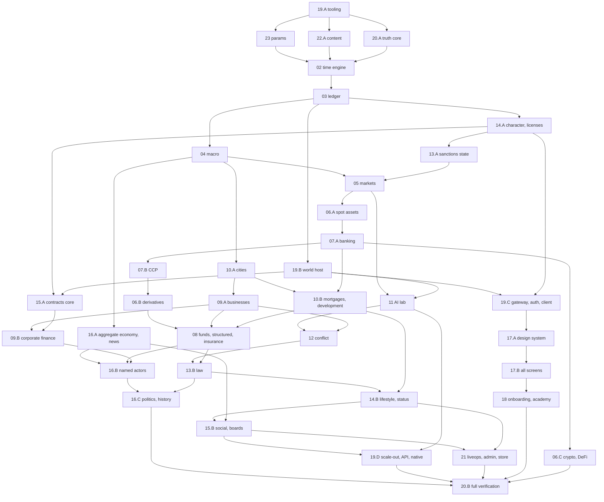

# 19 — Technical Architecture

Owner module: 19. Status: complete specification, 2026-10-18.
Depends on: 00 (conventions, §5 contracts), 02 (time engine, `step()`, RNG, determinism, snapshots), 03 (ledger API). Consumed by every module: each module's engine code runs inside the processes, partitions, protocol and persistence defined here.

This file specifies the monorepo and packages, the server processes, how the one persistent world is partitioned and ticked across machines, the data model (tables and stores), the client–server protocol (intents and deltas), the HTTP and expert APIs, persistence and recovery, scaling, security, observability, the client application, and (§12) the module dependency graph and build order that every builder follows.

Section map: §1 Purpose · §2 Entities · §3 Rules and formulas · §4 Player intents and protocol messages · §5 Engine events · §6 NPC behaviour (execution) · §7 Screens · §8 Edge cases · §9 Exploits and counters · §10 Acceptance tests · §11 Data model (stores and tables) · §12 Module dependency graph and build order.

Citation note: a plain number such as `02 §3` cites a module of this specification (02 = time engine). `vision/02-multiplayer §x` cites the original vision file `/vision/02-multiplayer-systems.md`, whose decisions this file keeps.

---

## §1 Purpose

1. **One authoritative world.** The server is the only truth (L1, L14). Clients send intents and render deltas. No client ever runs the authoritative simulation, holds the world seed, or computes its own fills, balances or roll outcomes.
2. **One logical world on many machines.** The world is a single deterministic fold over sealed intents. It is executed by many single-writer **partitions** under a bulk-synchronous tick (one barrier per pipeline phase of 00 §5.2). The result of a tick never depends on how many partitions exist or which machine runs them. That is what makes partitioning invisible (L1) and replay exact.
3. **Fairness by construction.** Every actor (human UI, expert API, player AI, delegated manager, NPC) enters the world through the same intent pipeline with the same validation and the same tick (00 §5.5). Ordering inside a tick never rewards network speed.
4. **Provable honesty.** Every input is stored; every output is reproducible; every random outcome a player is party to is verifiable after the fact (§3.12). The Truth Machine (20) runs on the same engine packages.
5. **Privacy by serialization.** Data the client must not know never leaves the partition that owns it (L11). The gateway only relays deltas already filtered for their recipient.
6. **A builder's map.** §12 orders every module of 00 §1 into a build sequence with gates, so the game can be built bottom-up without a question.

---

## §2 Entities

All types are TypeScript-style. `Money`, `Price`, `Qty` are `bigint` per 00 §3.1. `Tick` is `number` (safe integer; the world will not exceed 2^53 ticks). IDs follow 00 §3.2. Types in this section are the platform types; module-owned world entities live in their modules.

### §2.1 Deployment and partition entities

```ts
type PartitionKind =
  | "COORD"    // coordinator: clock, calendar, macro (04), sys accounts, global schedulers
  | "PLAYER"   // characters and the player-controlled entities homed with them
  | "MARKET"   // order books and batch auctions for an asset group (05, 06)
  | "CITY"     // cities, districts, properties, businesses, companies HQ'd there (09, 10)
  | "FINANCE"  // one per bloc: NPC banks, insurers, rating agencies, NPC funds, SPVs, gov, cbk, reg, crt, exc (04, 07, 08, 13)
  | "CCP"      // the Clearing House (07): single entity, own partition
  | "ACTOR";   // named NPC actors and dynasties (16)

interface PartitionDescriptor {
  partitionId: string;          // e.g. "PLAYER-07", "MARKET-EQ-FDL-1", "CITY-port-avalon"
  kind: PartitionKind;
  shardKey: string;             // what it owns: hash range, asset group id, city id, bloc code
  hostId: string;               // which process currently runs it (changes on rebalance; never affects results)
  epoch: number;                // incremented on every move/rebalance
  createdTick: Tick;
  status: "ACTIVE" | "DRAINING" | "MOVING" | "RECOVERING" | "HALTED";
}

interface PartitionMap {        // owned by COORD, versioned, part of every TickRecord
  version: number;
  effectiveTick: Tick;          // map changes take effect only at a snapshot boundary (§3.5.6)
  partitions: PartitionDescriptor[];
  homeRules: HomeRuleTable;     // §3.5.1
  playerHashRanges: { partitionId: string; from: number; toExclusive: number }[]; // over 0..2^32
}

interface HostDescriptor {
  hostId: string;
  role: "WORLD" | "GATEWAY" | "WEB" | "PROJECTOR" | "JOBS" | "HARNESS" | "ADMIN";
  cores: number; memoryGiB: number; region: string;
  engineVersion: string;        // semver of @tycoon/engine bundle loaded
  status: "UP" | "DRAINING" | "DOWN";
}
```

### §2.2 Tick and log entities

```ts
interface IntentBatch {          // the source of truth: one per tick (logical, not per partition)
  tick: Tick;
  sealedAtMs: number;            // wall clock of seal (informational, not used by the engine)
  engineVersion: string;
  paramsVersion: number;         // 23 registry version in force at this tick
  contentVersion: number;        // 22 catalog version in force
  partitionMapVersion: number;
  intents: SealedIntent[];       // canonical order (§3.4.4)
  systemInputs: SystemInput[];   // admin intents, param changes, ad grants, verified external receipts
  entropyCommitRef: string;      // which committed entropy root covers this tick (§3.12)
  batchHash: string;             // SHA-256 of the canonical encoding of all of the above
}

interface SealedIntent {
  intent: Intent;                // 00 §5.5 envelope, full shape in §2.3
  sealTick: Tick;
  receivedByGateway: string;     // gateway id, for audit only
  orderKey: string;              // hex of H(entropy_tick, intentId), assigned at P0 (§3.4.4)
}

interface SystemInput {
  kind: string;                  // "sys.*" or "adm.*" (§4.3)
  inputId: string;
  payload: unknown;
  approvals: string[];           // admin ids (21 two-person rule); empty for automatic system inputs
  signature: string;             // signed by the platform key of the submitting service
}

interface TickRecord {           // written by COORD at P14, after all partitions report
  tick: Tick;
  batchHash: string;
  partitionHashes: Record<string, string>;   // partitionId -> state hash after P13
  worldHash: string;             // Merkle root over partitionHashes sorted by partitionId
  logicalStateHash: string;      // partition-independent hash (§3.6.6)
  phaseTimingsMs: Record<string, number>;    // P0..P14 wall time (max across partitions)
  safeMode: boolean;             // true if this tick was replayed in safe mode (02)
  invariantResults: { checked: number; failed: string[] };   // ids from 20 §3.1
  commitWallMs: number;
}

interface EngineEventRow {       // 00 §5.6 envelope as stored
  tick: Tick; seq: number;       // seq is global within the tick, canonical (§3.6.4)
  kind: string; subjectIds: string[]; payload: unknown;
  visibility: "PUBLIC" | "PARTIES" | "PRIVATE" | "SEALED";
  partyIds: string[];            // for PARTIES / PRIVATE: who may see it
  originPartition: string;
}

interface Snapshot {
  partitionId: string;
  tick: Tick;                    // state AFTER this tick committed
  engineVersion: string;
  uri: string;                   // object storage key
  sizeBytes: number;
  stateHash: string;
  logicalEntityHashes: string;   // uri of the per-entity hash list (for partition-independent recovery)
  kind: "DAILY" | "CHAPTER" | "MOVE" | "MANUAL";
}
```

### §2.3 Intent envelope (owner 19; binding shape of 00 §5.5)

```ts
interface Intent {
  intentId: string;              // client-generated ULID, unique per actor forever
  actorId: string;               // chr_… or an operator acting under a Mandate (opr_…)
  onBehalfOf?: string;           // the principal entity (cmp_, fnd_, bnk_ …) when acting for an entity
  mandateId?: string;            // required when actorId is an operator
  kind: string;                  // namespaced: mkt.*, bank.*, fund.*, biz.*, prop.*, lab.*, ops.*, law.*, soc.*, life.*, acct.*
  payload: unknown;              // validated by the zod schema registered for `kind` (§3.9.2)
  clientTick: Tick;              // the tick the client believed was next
  tickPolicy: "NEXT" | "EXACT";  // EXACT: reject if it misses clientTick's seal (§3.4.2)
  nonce: number;                 // strictly increasing per (sessionKeyId)
  sessionKeyId: string;          // which registered signing key signed it
  channel: "UI" | "API" | "AI" | "MANAGER" | "SYSTEM";
  signature: string;             // Ed25519 over canonical encoding (§3.9.1), base64url
}

interface IntentResult {         // delivered on the actor's `me` channel at P14 of the tick
  intentId: string; tick: Tick;
  status: "ACCEPTED" | "REJECTED" | "PARTIAL" | "QUEUED_NEXT";
  rejectCode?: string;           // stable code from the owning module, e.g. "MKT_INSUFFICIENT_FUNDS"
  rejectParams?: Record<string, string>;   // for localized messages (17)
  effects?: string[];            // ids of fills, postings, entities created
}
```

### §2.4 Protocol entities (client ↔ gateway)

```ts
type ClientMsg =
  | { t: "hello"; protoVersion: number; sessionToken: string; lastSeen?: Record<string, number>; locale: string; device: DeviceInfo }
  | { t: "sub"; ch: string; params?: unknown }
  | { t: "unsub"; ch: string }
  | { t: "intent"; intent: Intent }
  | { t: "ping"; clientMs: number }
  | { t: "ack"; ch: string; seq: number }          // optional flow-control ack
  | { t: "req"; reqId: string; op: string; args: unknown };   // small read requests (§3.8.5)

type ServerMsg =
  | { t: "welcome"; serverTick: Tick; tickStartMs: number; tickMs: 5000; protoVersion: number; sessionId: string; features: string[] }
  | { t: "tick"; tick: Tick; phase: "SEALED" | "COMMITTED"; startMs: number; nextSealMs: number; worldStatus: WorldStatus }
  | { t: "snap"; ch: string; seq: number; tick: Tick; body: unknown }   // full channel state
  | { t: "delta"; ch: string; seq: number; tick: Tick; ops: DeltaOp[] }
  | { t: "intentAck"; intentId: string; sealTick: Tick | null; status: "SEALED" | "DUPLICATE" | "RATE_LIMITED" | "BAD_SIGNATURE" | "BAD_SCHEMA" | "LATE_EXACT" | "WORLD_HALTED" }
  | { t: "res"; reqId: string; ok: boolean; body?: unknown; err?: string }
  | { t: "pong"; clientMs: number; serverMs: number }
  | { t: "notice"; code: string; params?: Record<string, string> }   // maintenance, forced reload, version skew
  | { t: "bye"; code: string };

type DeltaOp =
  | { op: "set"; path: string; v: unknown }      // path: JSON-pointer-like, e.g. "/positions/ast_EQ_HALC/qty"
  | { op: "del"; path: string }
  | { op: "ins"; path: string; idx: number; v: unknown }   // list insert
  | { op: "trim"; path: string; keepLast: number };        // ring buffers (fills, news)

type WorldStatus = "RUNNING" | "HALTED_EXCHANGE" | "MAINTENANCE" | "CATCHING_UP";

interface DeviceInfo { platform: "web" | "pwa" | "ios" | "android"; appVersion: string; tz: string }
```

### §2.5 Account, session and key entities (platform side, not engine state)

```ts
interface Account {
  accountId: string;             // acc_…
  kind: "GUEST" | "FULL";
  email?: string;                // stored in the PII schema only (§3.14.2)
  emailVerified: boolean;
  createdAt: Date;
  ageBand: "16_17" | "18_PLUS";  // from the age gate (21 §3.9); under 16 cannot create an account
  country: string;               // ISO-3166 alpha-2, rules in 15
  countryChangedAt?: Date;
  timezone: string;              // IANA; used for local-day rules (ads, quiet hours)
  timezoneChangedAt?: Date;
  characterId?: string;          // chr_… exactly one once created (00 §5.9)
  twoFactor: { totp: boolean; passkeys: number };
  status: "ACTIVE" | "SUSPENDED" | "BANNED" | "DELETION_PENDING" | "ANONYMIZED";
  flags: string[];               // e.g. "REQUIRES_2FA", "API_ENABLED", "STAFF"
}

interface AuthSession {
  sessionId: string; accountId: string;
  createdAt: Date; lastSeenAt: Date; expiresAt: Date;
  deviceId: string; ipHash: string; userAgentHash: string;
  strength: "GUEST" | "PASSWORD_LESS" | "MFA";
  revokedAt?: Date;
}

interface SigningKey {           // per session, used for intent signatures (§3.9.1)
  sessionKeyId: string; sessionId: string; accountId: string;
  alg: "Ed25519" | "ES256";
  publicKey: string;             // base64url
  createdAt: Date; revokedAt?: Date;
  lastNonce: number;             // highest nonce accepted
}

interface ApiKey {               // expert API (§3.10.3)
  apiKeyId: string; accountId: string; label: string;
  scopes: ("read" | "trade" | "manage")[];   // "manage" covers non-market intents
  publicKey: string;             // the key pair is generated client side; server stores public key only
  createdAt: Date; lastUsedAt?: Date; revokedAt?: Date;
  ipAllowlist?: string[];
}

interface Presence {             // computed by gateways, consumed by engine via SystemInput (§3.8.7)
  characterId: string; present: boolean; sinceTick: Tick;
}
```

### §2.6 Engine package contract (shape assumed from 02)

19 runs the engine through this interface. 02 owns its internals; 19 owns how it is hosted.

```ts
interface PartitionEngine {
  load(snapshot: Uint8Array | null, ctx: PartitionContext): void;    // null = genesis for this shard
  runPhase(phase: PhaseId, tick: Tick, inbox: PhaseMessage[]): PhaseOutput;
  commit(tick: Tick): { stateHash: string; entityHashes: Map<string, string> };
  rollback(tick: Tick): void;                                       // undo all writes of `tick` (§3.6.5)
  serialize(): Uint8Array;                                          // snapshot body
  queryView(viewId: string, args: unknown, viewer: ViewerContext): unknown;  // read models for `req` (§3.8.5)
}

type PhaseId = "P0"|"P1"|"P2"|"P3"|"P4"|"P5"|"P6"|"P7"|"P8"|"P9"|"P10"|"P11"|"P12"|"P13"|"P14";

interface PhaseMessage {         // cross-partition message delivered between phases
  fromEntity: string; toEntity: string;    // canonical keys, never partition ids
  phase: PhaseId; tick: Tick;
  kind: string; body: unknown;
  canonicalKey: string;          // sort key: `${toEntity}|${kind}|${fromEntity}|${localSeq}`
}

interface PhaseOutput {
  outbox: PhaseMessage[];        // routed by the bus to the partitions homing each toEntity
  events: EngineEventRow[];      // with provisional seq; COORD assigns global canonical seq at P14
  postings: QueuedPosting[];     // queued for P13 (03)
  deltas: RecipientDelta[];      // only in P14
  metrics: Record<string, number>;
}

interface RecipientDelta { recipient: string /* chr id or public channel */; ch: string; ops: DeltaOp[] }
```

---

## §3 Rules and formulas

### §3.1 Monorepo and packages

**Rule 3.1.1 (layout).** One repository, pnpm workspaces, Turborepo task graph. Exact layout:

```
tycoon/
  apps/
    web/            Next.js 16 App Router: game client, marketing, account, store web checkout, REST route handlers
    gateway/        WebSocket gateway service (Node)
    world/          world host: coordinator + partitions (Node, worker_threads)
    projector/      event-stream consumers → read models (Node)
    jobs/           scheduled and batch jobs (Node, BullMQ workers)
    admin/          internal admin console (Next.js 16, separate deployment, staff SSO only) (21)
    harness/        Truth Machine runners: headless worlds, bot swarm, balance and load (20)
    native/         Capacitor shell for iOS and Android
  packages/
    engine/         the deterministic world: every module's engine code, organised by module number
      core/         02: clock, pipeline, rng, detmath, store, snapshot codec
      ledger/       03
      macro/        04
      markets/      05
      assets/       06 (sub-folders equity, etf, bond, fx, commodity, crypto, defi, derivatives, collectibles)
      banking/      07
      funds/        08
      business/     09
      realestate/   10
      lab/          11 (includes the strategy-graph VM, §3.11)
      conflict/     12
      law/          13
      progression/  14
      social/       15 (engine side: boards, contracts, alliances, filings)
      world/        16
      index.ts      PartitionEngine factory (§2.6)
    protocol/       zod schemas: Intent kinds, ClientMsg/ServerMsg, channel bodies, error codes; canonical encoder
    content/        22 catalogs as typed data (JSON + generated TS types), versioned
    params/         23 registry: typed defaults, ranges, units, owner; loader and change validator
    platform/       non-deterministic shared server code: db clients, bus, auth helpers, telemetry
    ui/             design-system components and tokens (17)
    i18n/           message catalogs en, fr and the `t()` helper (L8)
    sdk/            public TypeScript SDK for the expert API (§3.10.3) and the bot SDK used by 20
    config/         tsconfig, eslint (including the determinism rules §3.6.2), tailwind preset, vitest preset
  infra/            infrastructure as code, container images, runbooks
  tests/            cross-package e2e (Playwright), protocol contract tests
  docs/             generated API reference, ADRs
```

**Rule 3.1.2 (dependency direction).** Allowed import edges, enforced by an eslint boundaries rule and checked in CI:

| Package | May import | Must never import |
|---|---|---|
| `engine/*` | `engine/core`, lower-numbered or explicitly listed engine modules (per §12 graph), `params`, `content`, `protocol` (types only) | `platform`, `ui`, any Node built-in except none (engine is pure), any network, clock, filesystem, `Math.random`, `Date` |
| `protocol` | nothing but zod | everything else |
| `platform` | `protocol`, `params` | `engine` internals (only `engine/index.ts`) |
| `apps/world` | `engine`, `platform`, `protocol`, `params`, `content` | `ui` |
| `apps/web` | `protocol`, `ui`, `i18n`, `sdk`, `engine` (only for sandbox mode §3.17, loaded in a Web Worker) | `platform` server secrets |
| `apps/admin` | `protocol`, `ui`, `platform` (admin APIs) | `engine` write paths |
| commerce code (`apps/web/store`, 21) | `platform` | `engine` (structural guarantee of L7, §9 E19) |

**Rule 3.1.3 (engine modules inside the engine package).** Each module folder exports: `schema.ts` (entity types), `rules/*.ts` (pure functions), `intents.ts` (validators and handlers keyed by intent kind), `events.ts` (event kinds and payload schemas), `phases.ts` (which pipeline phases it runs in and the handler for each), `invariants.ts` (checks registered with 20), `views.ts` (read views), `params.ts` (its PARAM keys, mirrored in 23). A module may only write its own entities (00 §5.2) and queue postings; the store API (§3.6.3) enforces this by entity-kind ownership tables generated from `schema.ts`.

**Rule 3.1.4 (toolchain, pinned).** Exact versions are pinned in the lockfile at the start of the build and only upgraded at chapter boundaries after a full G2 gate (20 §3.9). DEFAULT stack (Mathis may override):

| Concern | Choice |
|---|---|
| Language | TypeScript, `strict`, `noUncheckedIndexedAccess`, `exactOptionalPropertyTypes` |
| Server runtime | Node.js 24 LTS, one pinned minor across all world hosts (determinism, §3.6.1) |
| Web framework | Next.js 16.4 App Router with React 19.3 (versions already chosen in the repo). Before writing any Next.js code the builder reads the guides in `node_modules/next/dist/docs/`; Next 16 conventions apply (for example `proxy.ts` instead of `middleware.ts`, async request APIs such as `await params` and `await cookies()`, Turbopack by default) |
| Styling | Tailwind CSS 4 with tokens from 17 as CSS variables |
| Client state | Zustand 5 stores fed by a Web Worker that decodes deltas; TanStack Query for HTTP reads |
| Charts | TradingView Lightweight Charts 5 (Apache-2.0; attribution link shown in the chart footer as the licence requires) |
| City renderer | three.js, orthographic instanced rendering (resolves 06-cities §15 renderer question per LC11) |
| Validation | zod 4 schemas in `packages/protocol`, shared by client and server |
| i18n | next-intl with ICU messages, keys from day one (L8) |
| WebSocket server | uWebSockets.js in the gateway (≥ 10k sockets per instance) |
| Message bus | NATS 2.x with JetStream (cross-partition phase messages, intent intake, event stream) |
| Relational DB | PostgreSQL 18 with Drizzle ORM; logical replication to a hot standby |
| Cache, presence, boards | Valkey 8 (Redis-compatible): sorted sets for boards, presence, rate-limit counters |
| Analytics store | ClickHouse: candles, postings archive, telemetry, harness results |
| Object storage | S3-compatible (snapshots, intent batch archives, city chunks, share images), with object lock for audit logs |
| Jobs | BullMQ on Valkey |
| Auth | Better Auth: passkeys, email magic link, Google, Apple, Discord, TOTP |
| Tests | Vitest (unit, property with fast-check), Playwright (e2e), k6 plus the harness load driver (load) |
| Observability | OpenTelemetry → Prometheus, Grafana, Loki, Tempo; Sentry for client and server errors |
| Native | Capacitor (current stable major, pinned), iOS and Android |
| PWA | Web App Manifest (Next 16 metadata route), service worker built with Serwist |
| CDN and edge protection | a CDN with WAF and DDoS protection in front of web, gateway and city chunk files |

### §3.2 Server processes

**Rule 3.2.1 (process roles).**

| Process | Count at launch | Count at architecture target | State | Responsibilities |
|---|---|---|---|---|
| `web` | 2 | 6–10 | stateless | Next.js pages, HTTP API (§3.10), auth, web checkout, sandbox bundle |
| `gateway` | 2 | 12 (10k sockets each, 100k CCU + headroom) | soft state (subscriptions, presence) | WebSocket termination, session check, signature and schema check, rate limits, intent forwarding, delta fan-out |
| `world` | 1 host (all partitions in one process, worker threads) + 1 warm standby | ~40 hosts | authoritative in-memory partition state | coordinator and partitions |
| `projector` | 2 | 8 | derived | consume event stream → Postgres / Valkey / ClickHouse read models |
| `jobs` | 1 | 4 | none | emails, push, recap rendering, estate auctions trigger inputs, archive compaction, data export/deletion |
| `admin` | 1 | 2 | stateless | admin console (21), staff-only network |
| `harness` | on demand | on demand | ephemeral | 20's runs against staging worlds |
| PostgreSQL | 1 primary + 1 standby | primary + 2 standbys + read replicas | durable | accounts, social, commerce, read models |
| NATS JetStream | 3-node cluster | 5-node cluster | durable streams | bus |
| Valkey | 1 + replica | 3 shards + replicas | cache | boards, presence, rate limits, BullMQ |
| ClickHouse | 1 | 3-node cluster | durable | analytics |

**Rule 3.2.2 (no tick logic in web).** Next.js never runs world logic and never holds a socket to clients for game traffic (serverless-style request lifetimes cannot hold a 5 s loop). It talks to the world only through (a) the bus (submitting `SystemInput`s on behalf of authenticated platform flows, e.g. a verified ad receipt) and (b) read models.

**Rule 3.2.3 (coordinator).** Exactly one active coordinator (`COORD` partition plus the tick driver) exists. A warm standby follows the bus and the tick records; it takes over when the active one misses `PARAM.coord_failover_missed_heartbeats = 3` heartbeats of `PARAM.coord_heartbeat_ms = 500` ms, using a lease in PostgreSQL (`coord_lease` table, §11) with fencing token = lease epoch. Only the holder of the current fencing token can seal ticks; partitions reject seal messages carrying an older token.

### §3.3 The tick driver: phases across partitions

**Rule 3.3.1 (bulk-synchronous phases).** Each tick runs the 15 phases of 00 §5.2 in order. For every phase `Pk`:
1. COORD broadcasts `PhaseStart(tick, Pk, fencingToken)` to all partitions.
2. Each partition runs `runPhase(Pk, tick, inbox_k)` where `inbox_k` is every `PhaseMessage` addressed to an entity it homes and produced in phases `< k` of this tick (or in P13/P14 of the previous tick for next-tick consequences), sorted by `canonicalKey`.
3. Each partition publishes its `outbox` to the bus subject `ph.<tick>.<k>.<destPartition>` and then `PhaseDone(tick, Pk, partitionId, outboxCount, digest)`.
4. When all `PhaseDone` messages arrive, COORD starts `P(k+1)`.
A phase in which a partition kind has no work (for example CITY in P6) still sends `PhaseDone` immediately. Phases are barriers; no partition starts `P(k+1)` before COORD says so.

**Rule 3.3.2 (phase ownership by partition kind).**

| Phase | COORD | PLAYER | MARKET | CITY | FINANCE | CCP | ACTOR |
|---|---|---|---|---|---|---|---|
| P0 ingest | seals batch, assigns order keys, splits by home | receives its intents | – | – | – | – | – |
| P1 validate | validates sys/adm inputs | validates player intents, places holds (§3.5.3) | validates order shape vs instrument rules | validates prop/biz intents routed to it | validates bank/fund/ins intents for NPC-hosted products | margin pre-check | – |
| P2 calendar | boundary hooks; macro step at day close (04) | daily accrual hooks | session phase changes (05) | – | rate resets | – | – |
| P3 world | global world scheduler, news (16) | – | – | city events | – | – | actor decisions (16) |
| P4 npc | – | – | NPC liquidity quotes (05) | NPC firms | NPC banks/funds orders | – | NPC actor orders |
| P5 ai | – | player AIs, defense scans scheduled (11, 12) | – | – | – | – | – |
| P6 match | – | – | batch auctions; RFQ/OTC fills (05, 06) | property and business exchange settlement matching | primary issuance auctions (04, 08) | – | – |
| P7 clear | – | margin and maintenance checks on player accounts; liquidation intents queued for tick N+1 | – | – | margin on NPC institutions' accounts | novation, initial and variation margin, default waterfall (07) | – |
| P8 finance | – | player-owned banks, funds, insurers, SPVs homed with their owner (07, 08) | – | – | NPC banks, interbank, repo, fund NAV, insurance, SPV cash flows (07, 08) | default-fund accounting | NPC actor portfolios rebalanced (16) |
| P9 real | – | – | – | businesses, properties, demand pools, supply chains, development (09, 10), hourly stagger | – | – | – |
| P10 conflict | – | ops resolution, hidden-session accrual on victims homed here, scans, detection (12) | – | city-asset ops targets (12) | – | – | NPC actor ops (16, 12) |
| P11 law | – | sanctions and Held applied to player accounts | surveillance features computed for the tick (05 → 13) | permits, zoning violations (10, 13) | investigations, courts, regulators of the bloc (13) | – | – |
| P12 social | world money-supply index, NWI denominators (03, 15) | contracts engine, alliances, reputation, prestige, NW and NWI per character (14, 15) | – | – | – | – | dynasty succession (16) |
| P13 ledger | sys accounts, stabilizer postings (03, 04) | commit own postings and inter-partition clearing legs | fees and fill postings for venue accounts | business and property postings | institution postings | CCP postings | actor postings |
| P14 emit | assigns global event seq, writes TickRecord, publishes `tick` | recipient deltas for its characters | public market deltas | public city deltas | public institution deltas | public CCP risk deltas | public actor news inputs |

**Rule 3.3.3 (phase time budget).** A tick has `TICK_REAL_SECONDS = 5` s of wall time. Default per-phase wall budgets (maximum across partitions, including barrier overhead):

| Phase | Budget ms | Phase | Budget ms |
|---|---|---|---|
| P0 | 100 | P8 | 300 |
| P1 | 250 | P9 | 300 |
| P2 | 50 | P10 | 150 |
| P3 | 200 | P11 | 100 |
| P4 | 300 | P12 | 150 |
| P5 | 900 | P13 | 250 |
| P6 | 600 | P14 | 300 |
| P7 | 300 | **Total** | **4,250 (slack 750)** |

Budgets are `PARAM.phase_budget_ms_P0 … PARAM.phase_budget_ms_P14` (values above). Intents for tick `N+1` are collected by gateways while tick `N` runs, so intake never consumes phase budget.

**Rule 3.3.4 (overrun: wait, never skip, never commit partially).**
1. If a phase exceeds its budget, nothing is cut. The tick simply finishes late; the next seal happens at `max(scheduledSeal(N+1), commit(N) + PARAM.min_inter_tick_gap_ms = 200)`. World time slows; it never jumps.
2. COORD measures `lateness = commitWallMs(N) − scheduledCommit(N)`. If lateness > 0 on `PARAM.catchup_trigger_ticks = 3` consecutive ticks, `WorldStatus` becomes `CATCHING_UP` (shown to clients as a small clock badge, 17).
3. While `CATCHING_UP`, the inter-tick gap shrinks to `PARAM.catchup_gap_ms = 200` until the world is back on schedule or `PARAM.catchup_max_ticks = 120` ticks pass; after that the schedule is re-based (the real-time anchor of the calendar moves forward by the accumulated delay; the game calendar itself is never skipped). Re-basing is recorded as a `sys.clock_rebased` event.
4. **Load levers are inputs, never side effects.** If COORD decides to reduce load (for example the AI-phase DU scale-down of 11), it submits a `SystemInput sys.load_scale { scale }` into the **next** batch. The engine reads it like any other input, so replay reproduces it exactly. A partition never changes its own behaviour based on wall-clock time or measured load.
5. A phase that has not reported `PhaseDone` after `PARAM.phase_hard_timeout_ms = 15000` is treated as a partition failure (§3.7.4).

**Rule 3.3.5 (next-tick consequences).** A consequence discovered in phase `k` that would require an earlier phase to rerun (for example a margin call found in P7 that becomes a liquidation order, or a hack resolved in P10 opening a session) is emitted as a `PhaseMessage` addressed to tick `N+1`, phase of its owner. It is stored with the tick's outputs and delivered in that phase's inbox on the next tick. This is the only way a cascade propagates, and it keeps every cascade ordered and replayable (vision/02-multiplayer §3.2 rule "consequences land next tick").

### §3.4 Intake, sealing and canonical order

**Rule 3.4.1 (intake path).**
1. Client sends `{t:"intent"}` to its gateway.
2. Gateway checks, in this order, and answers with `intentAck` on the first failure: frame size ≤ `PARAM.max_intent_bytes = 16384`; session valid and bound to the socket; `actorId` is the session's character or an operator the character owns (from the session's cached actor list, refreshed every tick from the `me` channel); `sessionKeyId` belongs to the session and is not revoked; signature valid (§3.9.1); nonce valid (§3.4.3); `kind` known in the protocol registry; payload passes the zod schema (§3.9.2); per-actor rate limit (§3.8.6); world not `MAINTENANCE`.
3. Gateway publishes the intent to the bus stream `INTAKE` with subject `intake.<partitionOfActor>` (from the cached `PartitionMap`) and returns `intentAck { status: "SEALED", sealTick }` only after the coordinator's sealing reply (step 5). Before the seal reply, the client shows "sending".
4. Gateways never reorder, never drop after ack, and never inspect payload semantics beyond schema.
5. COORD reads `INTAKE` continuously. At the seal instant of tick `N`, every intent with arrival time ≤ `sealInstant(N) − PARAM.gateway_seal_margin_ms = 150` is assigned `sealTick = N`; later arrivals get `N+1`. COORD replies per gateway with the list of `(intentId, sealTick)`.

**Rule 3.4.2 (tick policy).** `tickPolicy = "NEXT"` (default for UI): the intent goes into the first tick it can make. `tickPolicy = "EXACT"`: if the assigned `sealTick ≠ clientTick`, the intent is rejected with `LATE_EXACT` and never enters a batch (used by the expert API and by algos that must not slip a tick). `clientTick` older than `currentTick − PARAM.intent_max_age_ticks` (DEFAULT 3, owned by 02 §3.12) is rejected with `REJECT_STALE` under both policies (02 §3.12; ruling in 24).

**Rule 3.4.3 (replay protection and dedupe).**
1. `nonce` must be greater than `SigningKey.lastNonce − PARAM.nonce_window = 64` and not already seen in that window (a 64-bit sliding bitmap per key, held by the gateway in Valkey with the key's lastNonce). Accepted nonces advance `lastNonce` to the maximum.
2. `intentId` is a ULID; its timestamp part must be within `PARAM.intent_clock_skew_ms = 600000` (10 real minutes) of gateway time.
3. COORD keeps every `(actorId, intentId)` sealed in the last `PARAM.intent_dedupe_window_ticks = 17280` ticks (one real day) in an exact set; a duplicate gets `intentAck DUPLICATE` with the original `sealTick`. Because of rule 2, an older duplicate cannot exist.
4. Resubmitting the same `intentId` after a disconnect is therefore always safe: the client learns the original seal tick and never double-acts.

**Rule 3.4.4 (canonical order within a batch).** At P0, COORD computes for every sealed intent `orderKey = hex(SHA-256(entropy(N) ‖ intentId))`, where `entropy(N)` is the secret tick entropy of §3.12. The batch is sorted by `(orderKey, intentId)`. Systems that need an order among intents (queue priority on ties, pro-rata rounding, first-come allocations such as a limited IPO book) use this order. Because `entropy(N)` is unknown to everyone until reveal, arrival time and network speed give no advantage (§1.3), and no one can grind an `intentId` toward a favourable position. System inputs are ordered before player intents, sorted by `inputId`.

**Rule 3.4.5 (batch durability before execution).** COORD writes the sealed `IntentBatch` to the replicated `BATCH` stream (replication factor `PARAM.bus_replicas = 3`, acknowledged by a quorum) **before** sending `PhaseStart(N, P1)`. A batch that is not durable is never executed. The batch is mirrored to object storage by the `jobs` archiver within `PARAM.batch_archive_lag_ticks = 60`.

**Rule 3.4.6 (split by home).** After sealing, COORD splits the batch into per-partition inboxes for P1 by the home rule of the intent's `onBehalfOf ?? actorId` (§3.5.1). The full batch is the source of truth; the split is derived and reproducible.

### §3.5 Partitioning: homes, routing, holds, moves

**Rule 3.5.1 (home rules).** Every entity has exactly one home partition, computed by a pure function of the entity and the `PartitionMap`:

| Entity kind (00 §5.3) | Home |
|---|---|
| `chr` | `PLAYER` partition whose hash range contains `u32(SHA-256(chrId))` |
| `cmp`, `fnd`, `bnk`, `ins`, `spv`, `ali` controlled by a character | the controlling character's PLAYER partition (control = owner chain of 03; for an alliance treasury, the founder at creation; does not move when control changes except at the next snapshot boundary, §3.5.5) |
| `cmp` listed or controlled by an NPC | CITY partition of its HQ city |
| `biz`, `prop` | CITY partition of the city they are located in (wherever their owner is homed) |
| orders and the book of an asset | MARKET partition of the asset's group (§3.13.2) |
| `gov`, `cbk`, `reg`, `crt`, `exc`, `rat`, NPC `bnk`/`ins`/`fnd`, `frm` | FINANCE partition of their bloc |
| `hh` | CITY partition of its city |
| `ccp` | CCP |
| `npc` named actors and dynasties | ACTOR partition by `u32(hash(npcId)) mod nActorPartitions` |
| `row`, `sys` accounts, macro state, calendar | COORD |
| Isla Serena (no bloc) | its CITY partition; its institutions on FINANCE-FDL |
| hidden session (12) | the **victim** model's home (vision/02-multiplayer §4.2) |
| contract (15) between parties on different partitions | the home of the party with the lowest entity id (the "anchor") |

Every rule is deterministic, so any partition can compute where to send a message without asking anyone.

**Rule 3.5.2 (routing).** Partitions address messages to entities (`toEntity`), never to partitions. The bus layer resolves `toEntity → partitionId` from the current `PartitionMap`. A partition receiving a message for an entity it no longer homes (only possible across a map change) rejects the whole tick as a platform fault; map changes happen only at snapshot boundaries, so this signals a bug.

**Rule 3.5.3 (holds: money crosses partitions only by hold → settle).**
1. At P1, the actor's home partition validates the intent and places a **hold** on the resources it needs (cash for a buy at its limit price plus maximum fees, asset quantity for a sell, collateral for a margin product, escrow for a contract). A hold is a ledger-side reservation in the owning partition: `available = balance − Σ holds`. Postings never touch held amounts except the settlement of that hold.
2. The intent travels as a `PhaseMessage` with the hold id to the executing partition (MARKET for orders, CITY for property, FINANCE for an NPC bank product, the anchor for a contract).
3. The executing partition decides (fill, partial fill, award, reject) in its phase and returns a result message to the owning partition.
4. At P13 the owning partition posts the settlement against the hold and releases the remainder. A hold that receives no result by P13 of its tick stays open into the next tick only for resting orders (for which the hold lives as long as the order); for everything else it is released and the intent result is `REJECTED` with `PLATFORM_NO_RESULT` (a bug signal that the Truth Machine counts).
5. **Inter-partition clearing.** When the two legs of a posting belong to accounts on different partitions, each partition posts its own leg against its **inter-partition clearing account** `sys:ipc:<thisPartition>:<otherPartition>`. Invariant (20): for every pair `(A,B)` and every currency, `balance(ipc:A:B) + balance(ipc:B:A) = 0` after every P13. The ledger module (03) treats `ipc` accounts as `sys` TRANSFER accounts; they never appear in any player's net worth.

**Rule 3.5.4 (atomic multi-party settlement).** A P2P swap, an escrowed contract, an M&A closing or a syndicated loan touches several partitions. Procedure:
1. P1: each party's home places its hold and sends `HoldPlaced` to the anchor.
2. Anchor, in its owning phase (P12 for contracts, P6 for trades, P8 for finance), checks that every hold arrived and is sufficient. If yes it sends `Settle(holdId, legs)` to all; if not, `Abort(holdId)` to all.
3. P13: each partition posts or releases. Because phases are barriers and every message of a phase arrives before the next phase starts, there is no "in doubt" state: either all legs post in the same tick or none do. A partition crash aborts the whole tick for every partition (§3.7.4), so partial settlement is impossible.

**Rule 3.5.5 (rebalancing and moves).** The world moves an entity group (a character with everything homed with it, or a city, or an asset group) between partitions only at a **snapshot boundary** (end of day, `t = 719` commit):
1. COORD publishes the new `PartitionMap` with `effectiveTick = boundaryTick + 1` in the batch of the boundary tick as `SystemInput sys.partition_map`.
2. After P14 of the boundary tick, the source partition serializes the moving entities (`MOVE` snapshot), the target loads them, and both report entity hashes; COORD checks that the logical hashes match.
3. The next tick runs under the new map. A move that fails the hash check is cancelled (the old map stays) and an alert fires.
4. Moves never change any outcome: rule 3.6.6's logical state hash is identical with and without the move.

**Rule 3.5.6 (map change policy).** `PartitionMap` changes only by `sys.partition_map` at a snapshot boundary. Triggers (evaluated by COORD on platform metrics, never inside the engine): a PLAYER partition above `PARAM.partition_target_agents = 25000` agents or above 80% of its measured phase budget for `PARAM.rebalance_trigger_days = 3` consecutive game days is split (its hash range halved); two adjacent partitions below 30% each are merged; a host above `PARAM.host_cpu_target = 0.7` average gets partitions moved off. At most `PARAM.max_moves_per_boundary = 4` partition moves per boundary.

**Rule 3.5.7 (hosts versus partitions).** A host runs any number of partitions as worker threads. Which host runs a partition never affects results; host placement can change at any snapshot boundary with a `MOVE` snapshot and is not part of `PartitionMap.homeRules` (only `hostId`, which is excluded from all hashes).

### §3.6 Determinism

**Rule 3.6.1 (runtime pinning).** Every world host and every harness runner uses the same Node.js minor version and the same `@tycoon/engine` bundle hash for a given `engineVersion`. The world host refuses to load a partition when the bundle hash or Node version differs from the value recorded in the coordinator's active configuration. The client sandbox (§3.17.4) is not authoritative and may differ.

**Rule 3.6.2 (forbidden in engine code).** Enforced by the `@tycoon/eslint-config/determinism` rule set on `packages/engine/**`, failing CI:
- `Math.random`, `Date`, `performance`, `setTimeout`, `setInterval`, `queueMicrotask`, `process`, `globalThis` access, `crypto` (except the vendored pure SHA-256 and Ed25519 verify in `engine/core/crypto`), `Intl`, `toLocaleString`, `localeCompare`.
- `Math.sin/cos/tan/exp/log/pow/sqrt/cbrt/hypot/atan2` and friends directly: use `detmath` (02), which is implemented with correctly rounded or fixed-algorithm versions identical on every platform. Only `+ − × ÷`, `Math.abs/min/max/floor/ceil/round/trunc/sign/fround` and `Math.imul` are allowed raw.
- `Array.prototype.sort` without an explicit comparator; comparators that can return inconsistent results (lint checks for `localeCompare` and subtraction of possibly NaN values).
- `for…in`, iteration over `Object.keys` of objects used as maps (use the engine `SortedMap`), `WeakMap`, `WeakRef`, `FinalizationRegistry`, `Symbol()` as keys in state.
- `async`/`await`, Promises, generators that yield across phases.
- `JSON.stringify` for anything hashed or serialized: use the canonical encoder of `packages/protocol`.
- Summation of floats over collections must iterate in canonical order (sorted by entity id); the store API only exposes collections in that order.

**Rule 3.6.3 (store API).** Engine state lives in a typed in-memory store per partition. `store.get(kind, id)`, `store.iter(kind)` (sorted by id), `store.put(entity)`, `store.del(id)`. Each write records an undo entry for the open tick. `put` and `del` check the ownership table: the calling module (bound when the phase handler is invoked) must own the entity kind; otherwise it throws `OwnershipViolation`, which aborts the tick (safe mode, §3.6.5). The ownership table is generated at build time from each module's `schema.ts`.

**Rule 3.6.4 (event sequence numbers).** Each partition assigns provisional `seq` within its outputs. At P14, COORD orders all events of the tick by `(phase, originEntityId, provisionalSeq)` and assigns the global `seq` 0…n−1. Consumers rely only on `(tick, seq)`.

**Rule 3.6.5 (rollback and safe mode).** If any invariant fails in P13 on any partition, or any partition throws, COORD broadcasts `TickAbort(N)`. Every partition calls `rollback(N)` (undo log), and the tick is re-executed in **safe mode** (02): the same batch, with the failing module's optional behaviours disabled as 02 specifies, and with extra invariant checks. If the safe-mode run also fails, COORD halts the world (`WorldStatus = MAINTENANCE`, diegetic "Trading halted by the Exchange", 17), pages on-call, and files a reproducible case (batch hash, snapshot ids, partition messages) for 20. No tick is ever committed with a failed invariant.

**Rule 3.6.6 (partition-independent hash).** Every entity has `entityHash = SHA-256(canonicalEncode(entity))`, updated when written. `logicalStateHash = Σ_entities u256(SHA-256(entityId ‖ entityHash)) mod 2^256`, maintained incrementally (subtract old term, add new). Because addition is commutative, the value does not depend on which partition holds which entity. `TickRecord.logicalStateHash` is the sum over partitions. Tests (§10) run the same batches with 1, 3 and 17 partitions and require identical logical hashes at every tick.

**Rule 3.6.7 (golden replay in CI).** Every engine change runs the regression seeds of 20 (headless) and, before deployment, replays the last `PARAM.deploy_replay_game_days = 1` game day of production batches from the latest snapshot on both the old and new engine. Divergence is allowed only for event kinds and entities listed in the change's `intendedDivergence` manifest; anything else blocks the deploy.

### §3.7 Persistence, recovery and retention

**Rule 3.7.1 (what is the source of truth).** In order of authority: (1) sealed `IntentBatch` stream plus the entropy secrets (§3.12), (2) `TickRecord`s, (3) snapshots, (4) engine events, (5) read models. (1) and the genesis configuration alone are sufficient to rebuild the world; (2) and (3) make it fast; (4) and (5) are derived and can be rebuilt.

**Rule 3.7.2 (commit order of a tick).**
1. `IntentBatch(N)` durable on the bus (rule 3.4.5).
2. P1–P13 run; partitions hold the committed tick in memory and append their inbound `PhaseMessage`s and outputs to the `PHASE` stream (retention ≥ two snapshot intervals).
3. Partitions report `stateHash` and entity-hash deltas; COORD writes `TickRecord(N)` in PostgreSQL inside one transaction together with the global event rows' index; the event bodies go to the `EVENTS` stream.
4. Only after the `TickRecord` transaction commits does COORD publish `tick COMMITTED` and do partitions release deltas to gateways (P14). So a client never sees a state the server could lose.

RPO for committed ticks is zero. A tick whose `TickRecord` was not written is not committed, and after a failure it is re-executed from its durable batch, producing identical results.

**Rule 3.7.3 (snapshots).** Every partition writes a `DAILY` snapshot after the day-close tick (`t = 719`), aligned on the same tick world-wide, to object storage (zstd-compressed canonical encoding, with the per-entity hash list). Also `CHAPTER` at every chapter boundary, `MOVE` on rebalance, `MANUAL` by admin. Writing is asynchronous (copy-on-write fork of the store via structural sharing) so it does not stall the next tick; the snapshot must finish within `PARAM.snapshot_max_ticks = 60`, or an alert fires.

**Rule 3.7.4 (partition failure and recovery).**
1. A partition is failed when its host misses `PARAM.partition_failover_missed_heartbeats = 3` heartbeats of 500 ms, or a phase hits the hard timeout (rule 3.3.4).
2. COORD aborts the open tick world-wide (`TickAbort`), marks the partition `RECOVERING`, and sets `WorldStatus = CATCHING_UP`.
3. A standby host loads the latest snapshot of that partition and replays every committed tick since, using the recorded inbound messages from `PHASE` (so it does not need other partitions to re-run). For each replayed tick it checks its `stateHash` against the `TickRecord`. A mismatch halts the world (rule 3.6.5 escalation).
4. When caught up, it rejoins and the aborted tick re-runs for everyone. Target recovery time `PARAM.partition_rto_s = 60` (the rest of the world waits at the tick boundary rather than running ahead).
5. If `PHASE` messages are missing (bus loss beyond replication), COORD recovers **the whole world** from the last common snapshot by re-running all partitions from batches. Target `PARAM.world_rto_s = 900`.

**Rule 3.7.5 (coordinator failover).** As rule 3.2.3. The new coordinator reads the last `TickRecord`, re-reads `INTAKE` from the last sealed position, re-seals the next tick only after confirming the previous lease epoch can no longer write (fencing). Intents that the old coordinator had acked as sealed for a tick that never committed keep their seal tick: the new coordinator re-uses the durable batch for that tick.

**Rule 3.7.6 (retention).**

| Data | Hot | Warm | Cold / forever |
|---|---|---|---|
| Intent batches | bus 2 game days | PostgreSQL `intent_batch` 1 game year (~15 real days) | object storage forever (court cases, replay; L1 world never resets) |
| Phase messages | bus ≥ 2 snapshot intervals | – | dropped (rebuildable from batches) |
| Engine events | PostgreSQL 1 game year, partitioned by game week | ClickHouse 2 game years | object storage forever, Parquet per game week |
| Tick records | PostgreSQL forever | – | – |
| Snapshots | last 48 `DAILY` per partition | 1 per real day for 90 real days | every `CHAPTER` snapshot forever |
| Postings archive | PostgreSQL 1 game year | ClickHouse forever | – |
| Audit log (admin, enforcement) | PostgreSQL | – | object storage with object lock, `PARAM.audit_retention_years = 10` (owned by 21; ruling in 24) |
| Telemetry | Prometheus 15 days, Loki 30 days, Tempo 7 days | ClickHouse 13 months | – |

Retention of personal data follows §3.14 and 21; the engine stores no personal data, so engine retention is unaffected by deletion requests.

**Rule 3.7.7 (backups).** PostgreSQL continuous WAL archiving with point-in-time recovery for `PARAM.pg_pitr_days = 35` days and a daily base backup; ClickHouse daily backups for 30 days; object storage versioned and replicated to a second region. A restore drill runs every chapter (8 real weeks): restore staging from production backups and replay one game day; pass = matching `TickRecord` hashes.

**Rule 3.7.8 (old-tick replay).** Any tick range can be replayed in an isolated `harness` world from the nearest earlier snapshot and the archived batches. Used for court evidence (13), support (21), disputed fills and Truth Machine investigations (20). The replay service exposes the result only through views filtered by the requester's visibility (§3.10.2 `replay`).

### §3.8 Gateway and real-time protocol

**Rule 3.8.1 (connection lifecycle).**
1. The client obtains a **socket ticket** by `POST /api/v1/session/ws-ticket` (authenticated by the web session cookie or, for native, by the bearer token in secure storage). Ticket: random 256-bit, single use, valid `PARAM.ws_ticket_ttl_s = 60`, bound to session id and device id.
2. Client opens `wss://play.<domain>/v1/ws` and sends `hello` with the ticket as `sessionToken`, its `protoVersion`, `lastSeen` per channel and locale.
3. Gateway validates the ticket, loads the session and its character, sends `welcome` with server tick, tick start time and feature flags. The client aligns its tick pulse from `tickStartMs` and the `ping`/`pong` offset (median of the last 5 round trips).
4. The client subscribes with `sub`. Every subscription is authorized (rule 3.8.2) and answered by `snap` then `delta`s.
5. Heartbeat: client `ping` every `PARAM.ws_ping_s = 15`; gateway closes after `PARAM.ws_idle_timeout_s = 45` without any frame.
6. A session revoked server side (logout elsewhere, ban, password change) closes the socket with `bye SESSION_REVOKED` within one tick.
7. At most `PARAM.max_sockets_per_account = 4` concurrent sockets per account (web tabs, phone, API). The oldest is closed with `bye TOO_MANY_SOCKETS`.

**Rule 3.8.2 (channel catalog and authorization).** The catalog below is binding for 17 (it adopts 17 §2.6 exactly and adds the platform channels). Authorization is checked at `sub` and re-checked on every tick in which the viewer's rights change (for example leaving an alliance closes `alliance:{id}` with a `notice CHANNEL_REVOKED`).

| Channel | Who may subscribe | Producer partition | Cadence |
|---|---|---|---|
| `clock` | anyone, including logged-out spectators | COORD | every tick |
| `me` | own character only (includes `IntentResult`s and alerts) | PLAYER | every tick (often empty) |
| `me.connections` | own character | PLAYER | ≤ once per `PARAM.ui_connections_refresh_ticks = 30` |
| `me.lab`, `me.security`, `me.legal` | own character | PLAYER | on change |
| `ticker:{listId}` | own watchlists (≤ 50 assets), public lists | MARKET (fan-in by gateway) | every tick |
| `book:{assetId}` | any character with the asset's license tier visible (06); ≤ `PARAM.max_book_subs = 4` per socket | MARKET | every tick |
| `tape:{assetId}` | as `book` | MARKET | every tick |
| `candles:{assetId}:{res}` | anyone | projector read model, live bar from MARKET | live bar every tick |
| `news` | any character (server-side filter by the character's regions, holdings, follows) | COORD + projector | on change |
| `filings`, `case:{caseId}` | anyone | FINANCE / projector | on change |
| `board:{boardId}:{scope}`, `league:{groupId}` | anyone / league members | projector | every game hour (top), daily (full) |
| `city:{cityId}` | anyone | CITY | on change |
| `macro:{bloc}` | anyone | COORD | at publication |
| `system:risk` | anyone | projector | every game hour |
| `alliance:{id}` | members (role-filtered fields) | PLAYER (anchor) | on change |
| `chat:{channelId}` | members of the chat channel (15) | chat service (not engine) | live |
| `auction:{lotId}` | anyone | CITY / PLAYER anchor | every tick while open |
| `fund:{fundId}` | public view for anyone; full view for manager and investors | home of the fund | daily NAV; live for manager |
| `inst:{entityId}` | owner and roles the owner granted (07/08) | home of the institution | every tick |
| `company:{cmpId}` | public view for anyone; full view for owner and authorized roles | home of the company | on change |
| `rank`, `onboarding` | own character | PLAYER | on change |
| `acct:entitlements` | own account | platform (gateway from the platform database; never the engine, 21 Rule 3.13.3) | on change (E-64) |
| `status` | anyone | platform | on change (`WorldStatus`, maintenance windows, version notices) |

Limits: `PARAM.max_subscriptions_per_socket = 64`; `PARAM.max_sub_changes_per_s = 10`. Unknown channel or forbidden channel answers `notice CHANNEL_DENIED` and nothing else (no hint whether the entity exists).

**Rule 3.8.3 (privacy by serialization, L11).** The engine produces `RecipientDelta`s that already contain only what the recipient may see (00 §5.6 visibility). The gateway routes them by recipient and channel and never filters or enriches; it cannot leak what it never receives. Public channel deltas are produced once per tick and fanned out. Hidden-state fields (hidden variables of 04/05, other players' positions, the mapping between connection entries and hidden sessions of 12, NPC decision parameters, sealed evidence) have no protocol schema at all, so the encoder cannot serialize them by mistake: the protocol package contains only client-visible shapes and a CI test (§10 T27) asserts that every channel body schema is a subset of the visible-field allowlist.

**Rule 3.8.4 (encoding).** Frames are MessagePack (binary WebSocket frames) in production and JSON in development (`PARAM.ws_json_frames`, dev only). `Money`, `Price`, `Qty` travel as decimal strings (00 §3.1). One frame per channel per tick at most; all ops of a tick for a channel are coalesced. WebSocket compression (`permessage-deflate`) is off (CPU cost at fan-out); payloads are already small. Target average downstream ≤ `PARAM.target_client_bytes_per_tick = 4096` (under 1 KB/s).

**Rule 3.8.5 (request/response reads over the socket).** `req` serves small, latency-sensitive reads; heavy history goes over HTTP (§3.10). Ops: `asset.detail`, `orders.open`, `positions.full`, `intent.preview` (fees, holds, success, detection and sanction bands that modules show before confirm, computed by the owning partition's `queryView` on the last committed state), `entity.public`, `search.entities`, `statement.latest`. Limit `PARAM.max_req_per_s = 10` per socket; `intent.preview` limited additionally to `PARAM.max_preview_per_tick = 5`. Previews never reveal hidden state beyond the bands the owning module defines.

**Rule 3.8.6 (rate limits, all channels).**
- Per acting actor (character or operator): `PARAM.intents_per_tick_per_actor = 20` (00 §5.5), counted at the gateway (token bucket refilled at each seal) and re-checked at P1 by the engine (authoritative; intents over the limit are rejected with `RATE_LIMITED` in sealed order, so the engine's count is deterministic).
- Per principal (a character and all operators acting for it): `PARAM.intents_per_tick_per_principal = 100`.
- AI evaluation: `PARAM.du_hard_cap = 2000`, `PARAM.du_partition_cap = 3000000` (RESOLVED-NUMBERS A1; owned by 11).
- Socket frames: `PARAM.max_frames_per_s = 50`; over the limit for 5 s closes with `bye RATE_LIMITED`.
- HTTP: per IP `PARAM.http_rps_per_ip = 20`, per account `PARAM.http_rps_per_account = 10`, auth endpoints `PARAM.auth_attempts_per_15min = 10` per account and per IP with exponential backoff.
- The UI, the expert API and delegated managers of the same actor share the same intent bucket. No channel gets more throughput than another (§1.3).

**Rule 3.8.7 (presence).** A character is present if any socket of its account is open and authenticated, or it sealed an intent in the last `PARAM.presence_intent_window_ticks = 180` (15 real minutes). Gateways publish presence changes to COORD, which includes them in the next batch as `SystemInput sys.presence { characterId, present }`. The engine reads presence only from these inputs, so replay is exact (12 uses it for offline accrual). Presence of other characters is never sent to any client except where 15 defines an opt-in "online" indicator for friends and alliance members.

**Rule 3.8.8 (backpressure).** Per socket, if the outbound buffer exceeds `PARAM.ws_soft_buffer_bytes = 1048576`, the gateway stops sending deltas for public channels and marks them stale; when the buffer drains it sends a fresh `snap` for each. `me` is never dropped. Above `PARAM.ws_hard_buffer_bytes = 4194304` the socket closes with `bye SLOW_CONSUMER`.

**Rule 3.8.9 (reconnect and resume).** For each recipient the gateway layer keeps the last `PARAM.resume_buffer_ticks = 720` ticks (one game day) of `me` deltas in a Valkey stream, and for public channels only the latest snapshot. On `hello` with `lastSeen`, `me` is resumed from the buffer if `lastSeen.me ≥ currentTick − 720`; otherwise, and for every other channel, the client receives a fresh `snap`. The "While you were away" report (17, 14) is a read model built by the projector, not a delta replay.

**Rule 3.8.10 (protocol versioning).** `protoVersion` is an integer. Gateways accept `PARAM.proto_min_version` to current. A client below minimum gets `bye UPGRADE_REQUIRED` and the client shows the update screen. Schema changes are additive within a version; removing or changing a field increments the version. The server supports current and current−1 for at least `PARAM.proto_overlap_days = 14` real days (store review delays on native).

### §3.9 Security and integrity requirements

This section sets design requirements and standard defensive practices. It describes what the platform must guarantee, not how anyone could attack it.

**Rule 3.9.1 (intent signatures).** Each authenticated session registers a signing key: the client generates an Ed25519 key pair (ES256 on platforms without Ed25519 in WebCrypto) as a non-extractable key in WebCrypto (web) or the platform keystore (native), and registers the public key by `POST /api/v1/session/keys` within the authenticated session. Every intent is signed over the RFC 8785 canonical JSON of `{intentId, actorId, onBehalfOf, mandateId, kind, payload, clientTick, tickPolicy, nonce, sessionKeyId, channel}`. The gateway verifies; the batch stores the signature, so every sealed intent is attributable to a registered key (non-repudiation for courts and disputes). Keys are revoked on logout, session expiry and password or MFA change. Expert API keys (§3.10.3) work the same way, with the key pair generated by the user.

**Rule 3.9.2 (schema validation everywhere).** Every intent kind has one zod schema in `packages/protocol`, generated from the owning module's `intents.ts` registry. Validation runs twice: shape at the gateway (cheap rejection), and full semantic validation in the engine at P1 (authoritative: ownership, licenses, holds, Held, balances, mandate limits). The engine never trusts the gateway's check. Strings have maximum lengths; numbers are decimal strings parsed to bigint with range checks; unknown fields are rejected.

**Rule 3.9.3 (authentication).**
1. Sign-in methods: passkeys, email magic link, Google, Apple (required on iOS), Discord; optional TOTP (Better Auth).
2. **Guest** accounts are device-bound and limited as 15 specifies (no P2P, no chat, no API). Upgrading to FULL keeps the character.
3. MFA (passkey or TOTP) is **required** for: creating API keys, any staff account, accounts on a top-100 global board, accounts in the top 1% of NWI and alliance Chairs (with 14 §3.1.6's block on P2P and contract signatures above $1M real until enabled), and turning on `API_ENABLED` (ruling in 24). It is offered to everyone.
4. Web sessions: HttpOnly, Secure, SameSite=Lax cookies; rolling expiry `PARAM.session_idle_days = 30`, absolute `PARAM.session_max_days = 90`. Native: refresh token in the platform secure storage, access token lifetime `PARAM.access_token_ttl_min = 15`.
5. Account-security changes (email, password, MFA reset) trigger a new-device alert and a `PARAM.security_change_hold_hours = 24` real-hour hold on P2P transfers and on removing value from the account (vision/02-multiplayer §10.1), enforced by the engine via `SystemInput sys.account_security { characterId, holdUntilTick }`.
6. Credential stuffing defenses: rate limits of rule 3.8.6, breached-password check for any password-based flow (none at launch, as sign-in is passwordless; the rule applies if one is added), CAPTCHA challenge after `PARAM.auth_captcha_after_failures = 5`.

**Rule 3.9.4 (authorization: server authority).**
1. The server is the only authority on every outcome: fills, balances, rolls, verdicts, ranks. The client is untrusted and only ever proposes intents.
2. Gateway check: `actorId` must be the session's character or an operator owned by it (rule 3.4.1). It is a coarse filter only.
3. Engine check at P1: the actor must have authority over `onBehalfOf` through the owner chain (03 §5.3), a role granted by the owner (07/08/09/15 role tables), or a Mandate whose scope covers the intent kind and limits (11, 14). Missing authority rejects with `AUTH_NOT_PERMITTED`.
4. Admin and staff never act through player intents. Their actions are `adm.*` SystemInputs (§4.3) from the admin service on a staff-only network, authenticated with staff SSO and hardware-backed MFA, and every value-changing one needs two distinct approvers (21).
5. Least privilege for services: each service has its own database role and bus credentials limited to the subjects it needs (web cannot publish `BATCH`; gateways cannot read `pii`; only COORD can write `tick_record`).

**Rule 3.9.5 (audit logs).** Every admin action, enforcement decision, param change, content change, engine upgrade, key rotation and data export/deletion is written to `audit_log` (§11) as an append-only row whose `hash = SHA-256(prevHash ‖ canonical(row))`. The chain head is anchored daily into the public integrity report (§3.12.5) and the log is mirrored to object storage with object lock (`PARAM.audit_retention_years`). Admin actions that change world state also appear as SystemInputs inside the batch, so they replay and are visible to the Truth Machine (vision/02-multiplayer §10.1 "insider abuse").

**Rule 3.9.6 (secrets and keys).** Secrets live in a managed secret store, never in the repository or images. Platform signing keys (SystemInput signatures, entropy commitments, integrity report signatures) are held in a KMS or HSM and never exported; rotation every `PARAM.platform_key_rotation_days = 90` with the previous key kept for verification. The world seed is generated at genesis inside the KMS-protected environment and is readable only by world hosts.

**Rule 3.9.7 (transport and web hardening).** TLS 1.3 only on public endpoints; HSTS with preload; a strict Content-Security-Policy with per-request nonces (set in `proxy.ts`, Next 16); `frame-ancestors 'none'` except for the Capacitor origin; CSRF protection on state-changing HTTP routes (double-submit token plus SameSite); all user-generated text rendered as text, never HTML; uploads (avatars, 15) re-encoded server side; dependency scanning and an SBOM on every build; container images minimal and signed.

**Rule 3.9.8 (client trust boundary).** The client bundle and content packs contain only public content. 22's catalogs are split at build time into `content/public` (shipped) and `content/server` (hidden NPC parameters, secret world facts, ground-truth values of 16's secrets), and the build fails if a server-only key is referenced from client code. Because the client never receives hidden state, modifying a client yields no information and no authority.

**Rule 3.9.9 (integrity telemetry and fair-play signals).** The platform computes and forwards to 15 (anti-cheat owner) and 13 (in-world law) only aggregate, design-level signals: intent cadence regularity per actor, simultaneous-session patterns, device and network clustering between accounts (hashed, §3.14), value-flow graphs between linked accounts, rate-limit hits. 15 owns the thresholds and the enforcement ladder; 19 guarantees the signals exist, are computed from logs without affecting the deterministic world, and that any world consequence enters only as a reviewed `adm.*` or `sys.*` input. Compensation and clawback for bug exploitation are compensating ledger postings with a reason code, never a world rollback (vision/02-multiplayer §10.1).

**Rule 3.9.10 (abuse resistance of infrastructure).** A CDN with WAF and volumetric protection fronts web, gateway and static assets; gateways accept connections only from the CDN; world hosts, databases and the bus have no public addresses. Gateways shed new connections before existing ones under load (`PARAM.gateway_max_sockets = 10000`).

### §3.10 HTTP API and the expert API

**Rule 3.10.1 (HTTP surface).** Route handlers in `apps/web/app/api/v1/**/route.ts` (Next 16 conventions: `await params`, `await cookies()`; read `node_modules/next/dist/docs/` before writing them). JSON bodies, money as decimal strings, errors `{ code, params }`. All routes require authentication except those marked public.

| Route | Method | Purpose | Owner of data |
|---|---|---|---|
| `/api/auth/*` | various | Better Auth handlers | 19 |
| `/api/v1/session/ws-ticket` | POST | socket ticket (§3.8.1) | 19 |
| `/api/v1/session/keys` | POST, DELETE | register or revoke a session signing key | 19 |
| `/api/v1/sessions` | GET, DELETE `/{id}` | list and revoke own sessions and devices | 19 |
| `/api/v1/apikeys` | GET, POST, DELETE `/{id}` | expert API keys (§3.10.3); POST requires fresh MFA | 19 |
| `/api/v1/me/export` | POST | start a data export (21, §3.14) | 19/21 |
| `/api/v1/me/delete` | POST | start account deletion (21, §3.14) | 19/21 |
| `/api/v1/assets` | GET (public) | asset directory | 06 read model |
| `/api/v1/history/candles` | GET (public) | `assetId, res ∈ {tick, hour, day}, from, to`, ≤ 5,000 bars per call | 05 read model |
| `/api/v1/statements/{entityId}` | GET | financial statements; public for listed companies and funds per 03/08/09, full for owner | 03 |
| `/api/v1/ledger/me` | GET | own postings, paginated by tick | 03 |
| `/api/v1/me/nw-history` | GET | own NW and NWI series, `res ∈ {day, hour}, from, to`, ≤ 5,000 points (errata E-56) | 03 read model |
| `/api/v1/orders/me` | GET | own order history (all statuses), `status, from, to, cursor` (errata E-56) | 05 read model |
| `/api/v1/boards/{boardId}` | GET (public) | board pages | 15 |
| `/api/v1/profiles/{handle}` | GET (public) | public profile, Legacy | 14/15 |
| `/api/v1/filings`, `/api/v1/docket` | GET (public) | public filings, court docket | 15/13 |
| `/api/v1/news` | GET (public) | Wire archive | 16 |
| `/api/v1/archive/*` | GET (public) | world history (16), Hall of Fame (15), Gilt List (14/15) | 15/16 |
| `/api/v1/replay` | POST | request a replay view of a tick range the requester was party to (13, 21) | 19 |
| `/api/v1/verify/roll` | GET (public) | verify a revealed roll (§3.12.4) | 19 |
| `/api/v1/integrity/report` | GET (public) | latest signed integrity report (§3.12.5) | 19/20 |
| `/api/v1/push/subscribe` | POST, DELETE | Web Push or native push token | 19/15 |
| `/api/v1/academy/*`, `/api/v1/help/*` | GET | Academy and help content | 18 |
| `/api/v1/store/*`, `/api/v1/ads/*` | various | cosmetics store, receipts, rewarded-ad verification (21) | 21 |

HTTP reads come from read models (PostgreSQL, ClickHouse, Valkey) and never from partitions (vision/02-multiplayer §3.6), except `replay`, which uses the harness.

**Rule 3.10.2 (read models).** The projector consumes `EVENTS` in `(tick, seq)` order and maintains read models idempotently (upsert keyed by `(tick, seq)` watermarks per projection). Each projection has a version; a new version rebuilds from the event archive in the background and swaps atomically. Lag target `PARAM.projector_lag_ticks_p95 = 2`. Projections: candles, boards and leagues, profiles and Legacy, filings, docket, news archive, statements, Hall of Fame, history archive, systemic risk, "While you were away", notifications, integrity metrics.

**Rule 3.10.3 (expert API).** Resolves V3 Part 13 Q3 ("public from the start, or unlocked?"): **unlocked**, DEFAULT (Mathis may override). Flag `api.eligible` is true when: account FULL, MFA enabled, account age ≥ `PARAM.api_min_account_age_days = 7` real days, license ≥ LIC2 (13/14), and no active automation sanction (15). Then:
1. The player creates up to `PARAM.max_api_keys = 5` keys with scopes `read`, `trade` (mkt.*), `manage` (other intent kinds). The key pair is generated by the player's tooling; the server stores only the public key.
2. Transport: the same WebSocket protocol at `wss://api.<domain>/v1/ws` (auth by signing a server challenge with the API key instead of a ticket), and the read-only HTTP routes of rule 3.10.1 with a signed `Authorization` header (timestamp + signature, `PARAM.api_sig_skew_s = 60`).
3. Same intents, same validation, same tick, same rate bucket as the UI (rule 3.8.6). The API grants no extra data, no lower latency and no order types the UI lacks (vision/02-multiplayer §4.1 rule 2, V3 Part 4).
4. `packages/sdk` is the official TypeScript client (signing, nonce management, resume, typed channels). It is also the client used by 20's bot swarm, with player-level permissions only.
5. Automation outside the in-game AI is allowed only through this API (15 sets the policy); UI scripting is not an approved path.
6. `me.connections` through the API keeps the UI refresh limit (12 §3.7: at most once per game hour).

### §3.11 Hosting the strategy-graph VM (player AIs)

11 owns the block catalog, model math and DU costs; 19 owns how graphs execute on servers.

**Rule 3.11.1 (no user code).** Player AIs are strategy graphs built from in-game blocks (vision/02-multiplayer §4.1 rule 1). No player-supplied code, expression language with loops, or uploaded binaries ever runs on servers.

**Rule 3.11.2 (compile and validate).** On `lab.graph_save` (11), the engine compiles the graph to a compact bytecode: topological order, typed ports, constant folding. Limits: `PARAM.sg_max_nodes = 400`, `PARAM.sg_max_depth = 32`, `PARAM.sg_max_fanout = 16`, iteration only through the bounded `ForEachSymbol` block over a set ≤ 50 symbols. Graphs violating limits are rejected at save, never at run.

**Rule 3.11.3 (metered execution).** The interpreter charges each block's DU cost (11) before executing it. When the agent's per-tick DU allowance is exhausted, evaluation stops at that block boundary; outputs not produced are treated as "no signal", and the remaining work does not carry over. Execution is pure: reads come from a per-tick immutable view of committed state (prices, own positions, signals the model has access to), writes are only proposed intents.

**Rule 3.11.4 (parallelism without nondeterminism).** In P5 each PLAYER partition shards its agents across a worker pool (`PARAM.ai_workers_per_partition = cores − 2`) by `hash(agentId) mod W`. Each agent's run is independent; proposed intents are collected and sorted by `(agentId, localSeq)` before entering P6 inboxes. Worker count never changes results (test T14).

**Rule 3.11.5 (scale-down).** If the sum of agents' DU demand in a partition would exceed `PARAM.du_partition_cap`, the partition applies the scale factor carried by the current `sys.load_scale` input (decided by COORD from the previous tick's measured demand) uniformly; the diegetic "compute shortage" news and compute price effect are 11's and 06's.

### §3.12 Entropy, commit-reveal and verifiable rolls

**Rule 3.12.1 (epochs).** Entropy is managed in epochs of `PARAM.entropy_epoch_ticks = 720` (one game day). Before epoch `e` starts, COORD obtains a fresh 256-bit secret `S_e` from the KMS-backed generator and publishes `C_e = SHA-256("tycoon-entropy" ‖ e ‖ S_e)` in the batch of the last tick of epoch `e−2` (so the commitment is public at least one full epoch in advance) and in a `sys.entropy_committed` PUBLIC event.

**Rule 3.12.2 (tick entropy).** `entropy(N) = HMAC-SHA-256(S_e, "tick" ‖ N)` for tick `N` in epoch `e`; this is 02's per-tick secret `e(N)`, and the value fed to RNG streams is 02 §3.11.2's `TickEntropy(N)`, which also mixes `intentsRoot(N)` and `worldHash(N−1)` (02 owns the entropy guarantees; ruling in 24). 02's RNG streams are seeded as `seed(stream, entity, N) = SHA-256(worldSeed ‖ entropy(N) ‖ streamId ‖ entityId)` for world-internal draws, and **player-party rolls** (breach, detection, any roll a player can dispute) use `rollU = u53(SHA-256(entropy(N) ‖ rollDomain ‖ sortedSubjectIds ‖ rollIndex)) / 2^53`, which does not involve the secret world seed, so players can verify it.

**Rule 3.12.3 (reveal).** `S_e` is revealed `PARAM.entropy_reveal_lag_ticks = 1000` ticks after epoch `e` ends (vision/02-multiplayer §3.3: "revealed at N+1000"), by `sys.entropy_revealed { epoch, secret }` (PUBLIC). Anyone can check `C_e`. Until reveal, nobody outside the world hosts can compute any tick's entropy, so no one can predict auction order keys or rolls.

**Rule 3.12.4 (verify a roll).** Each player-party roll event carries `{tick, rollDomain, subjectIds, rollIndex, threshold, outcome}` in the party's private event (thresholds as the owning module exposes them; where a module shows only bands, the band). After reveal, `GET /api/v1/verify/roll?eventId=…` recomputes `rollU` from the revealed secret and returns `rollU`, the threshold and whether `rollU < threshold` matches the recorded outcome. The same function is in `packages/sdk`, so players can check independently.

**Rule 3.12.5 (public integrity report).** Every game day the jobs service publishes a signed report (V3 Part 8): money minted and destroyed by reason class, M0/M2 per bloc, systemic indicators, invariant check counts and failures, entropy commitments and reveals of the day, audit-log chain head, exploit-fix history entries released by 21. Shown in the Exchange diegetic "Stabilizer and Exchange report" screen (17).

### §3.13 Scaling and capacity

**Rule 3.13.1 (targets).**

| Stage | CCU | Agents (players + player AIs) | Deployment | p99 tick work |
|---|---|---|---|---|
| Alpha | ≤ 500 | ≤ 5,000 | one world host (all partitions as worker threads) + warm standby | < 2.0 s |
| Launch | 5,000 | 40,000 | one world host (≥ 32 cores) + standby | < 2.5 s |
| Architecture target | 100,000 | 750,000 | ~40 world hosts | < 2.5 s |

These are the load-test pass criteria (vision/02-multiplayer §3.2, 20).

**Rule 3.13.2 (partition counts).**
- PLAYER: `ceil(agents / PARAM.partition_target_agents)` (25,000), minimum 2.
- MARKET: asset groups of 22 are assigned so that each MARKET partition's measured P6 cost is ≤ 60% of the P6 budget; default grouping by bloc and class (EQ-FDL, EQ-EUN, …, BOND-ALL, FX-ALL, CMD-ALL, CRYPTO-ALL, DERIV-by-underlying-bloc). A single asset is never split; a batch auction is a sort and a sweep, O(n log n), so 100k orders on one asset in a tick is tens of milliseconds (load test "whole world buys one stock").
- CITY: one per city (16 at launch), plus procedural-city growth splits by district group if one city exceeds its P9 budget.
- FINANCE: one per bloc (5).
- CCP: 1. COORD: 1. ACTOR: `ceil(namedActors / 300)` (2 at launch).

**Rule 3.13.3 (gateway sizing).** `gateways = ceil(CCU × 1.3 / PARAM.gateway_max_sockets)`, minimum 2, in at least two availability zones.

**Rule 3.13.4 (hosting).** Resolves roadmap Q7, DEFAULT (Mathis may override): alpha on one dedicated EU server for world, gateway, PostgreSQL, NATS and Valkey, plus managed S3-compatible object storage and a CDN; from open beta, a container platform in one primary EU region across three availability zones, with a disaster-recovery copy (backups, object storage replication, standby database) in a second region. The single world has one coordinator region; tick timing (5 s) tolerates intercontinental client latency, so edge gateways in other continents are added only for socket termination close to players (they forward to the primary region over the bus). The cost benchmark of roadmap M34 runs before choosing the beta platform.

### §3.14 Personal data and privacy mechanics

**Rule 3.14.1 (no personal data in the engine).** The engine knows characters by `chrId` and handle only. Email, IP, device ids, payment data and real names never enter batches, events, snapshots or engine state. Country and age band enter only as `sys.*` inputs carrying the game-relevant value (`country` code for boards and country rules, `ageBand` for chat rules).

**Rule 3.14.2 (separation).** Personal data lives in PostgreSQL schema `pii` with its own database role, readable only by `web` (auth flows), `jobs` (emails, exports) and `admin` (support, audited). Columns holding email are encrypted at the application layer with a KMS data key; lookup uses a keyed hash (`email_hmac`). IP addresses and user agents are stored only as keyed hashes rotated every `PARAM.ip_hash_salt_rotation_days = 30`.

**Rule 3.14.3 (export).** `POST /api/v1/me/export` enqueues a job that assembles account data, character public and private history (postings, intents, events visible to the character), chat messages authored, purchases, and delivers a download link valid 7 days, within `PARAM.export_sla_days = 30` (21 legal).

**Rule 3.14.4 (deletion).** `POST /api/v1/me/delete` sets `DELETION_PENDING` for `PARAM.deletion_grace_days = 14` (cancellable). Then: personal data in `pii` is deleted, the account becomes `ANONYMIZED`, the character is renamed to a generated label, removed from boards, and its unique assets go to the estate process (14, vision/02-multiplayer §3.7) through `sys.account_deleted`. The world's history keeps the pseudonymous `chrId` and the generated label, because removing world history would break replay and other players' records; no personal data remains attached to it. Chat messages authored are deleted or replaced by "[removed]".

### §3.15 Observability

**Rule 3.15.1 (metrics, minimum set).** `tick_commit_lateness_ms`, `tick_phase_ms{phase,partition}`, `ticks_missed_total` (always 0 by design; counts re-based delays), `safe_mode_replays_total`, `invariant_failures_total{id}`, `intents_sealed_total{kind}`, `intent_rejects_total{code}`, `ws_sockets{gateway}`, `delta_bytes_per_tick{channel}`, `resume_hits_total`, `du_demand{partition}`, `du_scale`, `projector_lag_ticks{projection}`, `money_flow_micro{class,reason}`, `bus_ack_ms`, `snapshot_duration_ms`, `pg_tx_ms`, client web vitals and tick render time from real users (sampled).

**Rule 3.15.2 (SLOs).** Tick commit lateness p99 < `PARAM.slo_tick_lateness_p99_ms = 500`; delta delivery after commit p95 < `PARAM.slo_delta_p95_ms = 500`; world availability (ticks committed vs scheduled per month) ≥ `PARAM.slo_world_availability = 0.999`; HTTP read p95 < 300 ms; projector lag p95 ≤ 2 ticks. Burn-rate alerts page on-call.

**Rule 3.15.3 (tracing and logs).** Each tick is one trace (span per phase per partition) sampled at 1 in `PARAM.tick_trace_sample = 60`, and 100% for late or aborted ticks. Logs are structured JSON with `tick`, `partition`, `intentId` where relevant, never personal data or payloads of private intents.

**Rule 3.15.4 (integrity dashboard).** World, per partition and per country (vision/02-multiplayer §10.3): money minted vs destroyed per tick by reason code, top 20 wealth deltas per game day with explanation breakdown, P2P flow graph, contract defaults, flagged accounts, tick timing. Feeds 04's stabilizer only through the engine's own ledger aggregates, never through the dashboard.

### §3.16 Deploys, versions and configuration changes

**Rule 3.16.1 (zero missed ticks).** Gateways, web, projector and jobs deploy rolling. World engine versions change only at a snapshot boundary: the new bundle is loaded on standby hosts, which load the boundary snapshots, and take over partition by partition in the gap after P14 of the boundary tick (`sys.engine_upgrade { engineVersion, effectiveTick }` in the boundary batch). If a host fails to take over within the inter-tick gap, the old version keeps running and the upgrade is retried at the next boundary.

**Rule 3.16.2 (params and content).** A param change (23) or content change (22) is a `sys.param_change` / `sys.content_change` SystemInput with the new version number, approved by two staff (21), effective at the tick named in it (default: next day close). The batch records `paramsVersion` and `contentVersion`, so replay uses the right values. Range checks from 23 run before approval.

**Rule 3.16.3 (feature flags).** World-affecting flags are params (deterministic, versioned, staged: challenge event → one country or city → world, vision/02-multiplayer §11). Client-only presentation flags live in the platform and may differ per user; they can never change engine behaviour.

**Rule 3.16.4 (database migrations).** Expand–migrate–contract: additive migration first, code that writes both shapes, backfill job, then removal in a later release. No migration locks a hot table for more than `PARAM.migration_max_lock_ms = 1000`.

**Rule 3.16.5 (state migrations).** A change to an engine entity shape ships a pure `migrate(vOld → vNew)` function run on snapshot load at the upgrade boundary; golden replay (rule 3.6.7) covers it.

### §3.17 The client application

**Rule 3.17.1 (structure).** `apps/web` is one Next.js 16 App Router codebase for web, PWA and native shells: route groups `(marketing)` (server-rendered, public), `(account)`, `(game)` (client-rendered game shell), `(store)` (21). The game shell is client-side after first load. A dedicated Web Worker owns the WebSocket, decodes MessagePack, applies deltas to normalized channel state and posts compact change sets to the main thread, where Zustand stores (one per channel family) feed React. TanStack Query handles HTTP reads.

**Rule 3.17.2 (no prediction of money).** The client never predicts fills, balances or outcomes. A submitted intent shows "pending tick N" with the tick ring countdown (17) until its `IntentResult`. Only cosmetic actions (layout, renaming a widget locally before confirmation) are optimistic.

**Rule 3.17.3 (performance budgets).** Trade screen first load ≤ `PARAM.ui_js_budget_kb = 200` KB gzipped JS; tick render ≤ `PARAM.ui_perf_tick_render_ms = 8` ms on the reference mid-range Android device (22 lists it); 60 fps scrolling for lists of 500 rows (virtualized); city renderer (three.js, instanced) ≥ 30 fps on the reference device at default quality, streaming city chunks from the CDN.

**Rule 3.17.4 (sandbox mode).** The client can run the engine locally in a Web Worker for the Academy (18), tutorials and the replay viewer, from a local seed. Sandbox results are **unranked and non-transferable**: they never affect the persistent world, boards or character, except Academy lesson completion flags and sandbox-only cosmetic badges recorded through ordinary HTTP. This resolves roadmap Q4 (option A, tightened: only Academy completion and sandbox badges carry over) and V3 Part 11 ("solo as a non-competitive sandbox"). Roadmap Q5 is resolved by the server existing: shared weekly challenges and the AI tournament run on server-side harness worlds with committed seeds revealed after lock (§3.12, 15). Roadmap Q8 (Held in solo) is 13's rule; in sandbox mode DEFAULT (Mathis may override): Held is off and replaced by the fine, op ban and record, matching the roadmap's recommendation B.

**Rule 3.17.5 (PWA).** Web App Manifest via the Next 16 metadata route; a Serwist service worker caches the app shell and static assets only, never market data; offline screen shows the last `me` snapshot read-only with its tick; Web Push for opted-in notifications (≤ 5 pushes per real day and quiet hours, 15).

**Rule 3.17.6 (native).** Capacitor wraps a static export of the game shell (the marketing and account routes stay on the web); data only via socket and HTTP. Native plugins: push, haptics on fills and alerts, secure storage for tokens and signing keys, share sheet, biometric unlock of the session. Purchases on native go through the platform stores (21).

**Rule 3.17.7 (localization and accessibility hooks).** Every user-visible string is an i18n key (L8) in `packages/i18n`; the protocol sends codes and params, never prose, except player-authored text and news text already localized by 16 into both languages. Numbers and money are formatted on the client by locale.

### §3.18 Environments and CI

**Rule 3.18.1 (environments).** `local` (docker compose with PostgreSQL, NATS, Valkey, MinIO, ClickHouse; `pnpm dev` starts web, gateway, a one-host world and the projector with a fast-clock option `PARAM.dev_tick_ms` for development only), `dev` (shared, reset freely), `staging` (production-like, fed by harness bots, restored from production snapshots for drills), `prod`. The world in `prod` is never reset (L1).

**Rule 3.18.2 (CI pipeline).** On every change: lint (determinism rules, import boundaries), typecheck, unit and property tests, protocol contract tests (client and server schemas from the same package; snapshot of every channel body schema), golden replay of 20's regression seeds, partition-independence test (rule 3.6.6) on a 3-game-day headless world, e2e smoke (Playwright), build, image signing. Release candidates additionally run 20's gates (§12.4).

---

## §4 Player intents and protocol messages

19 owns the envelope and the platform messages; every gameplay intent kind is owned and specified by its module (00 §5.5). This section lists what 19 itself defines.

### §4.1 Client protocol messages

| Message | Payload | Validation | Effect |
|---|---|---|---|
| `hello` | `protoVersion, sessionToken (socket ticket), lastSeen?, locale, device` | ticket valid, unused, unexpired, bound to device; `protoVersion ≥ PARAM.proto_min_version` | `welcome`; session attached; presence becomes true (rule 3.8.7) |
| `sub` | `ch, params?` | channel known; authorization (rule 3.8.2); subscription limit | `snap` then live `delta`s |
| `unsub` | `ch` | subscribed | stop deltas |
| `intent` | `Intent` (§2.3) | gateway checks of rule 3.4.1 | `intentAck`; later `IntentResult` on `me` |
| `ping` | `clientMs` | frame rate limit | `pong` |
| `ack` | `ch, seq` | – | flow-control hint only |
| `req` | `reqId, op, args` | op known; args schema; per-socket limits (rule 3.8.5) | `res` |

### §4.2 Platform HTTP actions (not intents)

| Action | Validation | Effect |
|---|---|---|
| Register session signing key | authenticated session; ≤ `PARAM.max_keys_per_session = 2` active keys; public key well-formed | `SigningKey` row; returns `sessionKeyId` |
| Revoke a session or device | own session | session revoked; sockets closed within one tick; signing keys revoked |
| Create API key | `api.eligible`; MFA verified within the last 10 real minutes; ≤ `PARAM.max_api_keys` | `ApiKey` row; `audit_log` entry; notification email |
| Revoke API key | owner | revoked immediately; open API sockets closed |
| Request data export | authenticated; ≤ 1 open request | job queued (rule 3.14.3) |
| Request deletion | MFA or fresh sign-in | `DELETION_PENDING` (rule 3.14.4) |
| Request replay view | requester was a party to the events (13) or staff with a ticket (21); range ≤ `PARAM.replay_max_ticks = 8640` (12 game days) | harness replay job; result view filtered by the requester's visibility |
| Verify a roll | public; event must be the requester's own private roll event, or a PUBLIC roll | returns recomputation (rule 3.12.4) |

### §4.3 System and admin inputs (`sys.*`, `adm.*`)

All are `SystemInput`s sealed into the batch, signed by the submitting service's platform key. `adm.*` inputs come only from the admin service and carry approvals per 21. The engine validates each at P1 like a player intent.

| Kind | Payload | Validation | Effect |
|---|---|---|---|
| `sys.presence` | `characterId, present` | from a gateway key | presence state for 12's accrual and 15's opt-in indicators |
| `sys.load_scale` | `partitionId, duScale ∈ (0,1]` | from COORD | AI DU scale-down for the tick (rule 3.11.5) |
| `sys.partition_map` | `PartitionMap` | only at a snapshot boundary; COORD key | new homes from `effectiveTick` (rule 3.5.5) |
| `sys.engine_upgrade` | `engineVersion, bundleHash, effectiveTick` | boundary tick; release approved by 2 staff | hosts switch version (rule 3.16.1) |
| `sys.param_change` | `paramsVersion, changes[{key, old, new}]` | 23 range checks; 2 approvals | new values from `effectiveTick` |
| `sys.content_change` | `contentVersion, diffRef` | 22 schema checks; 2 approvals | new content from `effectiveTick` |
| `sys.entropy_commit` | `epoch, commitment` | COORD key; epoch = current + 2 | commitment recorded, `sys.entropy_committed` event |
| `sys.entropy_reveal` | `epoch, secret` | `SHA-256(…secret) = commitment`; reveal tick reached | `sys.entropy_revealed` event |
| `sys.account_status` | `characterId, status: ACTIVE / SUSPENDED / BANNED` | from admin service with enforcement record (15, 21) | character frozen or released (15 defines what freezing means in play) |
| `sys.account_security` | `characterId, holdUntilTick` | from web on security change | value-removal hold (rule 3.9.3) |
| `sys.account_deleted` | `characterId, newLabel` | from jobs after grace period | rename, remove from boards, estate process (rule 3.14.4) |
| `sys.profile_change` | `characterId, handle?, country?, timezone?, ageBand?` | platform rules of 14/15 (country change once per 180 days, handle change limits) | game-relevant profile values |
| `sys.ad_grant` | `characterId, receiptId, amount` | verified ad receipt (21); L12 eligibility recomputed by the engine at P1 (NW < $1,000 real at local-day start, ≤ 10 per local day, $250 real each, both × MSI per 21 Rule 3.14.3) | FAUCET posting into restricted cash (03, 21) |
| `sys.guest_upgrade` | `characterId` | from web | guest limits lifted per 15 |
| `sys.wallclock_mark` | `utcIso` | COORD key; sealed every `PARAM.ad_clock_mark_minutes = 15` real minutes (21 Rule 3.14.2; ruling in 24) | the engine's only source of wall-clock time for account-level rules (local-day starts for ad eligibility, login-recency states of 15 §3.13); replays read the recorded mark |
| `adm.halt_world` / `adm.resume_world` | `reason` | 2 approvals | `WorldStatus` change, diegetic halt |
| `adm.halt_market` / `adm.resume_market` | `assetId or venue, reason` | 1 approval (emergency), confirmed by a second within 1 real hour or auto-resumed | trading halt (05) |
| `adm.compensate` | `characterId, amount, ccy, reasonCode, ticketId` | 2 approvals; reason code of class FAUCET or TRANSFER from `sys:compensation` | ledger posting, audit row, PRIVATE event to the player |
| `adm.clawback` | `characterId, amount or assetIds, reasonCode, evidenceRef` | 2 approvals; evidence attached | compensating postings (rule 3.9.9) |
| `adm.freeze_character` | `characterId, until?` | 2 approvals | as `sys.account_status SUSPENDED` |
| `adm.inject_event` / `adm.cancel_event` | `templateId, params, tick` | 2 approvals; template from 16/21 catalog | scheduled world event (16, 21) |
| `adm.snapshot` | `partitionId?` | 1 approval | `MANUAL` snapshot |

No `adm.*` kind can create money outside a FAUCET reason code, change odds, ranks or Prestige directly, or read sealed evidence; those powers do not exist in the engine (L7, 13).

---

## §5 Engine events

Platform events, namespaced `sys.*` and `adm.*`, in the 00 §5.6 envelope.

| Kind | Visibility | Payload | Consumers |
|---|---|---|---|
| `sys.tick_committed` | PUBLIC | `tick, worldHash, logicalStateHash, safeMode` | clients (`clock`), 20, integrity report |
| `sys.world_status` | PUBLIC | `status, reasonKey` | 17 (halt banner), 16 (diegetic news "Trading halted by the Exchange") |
| `sys.clock_rebased` | PUBLIC | `delayMs, fromTick` | 17 (clock), 02 calendar anchor |
| `sys.safe_mode_replay` | PRIVATE (staff) | `tick, failedInvariants[], module` | 20, on-call |
| `sys.invariant_failed` | SEALED | `tick, invariantId, partition, details` | 20 case files |
| `sys.load_scaled` | PUBLIC | `partitionScope: "world", duScale` (partition ids are never shown) | 11 (compute shortage news), 06 compute price |
| `sys.partition_moved` | PRIVATE (staff) | `partitionId, fromHost, toHost, entities` | ops only |
| `sys.engine_upgraded` | PUBLIC | `engineVersion, effectiveTick, patchNotesKey` | 17 (patch notes), 21 |
| `sys.param_changed` | PUBLIC | `paramsVersion, changedKeys[]` (values public, since every param is public in 23) | 17, 20, integrity report |
| `sys.content_changed` | PUBLIC | `contentVersion` | client content reload |
| `sys.entropy_committed` | PUBLIC | `epoch, commitment` | verifiers |
| `sys.entropy_revealed` | PUBLIC | `epoch, secret` | verifiers |
| `sys.account_status_changed` | PRIVATE (the character) | `status, reasonKey` | 17 |
| `adm.action` | PRIVATE (affected character) + audit | `kind, reasonKey, ticketId` (no staff identity shown to players) | 17, 21, audit log |

Presence inputs produce no event (presence must never leak).

---

## §6 NPC behaviour (execution)

1. **Same pipeline.** NPC liquidity providers (05), NPC institutions (07, 08), named actors (16), aggregate sectors (`hh`, `frm`) and engine-generated orders (liquidations, fund redemptions) create **internal intents** with `channel: "SYSTEM"` and an engine-assigned `intentId = hash(entropy(N), actorId, localSeq)`. They pass the same validators and matching as player intents (fairness rule 00 §5.5). They are not stored in the batch (they are reproducible outputs of the batch) but are recorded in the `PHASE` stream and as events.
2. **Where they run.** NPC liquidity in MARKET partitions (P4), NPC firms and households in CITY partitions (P4, P9), NPC banks, funds, insurers and governments in FINANCE (P4, P8), named actors in ACTOR (P3, P4, P10). They read only committed state and the macro broadcast of P2.
3. **Budgets.** NPC work is bounded per tick by `PARAM.npc_du_per_tick_per_partition = 500000` DU-equivalents; background NPCs are aggregated (16, V3 W11) rather than simulated individually when the budget binds. The budget is a parameter, not a load reaction, so behaviour is deterministic.
4. **NPC rate limits.** Each NPC actor class has a per-tick intent cap defined by its owner module (05, 16). They are never exempt from the market's per-asset order caps.
5. **Harness bots** (20) are not NPCs: they are external clients using `packages/sdk` with player-level permissions on staging worlds only.

---

## §7 Screens

Detailed layouts belong to 17. 19 requires these platform surfaces to exist:

| Screen / element | What it shows | Data source |
|---|---|---|
| Tick pulse and clock (shell) | game time, tick ring countdown to next seal, `CATCHING_UP` badge, halt state | `clock`, `status` |
| Connection indicator (shell) | connected / reconnecting / offline, last committed tick seen | Web Worker socket state |
| Pending intent chips | "pending tick N", then result with reject reason localized from `rejectCode` | `intentAck`, `me` |
| Diegetic halt overlay | "Trading halted by the Exchange" with reason key and expected resume if known | `sys.world_status` |
| Update required screen | new version available, store link (native) or reload (web) | `bye UPGRADE_REQUIRED`, `notice` |
| Maintenance notice | scheduled maintenance windows (21) | `status` |
| Settings › Security | sessions and devices with revoke, MFA setup, passkeys, recent security events | `/api/v1/sessions` |
| Settings › Data and privacy | export, deletion with grace countdown, consent toggles (21) | HTTP |
| API (screen 32 of 17) | eligibility checklist, keys with scopes and last use, usage vs rate bucket, SDK link, docs | `/api/v1/apikeys`, flag `api.eligible` |
| Verify | paste an event id or open from a roll in history: shows commitment, revealed secret, recomputed roll and match | `/api/v1/verify/roll` |
| Stabilizer and Exchange report | daily integrity report (rule 3.12.5) | `/api/v1/integrity/report` |
| Replay viewer | tick-by-tick replay of a range the player was party to, with the "Why it moved" ladder (17, 18) | replay job, sandbox engine |
| Offline screen (PWA) | last `me` snapshot read-only with its tick | service worker cache |

---

## §8 Edge cases

1. **Intent arrives exactly at the seal margin.** Arrival ≤ `seal − 150 ms` goes to tick N, otherwise N+1, using the coordinator's receive timestamp on `INTAKE` (single clock), never the gateway's.
2. **Client clock wrong by hours.** `clientTick` is advisory; `NEXT` intents seal normally; ULID timestamps outside ±10 real minutes are rejected with `BAD_SCHEMA` and the client re-syncs from `welcome` and regenerates ids.
3. **Same intent sent from two tabs.** Different `intentId`s are two intents (both may fill); the same `intentId` is deduplicated. The client generates the id once per user action.
4. **Socket drops after sending, before ack.** Client resends the same `intentId` on reconnect; gets `DUPLICATE` with the original `sealTick` or a fresh seal if it never arrived.
5. **Gateway crashes holding unacked intents.** Not acked means not sealed for the client; the client resends; dedupe makes it safe.
6. **Coordinator crashes between seal and execution.** The batch is durable before P1 (rule 3.4.5); the new coordinator re-executes it.
7. **Coordinator crashes after partitions commit but before `TickRecord`.** Partitions still hold tick N in memory with its undo log. The new coordinator collects their hashes; if all partitions report tick N complete with consistent digests, it writes the `TickRecord`; otherwise it orders rollback and re-runs N.
8. **Two coordinators believe they are active.** Fencing tokens: partitions accept only the highest lease epoch; the stale one's messages are ignored and it shuts down on its next lease check.
9. **A partition's host is slow but alive.** Overrun handling (rule 3.3.4); if persistently slow, rebalance at the next boundary.
10. **Hash mismatch on replay during recovery.** World halt and case file (rule 3.6.5); never "accept and continue".
11. **Engine upgrade fails on one partition.** All partitions stay on the old version for that boundary (a mixed-version tick is never allowed); retry next boundary.
12. **Param change scheduled on a tick that becomes a safe-mode replay.** The change applies by tick number; safe mode re-executes with the same `paramsVersion`.
13. **Entity changes control across partitions (a company bought by a player homed elsewhere).** Control changes immediately in the ledger; the home moves only at the next snapshot boundary. Until then, messages route to the old home (rule 3.5.1 uses the map's recorded home, not live control).
14. **Contract anchor party is deleted or banned.** Anchor is fixed at contract creation; the contract entity stays on that partition and keeps settling; deletion renames the party but does not move entities before the boundary.
15. **A hold outlives its order (order cancelled at P1 of the same tick it fills).** Order of operations: cancels are validated in P1 and reach MARKET before P6; a cancel and a fill of the same order in the same tick resolve as "cancel wins" if the cancel was sealed in that tick's batch.
16. **Recipient has no open socket.** `me` deltas go to the resume buffer only; after 720 ticks they expire; the next login gets a snapshot and the "While you were away" read model.
17. **Subscriber loses permission mid-session.** Channel closed with `CHANNEL_REVOKED` within the tick the right changed.
18. **Huge burst on one asset (crash day).** One MARKET partition handles the asset; P6 overruns are absorbed by slack and the overrun rule; the asset is never split.
19. **All AIs fire on the same tick.** Cadences are staggered by id (11); if demand still exceeds budget, `sys.load_scale` applies next tick, deterministically.
20. **Bus partially unavailable.** COORD does not seal while the `BATCH` stream lacks quorum; world shows `CATCHING_UP`; intents queue at gateways up to `PARAM.gateway_queue_max = 200000` then are refused with `WORLD_HALTED`.
21. **Database primary fails.** Tick records cannot commit; ticks wait (no commit without durable record). Standby is promoted (target < 60 s), ticks resume.
22. **Snapshot write fails.** Ticks continue; the next boundary writes a new snapshot; recovery uses the previous snapshot plus a longer replay. Alert if two consecutive daily snapshots fail.
23. **Engine bug found that has already affected outcomes.** Never a world rollback. Fix forward with a new engine version at a boundary; compensate affected entities with `adm.compensate` / `adm.clawback` postings identified from the event log (rule 3.9.9).
24. **Leap of chapters with an old native client.** `proto_min_version` forces update; the store-review overlap window keeps current−1 working for 14 real days.
25. **Player changes timezone to reset local-day ad limits.** Timezone changes take effect at the next local-day start and are limited to one per `PARAM.tz_change_cooldown_days = 30` (21 enforces L12 limits using the value from `sys.profile_change`).
26. **Account deletion while the character has open positions or debts.** Positions and debts follow the estate process (14) under the anonymized label; deletion never erases liabilities owed to other players.
27. **Replay request covering sealed evidence.** The view hides SEALED events unless 13's discovery rules have revealed them to the requester.
28. **Entropy reveal fails (KMS outage).** Reveal is retried every tick; reveals are late, never skipped; verification of the affected epoch waits. Commitments for future epochs are always published two epochs ahead, so a short outage never stops ticks.
29. **World genesis.** Tick 0 runs with `partitionMap.version = 1`, content and params version 1, the genesis config hash recorded in `tick_record` row 0.
30. **Daylight-saving or leap seconds.** The engine uses ticks only; wall clock is informational; seal scheduling uses a monotonic clock on the coordinator.

---

## §9 Exploits and counters

These are design-level threats with the platform rule that stops them. Methods are not described; only the guarantee.

| # | Threat (what a cheater would want) | Counter (rule) |
|---|---|---|
| E1 | Change balances, fills or outcomes from a modified client | Server authority; clients send intents only; all validation in the engine (rules 3.9.2, 3.9.4) |
| E2 | Learn hidden state by inspecting client data or traffic | Privacy by serialization; hidden fields have no protocol schema; content split (rules 3.8.3, 3.9.8) |
| E3 | Gain an advantage from network speed or arrival order | Batch sealing per tick; canonical order by secret entropy (rule 3.4.4); EXACT/NEXT policies give no priority |
| E4 | Predict randomness or auction order | Secret per-epoch entropy, committed in advance, revealed after use (§3.12) |
| E5 | Replay a captured intent or forge one | Signed intents, per-key nonces, intentId dedupe, ULID time window (rules 3.4.3, 3.9.1) |
| E6 | Exceed action limits by using several channels at once | One shared bucket per actor and per principal across UI, API and managers (rule 3.8.6) |
| E7 | Run private automation with an edge over players | Same intents, data and tick for the API; strategy graphs only on servers; no user code (rules 3.10.3, 3.11.1) |
| E8 | Exhaust server CPU with expensive AI graphs | Static graph limits and DU metering (rules 3.11.2, 3.11.3) |
| E9 | Double-spend across partitions | Hold → settle; barrier phases; whole-tick abort on failure (rules 3.5.3, 3.5.4) |
| E10 | Profit from a crash or restart mid-tick | Commit order with durable batch first and `TickRecord` last; nothing partial is visible (rule 3.7.2) |
| E11 | Detect hidden sessions by watching connection data | Identical serialization, rotating labels, refresh limit enforced on all channels including the API (12 §3.7, rule 3.10.3) |
| E12 | Observe another player's presence | Presence enters the engine only as inputs and is never emitted (rule 3.8.7, §5) |
| E13 | Take over an account | Passkeys/MFA, MFA required for API keys and top players, session revocation, 24 real-hour value-removal hold after security changes (rule 3.9.3) |
| E14 | Flood the service | CDN/WAF, gateway socket caps, frame and HTTP rate limits, backpressure (rules 3.8.6, 3.8.8, 3.9.10) |
| E15 | Use multiple accounts to funnel value | Platform provides clustering and value-flow signals; 15 sets limits and enforcement (rule 3.9.9) |
| E16 | Benefit from a bug before it is fixed | Event log identifies every beneficiary; compensating postings; fix forward (edge case 23) |
| E17 | Staff misuse of power | No direct database writes to world state; `adm.*` inputs with two approvals, in the batch, hash-chained audit log (rules 3.9.4, 3.9.5) |
| E18 | Dispute an outcome as rigged | Verifiable rolls after reveal, signed integrity report, replay (rules 3.12.4, 3.12.5, 3.7.8) |
| E19 | Buy power with money (breaking L7) | Structural: commerce code cannot import `engine`; entitlements live only in the platform database and never enter batches; there is no `sys.*` input that carries a purchase (rule 3.1.2, §4.3). The only money-related input is the rewarded-ad grant of L12, validated by the engine |
| E20 | Reset local-day limits by changing timezone or country | Change cooldowns, effective at next local day (edge case 25) |
| E21 | Grind an `intentId` for a better queue position | Order key is a hash with secret entropy unknown at submission (rule 3.4.4) |
| E22 | Read other players' private data through read endpoints | Every HTTP route and channel authorizes against the viewer; public views are separate projections (rules 3.8.2, 3.10.2) |
| E23 | Learn partition placement to target players | Partition ids and hosts never appear in any player-visible payload; `sys.load_scaled` is world-scoped (§5) |
| E24 | Gain foresight from the sandbox | Sandbox uses local seeds, is unranked and transfers nothing to the world (rule 3.17.4) |
| E25 | Exploit version skew between clients | Protocol min version; additive schemas; server never trusts client-side computed values (rule 3.8.10) |

---

## §10 Acceptance tests

Each test is checkable by the CI pipeline, the harness (20) or a scripted drill. "Headless world" = the engine run by `apps/harness` with the production pipeline and N partitions in one process.

1. **T1 Single-writer ownership.** A module writing an entity kind it does not own throws `OwnershipViolation` and the tick is rolled back; verified by a fault-injection test per module.
2. **T2 Determinism lint.** Adding any forbidden API of rule 3.6.2 to `packages/engine` fails CI.
3. **T3 Replay equality.** Re-running 3 game days of recorded batches from genesis produces identical `TickRecord.worldHash` and `logicalStateHash` at every tick.
4. **T4 Partition independence.** The same 3 game days with 1, 3 and 17 PLAYER partitions (and 1 vs 4 MARKET partitions) produce identical `logicalStateHash` at every tick.
5. **T5 Seal margin.** An intent arriving 151 ms before the seal is sealed in N; one arriving 149 ms before is sealed in N+1 (timestamps injected).
6. **T6 EXACT policy.** An EXACT intent that misses its tick is rejected `LATE_EXACT` and appears in no batch.
7. **T7 Dedupe.** Sending the same intent 5 times across 2 sockets yields one sealed intent and 4 `DUPLICATE` acks carrying the same `sealTick`.
8. **T8 Nonce window.** A nonce ≤ `lastNonce − 64`, or one already used in the window, is rejected; out-of-order nonces inside the window are accepted once.
9. **T9 Signatures.** An intent with any changed byte in a signed field fails `BAD_SIGNATURE`; a revoked key's intent fails.
10. **T10 Rate limits.** 25 intents from one actor in one tick: 20 accepted, 5 `RATE_LIMITED`, and the same 5 (by canonical order) are rejected on replay.
11. **T11 Canonical order unpredictability.** Over 10,000 ticks, the rank of a fixed intent's `orderKey` is uniform (chi-square p > 0.01) and uncorrelated with arrival order.
12. **T12 Hold → settle.** A buy whose hold is placed on PLAYER-1 and filled on MARKET-2 posts exactly one settlement; after P13, `ipc:A:B + ipc:B:A = 0` for every pair and currency; across a 30-game-day headless run no pair ever deviates.
13. **T13 Atomic swap.** A P2P swap where one side's hold is insufficient posts nothing on either side; with both sufficient, both legs post in the same tick.
14. **T14 AI worker independence.** P5 with 1, 4 and 16 workers produces identical proposed intents and identical state hashes.
15. **T15 DU metering.** An agent with allowance 2,000 DU running a graph whose full evaluation costs 3,000 DU stops at the block boundary at or below 2,000 DU every tick.
16. **T16 Graph limits.** Saving a graph with 401 nodes or depth 33 is rejected at save with the module's error code.
17. **T17 Overrun.** Injecting a 7 s delay in P6 delays that tick's commit, commits nothing partially, and the next tick seals ≥ 200 ms after commit; no tick number is skipped.
18. **T18 Catch-up.** After 3 late ticks, `WorldStatus = CATCHING_UP` is broadcast; after the backlog clears it returns to `RUNNING`; a re-base emits `sys.clock_rebased`.
19. **T19 Load lever is an input.** A `sys.load_scale` decision appears in the next batch; replaying without the live load monitor reproduces the scaled AI results exactly.
20. **T20 Safe mode.** An injected invariant failure in P13 rolls back the tick, re-runs in safe mode, and, when injected again, halts the world with a case file containing batch hash and snapshot ids.
21. **T21 Durable batch before execution.** Killing the coordinator after seal and before P1 results in the new coordinator executing the identical batch (same `batchHash`).
22. **T22 Commit before visibility.** No client receives a delta for tick N before `tick_record(N)` exists in PostgreSQL (checked by timestamp comparison in a drill with injected database latency).
23. **T23 Partition recovery.** Killing a world host running one PLAYER partition mid-tick: the tick aborts world-wide, the standby recovers from snapshot + `PHASE` replay with matching hashes, and the world resumes within 60 s with no lost committed tick.
24. **T24 Coordinator failover.** Killing the active coordinator: the standby takes the lease within `3 × 500 ms + lease acquisition`, the stale coordinator's messages are rejected by fencing, and the world resumes within 10 s.
25. **T25 Rebalance invisibility.** Moving a PLAYER hash range between partitions at a boundary leaves `logicalStateHash` identical to a run without the move, and no client sees a disconnect or delta gap.
26. **T26 Zero-missed-tick deploy.** A full rolling deploy (gateways, web, projector, then engine at a boundary) during a 5,000-CCU bot load misses zero ticks and keeps p99 lateness < 500 ms.
27. **T27 Privacy schema.** Every channel body schema in `packages/protocol` is a subset of the visible-field allowlist; a CI test fails on any field marked hidden in an engine `schema.ts` that appears in a protocol schema.
28. **T28 Connection entries indistinguishable.** For 1,000 generated `me.connections` payloads mixing legitimate and hostile entries, a classifier given only the wire bytes does no better than the base rate (accuracy within ±2 percentage points), matching 12's test 13.
29. **T29 Presence never leaks.** No event, channel body or HTTP response other than the opt-in friends/alliance indicator contains another character's presence; a scan of 1 game day of all outbound payloads finds none.
30. **T30 Channel authorization.** Subscribing to another character's `me`, an alliance the character is not in, or an `inst:` channel without a role returns `CHANNEL_DENIED` and no data; the error is identical whether or not the entity exists.
31. **T31 Revocation.** Revoking a session closes its sockets within one tick and its signing key rejects the next intent.
32. **T32 Resume.** Reconnecting after 600 ticks resumes `me` from the buffer with no gap; after 800 ticks the client receives a snapshot.
33. **T33 Backpressure.** A slow consumer above 1 MiB buffer stops receiving public deltas and keeps `me`; above 4 MiB it is closed with `SLOW_CONSUMER`; other sockets on the gateway are unaffected.
34. **T34 Bandwidth.** A typical active client (watchlist of 50, one book, news, me) receives ≤ 4 KB per tick on average over a 1-game-day bot session.
35. **T35 Protocol version.** A client at `proto_min_version − 1` gets `UPGRADE_REQUIRED`; current−1 keeps working.
36. **T36 Entropy commitments.** Every epoch's commitment is published ≥ 720 ticks before the epoch starts and every reveal matches its commitment; verified over a chapter-length headless run.
37. **T37 Roll verification.** For 10,000 player-party rolls after reveal, `/api/v1/verify/roll` recomputes `rollU` and agrees with every recorded outcome; the SDK function agrees with the server.
38. **T38 No foresight.** Before reveal, no API, channel or log readable by non-world services exposes `S_e` or `entropy(N)`; checked by secret scanning of all outbound payloads and service logs.
39. **T39 Expert API parity.** The same scripted strategy run via the UI protocol and via the API produces identical fills on a headless world; API intents share the UI rate bucket.
40. **T40 API eligibility.** An account failing any condition of rule 3.10.3 cannot create a key; the API screen shows the unmet conditions.
41. **T41 Commerce isolation.** The import-boundary check fails CI if any file under `apps/web/app/(store)` or the commerce services imports `@tycoon/engine`; no `sys.*` kind accepts a purchase id.
42. **T42 Admin two-person rule.** `adm.compensate` with one approval is rejected at P1; with two distinct approvers it posts with its reason code and an `audit_log` row whose hash chains to the previous row.
43. **T43 Audit chain.** Altering any historical `audit_log` row breaks verification of the chain from the daily anchor.
44. **T44 No PII in the engine.** A scan of batches, events and snapshots for 1 game day finds no email, IP, device id or payment field.
45. **T45 Export.** A data export contains account data, postings, intents and authored chat for the character and is delivered within the SLA in staging.
46. **T46 Deletion.** After the grace period, `pii` rows are gone, the character carries a generated label in boards and history, and replay of past ticks still produces identical hashes.
47. **T47 Snapshot alignment.** Every partition's `DAILY` snapshot exists for the same tick `t = 719`, is written within 60 ticks, and reloading it reproduces the recorded `stateHash`.
48. **T48 Restore drill.** Restoring staging from production backups and replaying one game day yields matching `TickRecord` hashes.
49. **T49 Old-tick replay.** A replay of a 1,000-tick range from 1 game year earlier (cold storage) completes and matches recorded hashes.
50. **T50 Retention.** Engine events older than 1 game year are present in the Parquet archive and absent from hot PostgreSQL partitions.
51. **T51 Projector idempotence.** Replaying the same event range twice into a projection yields identical read-model rows; rebuilding a projection from the archive matches the live one.
52. **T52 Load at launch target.** 5,000 CCU + 40,000 agents on one world host for 72 real hours: zero missed ticks, p99 tick work < 2.5 s (roadmap M34 criterion extended).
53. **T53 Load at architecture target.** Synthetic 100,000 CCU + 750,000 agents on the partitioned deployment for 24 real hours: p99 tick work < 2.5 s, delta p95 < 500 ms.
54. **T54 Hot asset.** "Whole world buys one stock": 100,000 orders on one asset in one tick clears within the P6 budget on one MARKET partition.
55. **T55 Client budgets.** Trade screen first load ≤ 200 KB gzipped JS; tick render ≤ 8 ms on the reference device; 500-row lists scroll at 60 fps (Playwright + device lab).
56. **T56 No money prediction.** Client code review check: no store mutation of balances, positions or fills occurs outside the delta application path (enforced by a lint rule on Zustand stores).
57. **T57 Sandbox isolation.** Nothing produced in sandbox mode (results, money, ranks) changes any server-side character state; only Academy completion flags and sandbox badges are written.
58. **T58 Content split.** The client bundle contains no key from `content/server`; the build fails if client code references one.
59. **T59 Halt.** `adm.halt_world` stops sealing after the current tick, clients show the diegetic halt overlay within one tick, and `adm.resume_world` resumes with no lost intents (queued intents are sealed on resume or refused if over the gateway queue limit).
60. **T60 Engine upgrade boundary.** An engine upgrade lands only at a boundary tick; a deliberately failing partition load keeps the whole world on the old version for that boundary.
61. **T61 Golden replay gate.** A change that alters an outcome not listed in `intendedDivergence` blocks deployment.
62. **T62 Security change hold.** After an email or MFA change, P2P transfers and value removal are rejected for 24 real hours with the hold's reject code; trading inside the character's own accounts still works.
63. **T63 Ad grant validation.** A `sys.ad_grant` for a character at or above $1,000 NW at local-day start, or an 11th grant in a local day, is rejected by the engine at P1 even with a valid receipt (L12).
64. **T64 Dependency graph.** The import-boundary configuration generated from §12's hard-edge table matches the actual imports in `packages/engine`; an import against the graph fails CI.

---

## §11 Data model (stores and tables)

### §11.1 Stores

| Store | Holds | Writer | Readers |
|---|---|---|---|
| NATS JetStream `INTAKE` | raw intents from gateways | gateway | COORD |
| `BATCH` (R3) | sealed `IntentBatch`es | COORD | partitions, archiver, harness |
| `PHASE` | phase messages and outbox digests per tick | partitions | recovering partitions |
| `EVENTS` | `EngineEventRow`s | partitions (COORD seq) | projector, archiver, jobs |
| `DELTAS` | `RecipientDelta`s by gateway subject | partitions | gateways |
| Valkey | resume buffers, presence, rate buckets, nonce bitmaps, boards (sorted sets), BullMQ, socket tickets | gateway, projector, jobs, web | same |
| PostgreSQL schemas `world`, `platform`, `pii`, `readmodel`, `commerce` (21), `social` (15) | tables §11.2 | per schema role | per schema role |
| ClickHouse | candles, postings archive, events warm tier, telemetry, harness results | projector, jobs, harness | web, admin, harness |
| Object storage | snapshots, batch archive, event Parquet, audit mirror (object lock), city chunks, share images, exports | world, jobs | world, harness, web (signed URLs) |

### §11.2 PostgreSQL tables (platform-owned)

Columns are `name type` with constraints; `bigint` money columns are micro-units; all timestamps `timestamptz`.

**Schema `world`**
```sql
tick_record(tick bigint PK, batch_hash text, world_hash text, logical_state_hash text,
            partition_hashes jsonb, phase_timings_ms jsonb, safe_mode bool,
            invariant_checked int, invariant_failed text[], params_version int,
            content_version int, engine_version text, partition_map_version int, commit_wall timestamptz)
intent_batch(tick bigint PK, engine_version text, params_version int, content_version int,
             partition_map_version int, entropy_epoch int, batch_hash text, body bytea /* zstd canonical */,
             archived_uri text)   -- partitioned by range of tick, one partition per game week
engine_event(tick bigint, seq int, kind text, visibility text, subject_ids text[], party_ids text[],
             origin_partition text, payload jsonb, PRIMARY KEY (tick, seq))   -- partitioned per game week
snapshot(partition_id text, tick bigint, engine_version text, uri text, size_bytes bigint,
         state_hash text, entity_hash_uri text, kind text, PRIMARY KEY (partition_id, tick))
partition_map(version int PK, effective_tick bigint, body jsonb, created_at timestamptz)
coord_lease(id int PK CHECK (id = 1), holder_host text, epoch bigint, expires_at timestamptz)
entropy_epoch(epoch int PK, commitment text, committed_tick bigint, secret text NULL, revealed_tick bigint NULL)
param_version(version int PK, effective_tick bigint, changes jsonb, approvals text[], created_at timestamptz)
content_version(version int PK, effective_tick bigint, diff_uri text, approvals text[], created_at timestamptz)
system_input(input_id text PK, kind text, tick bigint, payload jsonb, approvals text[], signature text)
```

**Schema `platform`**
```sql
account_ref(account_id text PK, kind text, status text, created_at timestamptz, age_band text,
            country text, country_changed_at timestamptz, timezone text, timezone_changed_at timestamptz,
            character_id text UNIQUE, flags text[])        -- no email here
auth_session(session_id text PK, account_id text FK, created_at, last_seen_at, expires_at,
             device_id text, ip_hash text, ua_hash text, strength text, revoked_at timestamptz NULL)
signing_key(session_key_id text PK, session_id text FK, account_id text, alg text, public_key text,
            created_at, revoked_at NULL, last_nonce bigint)
api_key(api_key_id text PK, account_id text FK, label text, scopes text[], public_key text,
        created_at, last_used_at NULL, revoked_at NULL, ip_allowlist text[] NULL)
device(device_id text PK, account_id text FK, platform text, app_version text, first_seen, last_seen)
push_subscription(id text PK, account_id text FK, kind text /* webpush|apns|fcm */, endpoint text,
                  keys jsonb, created_at, revoked_at NULL)
notification_pref(account_id text PK, prefs jsonb, quiet_hours jsonb)
audit_log(id bigserial PK, at timestamptz, actor text, actor_kind text /* staff|service|player */,
          action text, target text, payload jsonb, approvals text[], prev_hash text, hash text)
admin_approval(request_id text PK, kind text, payload jsonb, requested_by text, approved_by text[],
               status text, created_at, decided_at NULL)
export_request(id text PK, account_id text, status text, uri text NULL, created_at, completed_at NULL)
deletion_request(id text PK, account_id text, status text, grace_until timestamptz, completed_at NULL)
feature_flag_client(key text PK, rules jsonb)       -- presentation-only flags (rule 3.16.3)
integrity_report(game_day bigint PK, body jsonb, signature text, published_at timestamptz)
```

**Schema `pii`**
```sql
account_pii(account_id text PK, email_enc bytea, email_hmac text UNIQUE, email_verified bool,
            oauth_links jsonb, created_at, updated_at)
```

**Schema `readmodel`** (rebuildable; owner module in brackets): `board_row` [15], `board_snapshot` [15], `league_group` [15], `profile` [14], `legacy_entry` [14], `filing` [15], `docket_entry` [13], `news_item` [16], `statement` [03], `hall_of_fame` [15], `away_report` [14/17], `notification` [15], `systemic_risk` [07/08], `asset_directory` [06], `projection_watermark(projection text PK, version int, tick bigint, seq int)`.

**Other schemas.** `social` (chat channels and messages, moderation queue, reports, block lists, friend lists) is specified by 15; `commerce` (catalog, entitlements, purchases, receipts, ad receipts) by 21. Both live outside the engine and follow this file's security rules.

### §11.3 ClickHouse tables

`candle(asset_id, res, bucket_tick, o, h, l, c, v, n)`; `posting_archive(tick, entry_id, debit, credit, amount, ccy, reason, refs)`; `event_warm(tick, seq, kind, visibility, subject_ids, payload)`; `telemetry_*` (per metric family); `harness_run(run_id, seed, config_hash, metrics, verdict)` (20).

---

## §12 Module dependency graph and build order

This is the binding build sequence for every module of 00 §1. A builder implements the units in this order; a unit may start only when every unit it hard-depends on has passed its gate.

### §12.1 Edge types

- **Hard edge (A → B: B needs A).** B imports A's types or calls A's functions, or B's rules cannot be tested without A's state. Hard edges are the only edges that order the build and are enforced as import boundaries (rule 3.1.2, test T64).
- **Event edge (A ⇢ B).** B consumes A's events (00 §5.6). B builds against the event schema registered in `packages/protocol` and is tested with fixtures; an event edge never blocks the build and never creates an import.
- **Phase edge.** Order inside a tick is fixed by 00 §5.2 and never by module build order.

Cycles in the design (for example law ↔ reputation, markets ↔ news) are always broken into one hard edge and one event edge, or by splitting a module into build units.

### §12.2 Build units

Several modules are split into units so that gating state exists early and rich behaviour arrives later. Units carry the module number and a letter.

| Unit | Contents | Hard dependencies |
|---|---|---|
| **19.A** | Monorepo, toolchain, lint rules (determinism, boundaries), `packages/protocol` skeleton and canonical encoder, CI | – |
| **23** | `packages/params`: registry types, loader, range validator, all params of every file | 19.A |
| **22.A** | `packages/content`: catalog schemas, public/server split, generator scaffolding | 19.A |
| **20.A** | Truth Machine core: invariant registry, headless runner, regression-seed format, property-test presets | 19.A |
| **02** | Time engine: clock, calendar, pipeline, RNG streams, detmath, store, undo log, snapshot codec, `step()` | 19.A, 23, 22.A, 20.A |
| **03** | Ledger and accounting: chart of accounts, postings, reason codes, holds, ipc accounts, statements, consolidation, taxes | 02 |
| **19.B** | World host on one machine: coordinator, partitions as worker threads, bus, batch durability, tick records, snapshots, recovery, entropy commit-reveal | 02, 03 |
| **14.A** | Character, account link, ranks, license state, protection windows, restricted cash buckets (state and checks only) | 03 |
| **13.A** | Sanctions and Held registry: state, P1 checks used by every module (no investigations yet) | 03, 14.A |
| **15.A** | Contract engine core: typed clauses, escrow via holds, anchor rule, filings core | 03, 14.A, 19.B |
| **19.C** | Gateway, protocol channels, auth, sessions, signing keys, HTTP API skeleton, projector framework, client shell with Web Worker | 19.B, 14.A |
| **17.A** | Design system: tokens, shell, components, tick pulse, navigation frame | 19.C |
| **04** | Macro, central banks, sovereigns, FX regimes, crises | 03 |
| **16.A** | Aggregate economy (`hh`, `frm`, `row`), causal news framework, world scheduler | 04 |
| **05** | Market microstructure: batch auction, order types, NPC liquidity, impact, sessions, halts, surveillance features | 03, 04, 14.A, 13.A |
| **06.A** | Spot asset classes: equities, ETF shells, bonds, FX, commodities, collectibles | 05 |
| **07.A** | Banking, credit creation, deposits and runs, interbank, lending, repo, securities lending, prime brokerage | 03, 04, 06.A |
| **07.B** | Clearing house, novation, margin, default waterfall | 07.A, 06.A |
| **06.B** | Derivatives: options, futures, perps, swaps, CDS (cleared via 07.B) | 07.B |
| **06.C** | Crypto and DeFi | 06.A, 07.A |
| **10.A** | Cities, districts, properties, addresses, procedural city, city map data | 03, 04, 22.A |
| **10.B** | Mortgages, development, property exchange, growth | 10.A, 07.A |
| **09.A** | Business catalog, demand, operations, staff, supply chains, NPC contracts | 10.A, 03, 04 |
| **09.B** | Company building, corporate finance, IPOs, M&A, LBOs, restructuring | 09.A, 06.A, 07.A, 15.A |
| **08** | Funds, ETF creation/redemption, securitization, rating agencies, insurance, reinsurance, cat bonds | 06.B, 07.B, 09.A, 10.B |
| **11** | AI lab: compute, data, training, evaluation, deployment, strategy-graph VM (rule 3.11), mandates | 05, 06.A, 14.A, 19.B |
| **12** | Conflict and intelligence: attack surface, ops, hidden sessions, defense, detection, honeypots | 11, 09.A, 10.A, 13.A |
| **13.B** | Investigations, evidence, courts, verdicts, regulators, surveillance, whistleblowers, insurance claims, anti-grief | 12, 05, 07.B, 08, 13.A, 15.A |
| **16.B** | Named NPC actors, decision models, dynasties, politics and lobbying, strikes, non-macro world-event catalog (E-30) | 16.A, 08, 09.B, 10.B |
| **16.C** | World history and archive, eras and technology, secrets and facts, opportunity briefs (E-30) | 16.B, 13.B |
| **14.B** | Lifestyle catalog, Prestige, Reputation, Notoriety, clubs, hosting, Legacy, dynasty succession | 14.A, 10.B, 13.B |
| **15.B** | Partitions-facing social: boards, leagues, chapters, alliances, chat, the Wire, spectating, challenges, anti-cheat policy | 15.A, 14.B, 16.A, 19.C |
| **17.B** | Every screen of 17 (built per module as each module's unit lands; this unit is the final completeness pass) | 17.A and the module of each screen |
| **18** | Onboarding minute by minute, just-in-time introductions, Academy, help, explainability ladder, sandbox use | 17.B, 05, 09.A, 14.A, 16.A |
| **19.D** | Scale-out: multi-host partitions, rebalancing, failover drills, expert API, PWA, native shells, edge gateways | 19.C, 11, 15.B |
| **21** | Admin console, live events, patches, support, moderation, cosmetics store and pass, rewarded ads, privacy, age rating, store compliance | 19.C, 15.B, 14.B |
| **22.B** | Full content catalogs (every named item listed by all modules' notes) | 22.A and each consuming module's schema |
| **20.B** | Full swarm, population experiments, balance bands, release gates over the whole game | all units above |
| **01**, **24** | Documentation only (evaluation and decisions register): no code; kept current throughout | – |

Event edges worth naming (they never block): 16.A ⇢ 05 (news drives prices), 05 ⇢ 16.A (moves drive news), 13.B ⇢ 14.B (verdicts change Reputation and Notoriety), 14.B ⇢ 13.B (Notoriety affects investigation priors), 12 ⇢ 13.B (evidence), 07/08 ⇢ 15.B (systemic dashboards), every module ⇢ 20 (invariants), every module ⇢ 17 (screens), every module ⇢ 16 (news), 09.B ⇢ 05 (corporate actions).

### §12.3 Graph



(The table in §12.2 is authoritative where the drawing omits an edge.)

### §12.4 Build order (topological, with stages)

Units inside a stage may be built in parallel. Every unit closes with gates defined by 20 (interface assumed from 20 §3.9: **G1** unit gate, all of the unit's acceptance tests and property tests pass; **G2** integration gate, golden replay and every registered invariant over a 30-game-day headless world with all units built so far, plus T4 partition independence; **G3** adversarial gate, 20's bot swarm with player-level permissions finds no open exploit of severity S4+ in the unit and balance bands hold; **G4** release gate, G3 plus load tests T52–T54 and the restore drill T48).

| Stage | Units | Gate to leave the stage |
|---|---|---|
| S0 Foundations | 19.A → 23, 22.A, 20.A → 02 → 03 | G2 on an empty world: 30 game days of ticking, ledger invariants, replay T3 |
| S1 Platform core | 19.B, 14.A, 04 → 13.A, 15.A, 16.A → 19.C → 17.A | G2; T21–T24 drills; a logged-in client sees the clock and its `me` channel |
| S2 Markets | 05 → 06.A → 07.A → 07.B → 06.B, 06.C | G2 with NPC liquidity; T12, T13, T54 |
| S3 Real economy | 10.A → 09.A, 10.B → 09.B | G2; businesses and properties settle across CITY and PLAYER partitions |
| S4 Institutions | 08 | G3 for S2–S4 (credit, CCP default waterfall, fund runs exercised by the swarm) |
| S5 AI and adversarial | 11 → 12 → 13.B | G3 including T28 and T15 |
| S6 Living world | 16.B → 16.C | G2; causal news coverage per 16's tests |
| S7 Status and social | 14.B → 15.B | G3 for social exploits (collusion, alt funneling signals) |
| S8 Experience | 17.B → 18, 22.B | 17's and 18's acceptance tests; T55 |
| S9 Operations and scale | 21, 19.D | G4: T26, T48, T52, T53, T59 |
| S10 Whole-game verification | 20.B | G4 over the full game; release |

**Resolves roadmap Q1** (build order: AI and espionage before or after online), DEFAULT (Mathis may override): the authoritative server skeleton (19.B, 19.C) is built in S1, before markets, so every later unit is developed and tested in the partitioned, server-authoritative pipeline from the start; AI and espionage (S5) come after markets, the real economy and institutions; the client sandbox (rule 3.17.4) serves solo learning, never ranked play. This keeps roadmap option A's goal (prove the heist against NPC rivals before strangers can grief each other) because S5 is exercised by NPC actors and the swarm on staging before any public launch, and follows V3 Part 11's bottom-up order.

**Rule 12.4.1 (stage discipline).** A unit is not "done" until its module's acceptance tests pass in the partitioned headless world (not only in unit tests), its params are in 23, its content needs are in 22, its screens exist in 17.B's tracking list, and its invariants are registered with 20.

**Rule 12.4.2 (no stubs that change rules).** A unit built before an event-edge producer exists may use fixture events in tests, but production code never contains placeholder rules that differ from its module's specification. If a dependency is missing, the unit waits.

**Rule 12.4.3 (graph changes).** Adding a hard edge requires updating §12.2 and the generated boundary configuration in the same change; CI test T64 enforces that the code and this table agree.
